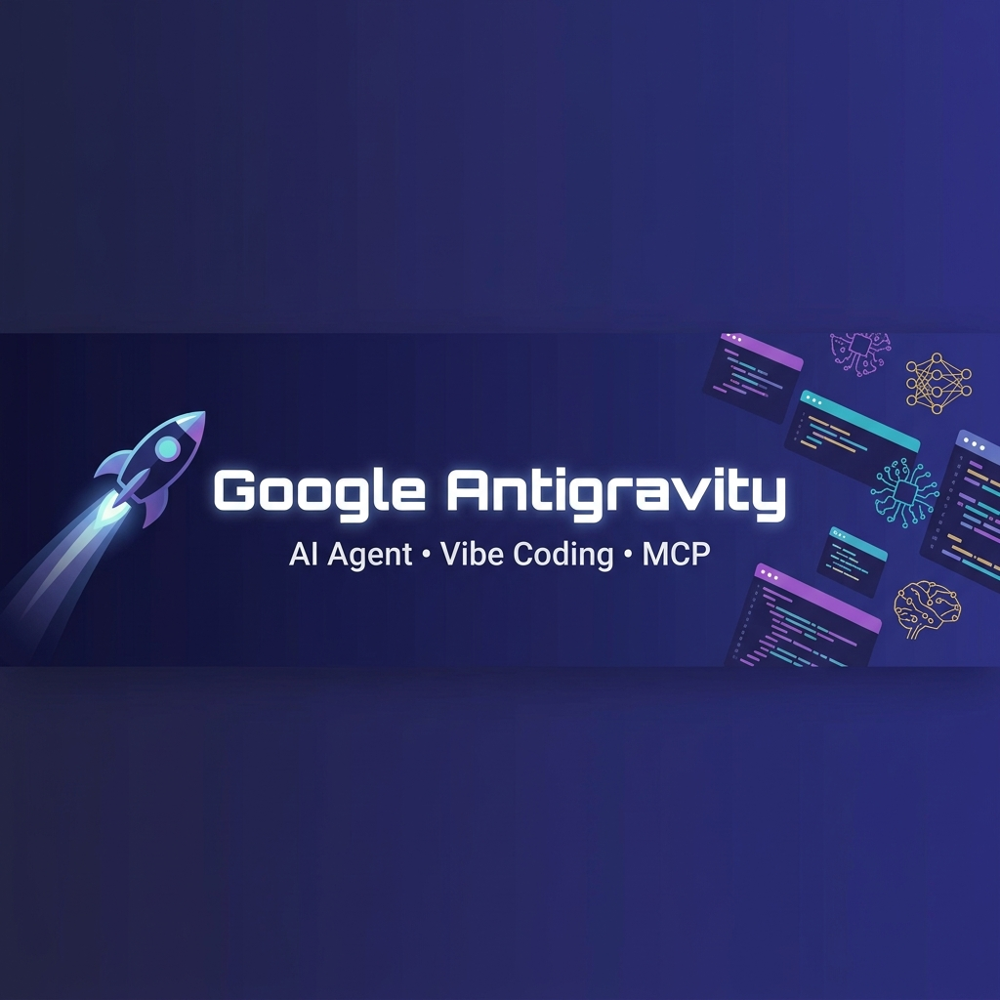
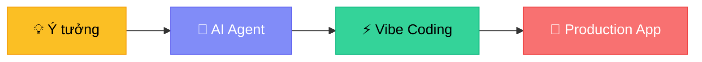
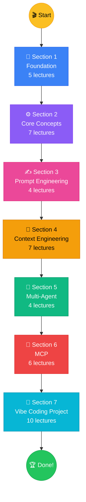

<p align="center">
  
</p>

<h1 align="center">🚀 Google Antigravity: AI Agent, AI App & Vibe Coding</h1>

<p align="center">
  <strong>Vibe Coding and Agentic Workflow: Build AI Apps nhanh, scalable & production-ready</strong>
</p>

<p align="center">
  <a href="#-curriculum"></a>
  <a href="#-curriculum"></a>
  <a href="#-tech-stack"></a>
  <a href="LICENSE"></a>
</p>

<p align="center">
  <a href="docs/SUMMARY.md">📑 Full Table of Contents</a> •
  <a href="docs/ROADMAP.md">🗺️ Learning Roadmap</a> •
  <a href="GLOSSARY.md">📖 Glossary</a> •
  <a href="CONTRIBUTING.md">🤝 Contributing</a>
</p>

---

## 🌟 About This Course

Khóa học này giúp bạn **hiểu và xây dựng AI Agent thực chiến** – không chỉ dừng ở lý thuyết, mà đi từ **mindset** đến **triển khai production**.



### Sau khóa học, bạn có thể:

| | Khả năng |
|---|---|
| 🏗️ | Build **AI Agent** cho sản phẩm thật |
| ⚡ | Tự động hóa **workflow** dev/business |
| 🧩 | Thiết kế hệ thống **multi-agent** phức tạp |
| 🔌 | Kết nối AI với hệ thống ngoài qua **MCP** |
| 🎨 | **Vibe Coding** — build app chỉ bằng mô tả ý tưởng |

---

## 🎯 Who Is This For?

> **Không yêu cầu kiến thức về AI** — sẽ được giải thích từ đầu!

| 👤 Đối tượng | Bạn sẽ nhận được |
|---|---|
| **Developer** muốn ứng dụng AI vào sản phẩm | Kiến thức A–Z về AI Agent |
| **Backend / Frontend / Fullstack** muốn tăng tốc build app | Vibe Coding workflow thực tế |
| **Tech Lead / Founder** muốn hiểu AI-powered product | Kiến trúc multi-agent & MCP |
| **Người đã dùng ChatGPT** muốn đi xa hơn | Từ prompt → production system |

### Prerequisites

- ✅ Kiến thức cơ bản về **programming** (JavaScript / TypeScript)
- ✅ Hiểu cách làm việc với **API, HTTP, JSON**
- ✅ Có tài khoản **Google Antigravity** (hướng dẫn setup trong khóa học)
- ❌ Không yêu cầu kiến thức về AI Agent, MCP hay Multi-Agent Systems

---

### 🌐 Liên hệ & Kết nối

Nếu bạn cần hỗ trợ hoặc muốn kết nối thêm ngoài khóa học, có thể liên hệ qua:

- 📧 **Email:** [dotanthanhvlog@gmail.com](mailto:dotanthanhvlog@gmail.com)
- 💼 **LinkedIn:** [https://www.linkedin.com/in/thanh270600/](https://www.linkedin.com/in/thanh270600/)
- 🐙 **GitHub:** [https://github.com/thanhmati](https://github.com/thanhmati)
- 📺 **YouTube:** [https://www.youtube.com/@laptrinhfullstack](https://www.youtube.com/@laptrinhfullstack)
- 💬 **Facebook Group:** [https://www.facebook.com/groups/ltfullstack](https://www.facebook.com/groups/ltfullstack)
- 📞 **Zalo** 0762216048

---

## 🛠 Tech Stack

<p align="center">
  
  
  
  
  
  
  
  
</p>

---

## 📚 Curriculum

> **7 Sections • 30+ Lectures • Từ Zero → Production**

```mermaid
flowchart LR
    S1["🧱 Foundation"]
    S2["⚙️ Core Concepts"]
    S3["✍️ Prompt Eng."]
    S4["🧠 Context Eng."]
    S5["🤖 Multi-Agent"]
    S6["🔌 MCP"]
    S7["🎨 Vibe Coding"]

    S1 --> S2 --> S3 --> S4 --> S5 --> S6 --> S7

    style S1 fill:#3b82f6,stroke:#2563eb,color:#fff
    style S2 fill:#8b5cf6,stroke:#7c3aed,color:#fff
    style S3 fill:#ec4899,stroke:#db2777,color:#fff
    style S4 fill:#f59e0b,stroke:#d97706,color:#000
    style S5 fill:#10b981,stroke:#059669,color:#fff
    style S6 fill:#ef4444,stroke:#dc2626,color:#fff
    style S7 fill:#06b6d4,stroke:#0891b2,color:#fff
```



---

### Section 1 · Foundation: AI Agent & Antigravity Basics

> 🧱 Xây nền tảng từ concept → setup → làm quen công cụ

<details>
<summary><b>📋 5 Lectures — Xem chi tiết</b></summary>

| # | Lecture | Mô tả |
|---|---------|--------|
| 1.1 | AI Agent là gì? Tư duy Agentic AI cho Developer | Bản chất AI Agent vs AI truyền thống |
| 1.2 | Google Antigravity là gì? | Nền tảng mới thay đổi cách Dev build AI App |
| 1.3 | Pricing Antigravity | Chi phí khi build AI app & cách tối ưu |
| 1.4 | Setup Antigravity từ A-Z | Chuẩn bị môi trường dev chuyên nghiệp |
| 1.5 | Antigravity IDE | Làm quen giao diện & các thành phần chính |

</details>

📂 [**→ Go to Section 1**](docs/section-01-foundation/README.md)

---

### Section 2 · Core Concepts: Model, Rules, Workflows & Skills

> ⚙️ Từ hiểu → build → control → production mindset

<details>
<summary><b>📋 7 Lectures — Xem chi tiết</b></summary>

| # | Lecture | Mô tả |
|---|---------|--------|
| 2.1 | Model trong AI Agent | Deep dive Gemini, Claude, GPT-OSS |
| 2.2 | Agent Modes & Settings | Kiểm soát hành vi AI Agent |
| 2.3 | Build AI App với 1 câu lệnh | Demo sức mạnh Antigravity |
| 2.4 | Rules trong AI Agent | Kiểm soát hành vi & coding style |
| 2.5 | Demo Rules: Trước vs Sau | Impact của Rules trong production |
| 2.6 | Workflows trong AI Agent | Tự động hoá quy trình dev |
| 2.7 | Agent Skills là gì? | Mở rộng sức mạnh Agent với Tools |

</details>

📂 [**→ Go to Section 2**](docs/section-02-core-concepts/README.md)

---

### Section 3 · Prompt Engineering for AI Agents

> ✍️ Viết prompt hiệu quả cho AI Agent — không chỉ cho chatbot

<details>
<summary><b>📋 4 Lectures — Xem chi tiết</b></summary>

| # | Lecture | Mô tả |
|---|---------|--------|
| 3.1 | Prompt Engineering cho AI Agent là gì? | Prompt ảnh hưởng agent suy nghĩ & hành động |
| 3.2 | Các lỗi phổ biến khi viết Prompt | Mơ hồ, xung đột, context quá dài |
| 3.3 | Cách thiết kế Prompt hiệu quả | Role, Goal, Constraints, Output |
| 3.4 | Debug & phân tích Prompt | Antigravity Kit |

</details>

📂 [**→ Go to Section 3**](docs/section-03-prompt-engineering/README.md)

---

### Section 4 · Context Engineering for AI Agents

> 🧠 Giúp AI Agent "Nhớ" & Tối ưu Token — Kỹ thuật quan trọng nhất khi Vibe Coding

<details>
<summary><b>📋 7 Lectures — Xem chi tiết</b></summary>

| # | Lecture | Mô tả |
|---|---------|--------|
| 4.1 | Context Engineering là gì? | Khác gì Prompt Engineering |
| 4.2 | Context Window là gì? | Giới hạn "RAM" của Agent |
| 4.3 | 5 trụ cột của Context Engineering | Instructions, Tools, Memory, Retrieval, State |
| 4.4 | Token là gì? Tại sao quan trọng? | Chi phí & hiệu suất |
| 4.5 | Context Documents — Bộ nhớ ngoài cho Agent | AGENTS.md, ARCHITECTURE.md, PLAN.md |
| 4.6 | Kỹ thuật Summarize Context | Giữ Agent "tỉnh táo" phiên dài |
| 4.7 | Context Compaction | "Nén" conversation |

</details>

📂 [**→ Go to Section 4**](docs/section-04-context-engineering/README.md)

---

### Section 5 · Multi-Agent Systems & Orchestration

> 🤖 Thiết kế hệ thống nhiều Agent phối hợp giải quyết bài toán phức tạp

<details>
<summary><b>📋 4 Lectures — Xem chi tiết</b></summary>

| # | Lecture | Mô tả |
|---|---------|--------|
| 5.1 | Multi-Agent System là gì? | Nhiều agents phối hợp |
| 5.2 | Thiết kế Orchestrator | Điều phối agents & workflow |
| 5.3 | Thiết kế Planner | Phân rã task & xác định dependency |
| 5.4 | Parallel Agent Execution | Agent Manager |

</details>

📂 [**→ Go to Section 5**](docs/section-05-multi-agent/README.md)

---

### Section 6 · Model Context Protocol (MCP)

> 🔌 Kết nối AI Agents với External Systems — API, Database, Tools

<details>
<summary><b>📋 6 Lectures — Xem chi tiết</b></summary>

| # | Lecture | Mô tả |
|---|---------|--------|
| 6.1 | MCP là gì? | Tổng quan & kiến trúc hệ thống |
| 6.2 | Review workflow Vibe Coding với MCP + Stitch | Workflow thực tế |
| 6.3 | Kết nối IDE tới Google Stitch MCP Server | Setup thực hành |
| 6.4 | Cài đặt Stitch Agent Skills | Skills chuyên biệt |
| 6.5 | GitHub MCP Server | Setup trong Antigravity |
| 6.6 | GitHub MCP Server Demo | 4 Use Cases thực tế |

</details>

📂 [**→ Go to Section 6**](docs/section-06-mcp/README.md)

---

### Section 7 · Vibe Coding Dự Án Thực Tế — Từ Ý Tưởng Đến Sản Phẩm

> 🎨 Áp dụng toàn bộ kiến thức để build dự án web hoàn chỉnh

<details>
<summary><b>📋 10 Lectures — Xem chi tiết</b></summary>

| # | Lecture | Mô tả |
|---|---------|--------|
| 7.1 | Tổng quan Vibe Coding & Lập kế hoạch | Mindset & project plan |
| 7.2 | Cài đặt Stitch Skills & Chuẩn bị | Môi trường dev |
| 7.3 | Thiết kế Design System với Stitch | Color, typography, shape |
| 7.4 | Tạo UI Screens – Phần 1 | Trang chủ & Navigation |
| 7.5 | Tạo UI Screens – Phần 2 | Tính năng chính |
| 7.6 | Convert Design → React Code | react-components skill |
| 7.7 | GitHub Workflow tự động | Branch, Commit & PR |
| 7.8 | Thêm tính năng & Fix bug | Iterative Vibe Coding |
| 7.9 | Polish UI, Responsive & Animation | Hoàn thiện sản phẩm |
| 7.10 | Review & Tổng kết | Best practices |

**🛠 Dự án thực tế:** English Practice Hub — Trang web luyện tập tiếng Anh

</details>

📂 [**→ Go to Section 7**](docs/section-07-vibe-coding/README.md)

---

## 🗺️ Learning Path



---

## ⭐ Điểm đặc biệt của khóa học

<table>
  <tr>
    <td align="center" width="25%">
      <h3>🎯</h3>
      <b>Agent Engineering</b><br/>
      <sub>Tập trung vào thực chiến, không phải AI theory chung chung</sub>
    </td>
    <td align="center" width="25%">
      <h3>🏗️</h3>
      <b>Real-world Cases</b><br/>
      <sub>Hướng dẫn theo use cases thực tế, không chỉ demo</sub>
    </td>
    <td align="center" width="25%">
      <h3>⚡</h3>
      <b>Production Ready</b><br/>
      <sub>Áp dụng trực tiếp vào developer workflow & production</sub>
    </td>
    <td align="center" width="25%">
      <h3>🧩</h3>
      <b>Cutting Edge</b><br/>
      <sub>Antigravity, MCP, Multi-Agent — công nghệ mới nhất</sub>
    </td>
  </tr>
</table>

---

## 📂 Repository Structure

```
antigravity-vibe-coding-course/
├── 📄 README.md                    ← You are here
├── 📄 CONTRIBUTING.md              ← Contribution guide
├── 📄 CHANGELOG.md                 ← Version history
├── 📄 GLOSSARY.md                  ← Technical glossary
├── 📄 LICENSE                      ← CC BY-NC-SA 4.0
├── 🖼️ assets/
│   └── banner.png                  ← Course banner
├── 📂 docs/
│   ├── SUMMARY.md                  ← Full table of contents
│   ├── ROADMAP.md                  ← Visual learning path
│   ├── section-01-foundation/      ← AI Agent & Antigravity Basics
│   ├── section-02-core-concepts/   ← Model, Rules, Workflows & Skills
│   ├── section-03-prompt-engineering/
│   ├── section-04-context-engineering/
│   ├── section-05-multi-agent/     ← Multi-Agent Systems
│   ├── section-06-mcp/            ← Model Context Protocol
│   └── section-07-vibe-coding/    ← Hands-on Project
└── 📂 .github/
    ├── ISSUE_TEMPLATE/             ← Bug reports, feature requests
    └── PULL_REQUEST_TEMPLATE.md
```

---

## 🚀 Quick Start

```bash
# 1. Clone the repo
git clone https://github.com/<your-username>/antigravity-vibe-coding-course.git

# 2. Start from Section 1
open docs/section-01-foundation/README.md

# 3. Follow the learning path section by section
#    Each section has its own README with lesson links
```

> 💡 **Tip:** Mở [📑 Full Table of Contents](docs/SUMMARY.md) để xem tổng quan tất cả bài học.

---

## 🤝 Contributing

Chúng tôi hoan nghênh mọi đóng góp! Xem [CONTRIBUTING.md](CONTRIBUTING.md) để biết cách đóng góp.

- 🐛 [Report a Bug](../../issues/new?template=bug_report.md)
- 💡 [Request a Feature](../../issues/new?template=feature_request.md)
- ❓ [Ask a Question](../../issues/new?template=question.md)

---

## 📄 License

Tài liệu này được phân phối theo giấy phép [Creative Commons Attribution-NonCommercial-ShareAlike 4.0 International](LICENSE).

Bạn được phép:
- ✅ **Chia sẻ** — sao chép và phân phối lại
- ✅ **Chỉnh sửa** — remix, chuyển đổi, xây dựng dựa trên tài liệu

Với điều kiện:
- 📌 **Ghi nguồn** (Attribution)
- 🚫 **Không thương mại** (NonCommercial)
- 🔄 **Chia sẻ tương tự** (ShareAlike)

---

<p align="center">
  <sub>Made with ❤️ for the Vietnamese Developer Community</sub><br/>
  <sub>Powered by <b>Google Antigravity</b> • Built with <b>Vibe Coding</b></sub>
</p>
