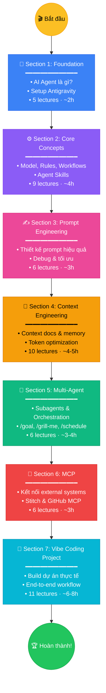
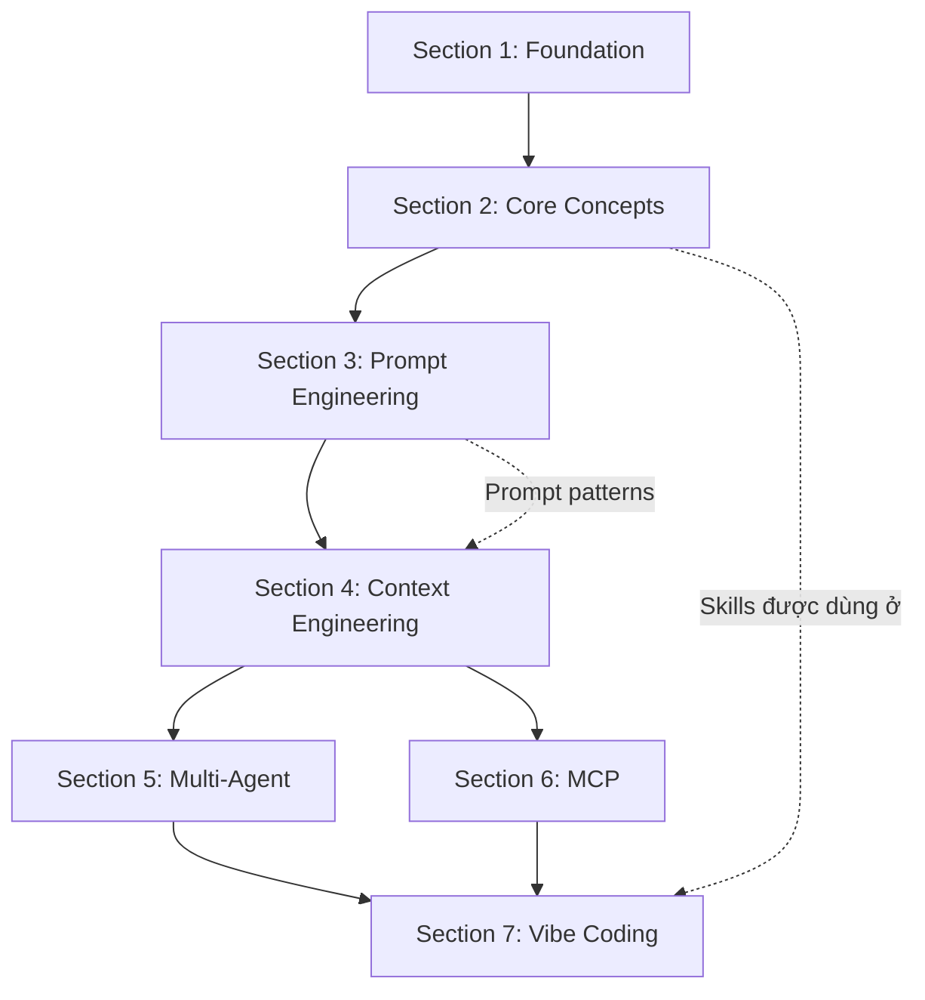

# 🗺️ Learning Roadmap — Lộ Trình Học

> Bản đồ visual giúp bạn hiểu lộ trình học và mối liên hệ giữa các section.

---

## Overview

---

## Skill Progression

```mermaid
graph LR
    subgraph "🟢 Beginner"
        B1["Hiểu AI Agent"]
        B2["Setup Antigravity"]
        B3["Viết Prompt cơ bản"]
    end

    subgraph "🟡 Intermediate"
        I1["Rules & Workflows"]
        I2["Context Engineering"]
        I3["Token Optimization"]
    end

    subgraph "🔴 Advanced"
        A1["Multi-Agent Design"]
        A2["MCP Integration"]
        A3["Production Vibe Coding"]
    end

    B1 --> B2 --> B3 --> I1 --> I2 --> I3 --> A1 --> A2 --> A3

    style B1 fill:#dcfce7,stroke:#16a34a,color:#000
    style B2 fill:#dcfce7,stroke:#16a34a,color:#000
    style B3 fill:#dcfce7,stroke:#16a34a,color:#000
    style I1 fill:#fef9c3,stroke:#ca8a04,color:#000
    style I2 fill:#fef9c3,stroke:#ca8a04,color:#000
    style I3 fill:#fef9c3,stroke:#ca8a04,color:#000
    style A1 fill:#fecaca,stroke:#dc2626,color:#000
    style A2 fill:#fecaca,stroke:#dc2626,color:#000
    style A3 fill:#fecaca,stroke:#dc2626,color:#000
```

---

## Section Dependencies

> 💡 **Tip:** Sections 5 và 6 có thể học song song sau khi hoàn thành Section 4. Cả hai đều cần trước Section 7.

---

## Time Estimate

| Section | Thời lượng | Tổng tích lũy |
|---------|-----------|----------------|
| Section 1: Foundation | ~2 giờ | 2 giờ |
| Section 2: Core Concepts | ~4 giờ | 6 giờ |
| Section 3: Prompt Engineering | ~3 giờ | 7 giờ |
| Section 4: Context Engineering | ~4-5 giờ | 11-12 giờ |
| Section 5: Multi-Agent | ~3-4 giờ | 15-17 giờ |
| Section 6: MCP | ~3 giờ | 18-19 giờ |
| Section 7: Vibe Coding | ~6-8 giờ | **24-27 giờ** |

---

[← Quay về README](../README.md) · [📑 Mục lục](SUMMARY.md)

