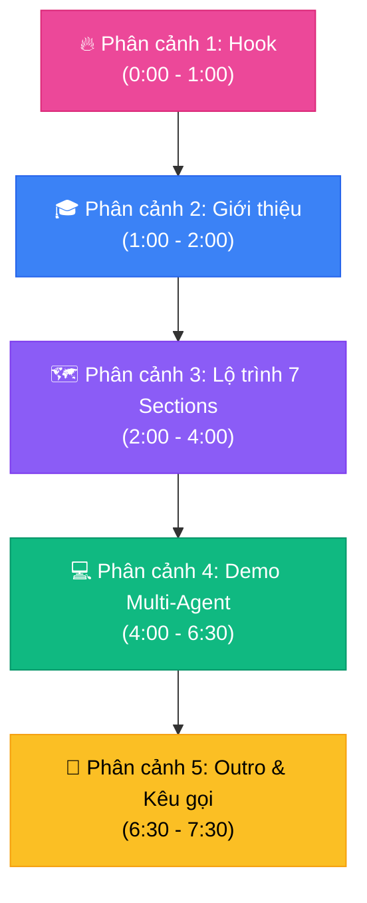

# 🎬 Kịch Bản Chi Tiết Video Giới Thiệu Khóa Học

> **Khóa học:** Google Antigravity: Xây dựng AI Agent, AI App & Vibe Coding  
> **Thời lượng dự kiến:** ~7-8 phút  
> **Phong cách:** Năng lượng, truyền cảm hứng, chuyên nghiệp và thực chiến  
> **Định dạng:** Kết hợp Quay mặt giảng viên (Talking-head) & Quay màn hình (Screencast)

---

## 🗺️ Bản Đồ Phân Cảnh (Video Outline)

---

## 📝 Chi Tiết Kịch Bản (Script & Visual Cues)

### 🔥 Phân cảnh 1: Hook (0:00 - 1:00)
*   **Mục tiêu:** Thu hút sự chú ý ngay từ 3 giây đầu tiên, chạm vào nỗi đau của lập trình viên khi làm việc với các chatbot AI thông thường.
*   **Định dạng:** Talking-head (giảng viên nói trước camera) + Chèn nhanh hình ảnh minh họa (B-roll).

| Thời lượng | Hình ảnh (Visual & Slide Outlines) | Lời thoại (Voiceover) | Ghi chú / Cues |
| :--- | :--- | :--- | :--- |
| **0:00 - 0:20** | **[Talking-head]** Giảng viên đứng trước camera, biểu cảm nghiêm túc nhưng năng lượng.  *B-roll chèn nhanh:* Cảnh một developer gõ phím mệt mỏi, màn hình IDE tràn ngập lỗi màu đỏ, cửa sổ ChatGPT cuộn dài dặc. | Bạn đã từng bao giờ cảm thấy kiệt sức khi phải copy-paste code liên tục từ ChatGPT hay Claude vào IDE của mình?  Bạn đã bao giờ thấy AI bắt đầu viết code lung tung, quên mất logic cũ chỉ sau một vài lượt chat vì đầy bộ nhớ context? | Giọng nói nhấn mạnh vào các từ khóa: *kiệt sức*, *copy-paste*, *lung tung*, *đầy bộ nhớ*. |
| **0:20 - 0:40** | **[Slide 1]** Chữ động lớn hiện trên màn hình nền tối: - **"Prompting là chưa đủ!"** - **"Chúng ta cần Agentic Workflow."** | Lập trình hỗ trợ bởi AI rất nhanh, nhưng khi bạn cần scale lên một dự án thực tế, đó thường là một cơn ác mộng.  Bởi vì việc chỉ viết prompt đơn thuần cho chatbot đã chạm tới giới hạn. Tương lai của phát triển phần mềm thuộc về: **Agentic Workflow** và **Vibe Coding**. | Chuyển cảnh dứt khoát bằng hiệu ứng âm thanh (swoosh). |
| **0:40 - 1:00** | **[Screencast]** Lướt nhanh cảnh một Agent trong Antigravity tự động spawn ra 4 Subagents chạy song song cực ngầu.  **[Slide 2]** Logo Google Antigravity & Google Stitch xuất hiện với hiệu ứng ánh sáng neon cực kỳ premium. | Nơi mà bạn không còn phải chat từng dòng code nữa. Bạn chỉ cần giao một mục tiêu lớn, và một đội ngũ AI Agent chuyên nghiệp sẽ tự động lên kế hoạch, tự viết code, tự chạy test và tự sửa lỗi cho bạn.  Chào mừng bạn đến với kỷ nguyên của **Google Antigravity 2.0**. | Nhạc nền bắt đầu tăng nhịp (upbeat) để tạo sự phấn khích. |

---

### 🎓 Phân cảnh 2: Giới thiệu khóa học & Giảng viên (1:00 - 2:00)
*   **Mục tiêu:** Thiết lập uy tín cá nhân của giảng viên và giới thiệu tổng quan mục tiêu khóa học.
*   **Định dạng:** Talking-head kết hợp trình chiếu Slide.

| Thời lượng | Hình ảnh (Visual & Slide Outlines) | Lời thoại (Voiceover) | Ghi chú / Cues |
| :--- | :--- | :--- | :--- |
| **1:00 - 1:20** | **[Talking-head]** Giảng viên cười thân thiện, giới thiệu bản thân.  **[Slide 3: Giảng viên]** - **Đỗ Tấn Thành** (Tấn Thành Lập Trình Fullstack) - Kênh YouTube: @laptrinhfullstack - Hơn 5 năm kinh nghiệm build product thực tế. | Xin chào các bạn, mình là Đỗ Tấn Thành, người sẽ đồng hành cùng các bạn trong khóa học đặc biệt này: **"Google Antigravity: Xây dựng AI Agent, AI App & Vibe Coding"**.  Với kinh nghiệm nhiều năm xây dựng sản phẩm và giảng dạy lập trình, mình hiểu rõ những khó khăn của anh em dev khi áp dụng AI vào quy trình làm việc thực tế hàng ngày. | Chèn logo YouTube và Facebook Group nhỏ ở góc dưới màn hình. |
| **1:20 - 2:00** | **[Slide 4: Định hướng khóa học]** - **Không học lý thuyết suông** - **Tập trung vào Agent Engineering** - **Production-Ready Mindset** | Khóa học này được thiết kế không phải để dạy bạn lý thuyết AI chung chung, mà tập trung 100% vào **Agent Engineering** thực chiến.  Bạn sẽ học được cách suy nghĩ như một kiến trúc sư hệ thống AI, kiểm soát hành vi của Agent bằng Rules, tự động hóa quy trình bằng Workflows và thiết lập môi trường sẵn sàng cho sản phẩm thực tế (production). | Nhấn mạnh chữ *thực chiến* và *kiến trúc sư hệ thống AI*. |

---

### 🗺️ Phân cảnh 3: Đi sâu lộ trình học (2:00 - 4:00)
*   **Mục tiêu:** Thuyết phục học viên bằng một lộ trình học cực kỳ bài bản, khoa học từ cơ bản đến nâng cao.
*   **Định dạng:** Screencast lướt qua tệp tin `Roadmap` hoặc `SUMMARY.md` trên IDE kết hợp Slide chuyển cảnh.

| Thời lượng | Hình ảnh (Visual & Slide Outlines) | Lời thoại (Voiceover) | Ghi chú / Cues |
| :--- | :--- | :--- | :--- |
| **2:00 - 2:30** | **[Screencast]** Mở tệp tin [ROADMAP.md](file:///Users/thanhdo/Documents/Project/antigravity-vibe-coding-course/docs/ROADMAP.md) trên IDE, cuộn chuột mượt mà qua sơ đồ Mermaid.  **[Slide 5]** Hiện 2 chặng đầu: - **Section 1 & 2: Khởi đầu & Khái niệm cốt lõi** (Model, Rules, Workflows, Skills) | Lộ trình học của chúng ta gồm 7 Section được sắp xếp từ dễ đến khó.  Chúng ta sẽ bắt đầu từ **Section 1 và 2** để xây dựng nền tảng vững chắc. Bạn sẽ hiểu cách hoạt động của reasoning model, cách viết Rules để ép Agent code theo đúng style của bạn, và mở rộng sức mạnh của Agent bằng Agent Skills. | Chỉ vào sơ đồ Mermaid khi nhắc đến từng Section. |
| **2:30 - 3:00** | **[Slide 6]** Chữ hiện nổi bật: - **Section 3 & 4: Prompt & Context Engineering** - *Quản lý bộ nhớ - Tối ưu hóa Token* | Tiếp theo, **Section 3 và 4** sẽ là những kỹ thuật cực kỳ quan trọng: Prompt Engineering và đặc biệt là **Context Engineering**.  Bạn sẽ học cách thiết kế các file context như `AGENTS.md`, `PLAN.md` để đóng vai trò làm bộ nhớ ngoài cho Agent, giúp Agent luôn tỉnh táo trong những phiên code dài mà vẫn tiết kiệm đến 80% token. | Hiển thị hình ảnh minh họa cho "Context Window" bị tràn và cách nén context. |
| **3:00 - 3:30** | **[Slide 7]** Đồ họa Multi-Agent: - **Section 5 & 6: Multi-Agent Systems & MCP** - *Subagents Spawning / /goal / /browser* - *Model Context Protocol (Stitch & GitHub)* | Chặng nâng cao ở **Section 5 và 6** sẽ đưa bạn vào thế giới của **Multi-Agent Systems**. Bạn sẽ làm quen với Antigravity 2.0, học cách phân rã task thành các Subagents chạy song song và kết nối AI với API, Database bên ngoài thông qua giao thức MCP và Google Stitch. | Chèn hiệu ứng icon Agent kết nối mạng lưới với nhau. |
| **3:30 - 4:00** | **[Screencast]** Lướt qua tài liệu Section 7, show ảnh mockup của dự án thực tế VibeSpace Studio.  **[Slide 8]** - **Section 7: Vibe Coding Dự án thực tế** - *Từ Concept đến Product hoàn chỉnh* | Cuối cùng, ở **Section 7**, chúng ta sẽ cùng nhau **Vibe Coding** một dự án thực tế hoàn chỉnh: VibeSpace Studio - Trạm âm thanh chữa lành.  Bạn sẽ thấy toàn bộ quy trình từ specs-driven development, thiết kế design system, code frontend/backend hoàn toàn bằng AI Agent. | Thể hiện sự hào hứng trong giọng nói khi nhắc đến dự án thực tế. |

---

### 💻 Phân cảnh 4: Demo Thực Tế Multi-Agent (4:00 - 6:30)
*   **Mục tiêu:** Tạo hiệu ứng "WOW" bằng cách trình diễn quy trình Multi-Agent Software Team thực tế trong Antigravity 2.0.
*   **Định dạng:** Screencast màn hình IDE hoạt động, thu nhỏ mặt giảng viên ở góc màn hình.

| Thời lượng | Hình ảnh (Visual & Slide Outlines) | Lời thoại (Voiceover) | Ghi chú / Cues |
| :--- | :--- | :--- | :--- |
| **4:00 - 4:30** | **[Screencast]** Quay màn hình Antigravity Chat. Nhập prompt xây dựng Kanban Board monorepo với 4 subagents.  *Hành động:* Nhấn gửi prompt. | Để các bạn thấy được sức mạnh thực sự, hãy cùng xem một demo thực tế.  Mình sẽ yêu cầu Antigravity xây dựng một ứng dụng Kanban Board full-stack monorepo và tự động spawn 4 subagents phụ trách các vai trò: UX/UI, Backend, Frontend, và Tester. | Quay màn hình độ phân giải cao, rõ nét chữ prompt. |
| **4:30 - 5:10** | **[Screencast]** Màn hình chuyển sang **Planning Mode**. Show tệp tin `implementation_plan.md` với các tag màu xanh/đỏ biểu thị file tạo mới/sửa đổi.  *Hành động:* Di chuột và nhấn nút **Approve Plan** màu xanh. | Ngay lập tức, Agent bước vào chế độ Planning. Nó không viết code bừa bãi mà tạo ra một bản thiết kế chi tiết: `implementation_plan.md`. Nó cho chúng ta biết chính xác những file nào sẽ được tạo mới hay sửa đổi.  Mình xem xét thấy hợp lý và nhấn **Approve Plan** để kích hoạt đội ngũ của mình. | Zoom cận cảnh vào nút **Approve Plan** và các file trong plan. |
| **5:10 - 5:50** | **[Screencast]** Mở sidebar `/agents` panel. Thấy 4 subagent được spawn ra dạng cây và bắt đầu chạy ngầm.  *Hành động:* Click mở file [task.md](file:///Users/thanhdo/.gemini/antigravity-ide/brain/c62c4a45-9410-45a2-9c34-7c65bb6df5aa/task.md) để thấy trạng thái chuyển đổi real-time `[ ]` ──▶ `[/]` ──▶ `[x]`. | Lúc này, cơ chế spawning hoạt động. Bảng `/agents` panel xuất hiện 4 subagent đang chạy ngầm song song. Mỗi agent hoạt động trong một môi trường cô lập, context sạch sẽ.  Tiến độ được cập nhật trực quan trên file `task.md`. Các bạn có thể thấy Backend đang code API, Frontend đang dựng component, tất cả chạy song song vô cùng mượt mà. | Di chuyển chuột mượt mà, tránh di giật cục bộ. |
| **5:50 - 6:30** | **[Screencast]** Chèn cảnh Agent tự động chạy lệnh `/browser`. Một cửa sổ Chrome tự động bật lên, click vào form đăng nhập, chụp màn hình QA layout.  Sau đó, mở file `walkthrough.md` báo cáo kết quả thành công. | Điểm đặc biệt nhất là khả năng tự sửa lỗi và Visual QA. Tester Agent chạy Vitest phát hiện lỗi API từ Backend, nó tự gửi log lỗi báo cho Backend Agent sửa chéo mà không phiền đến chúng ta.  Đồng thời, Agent gọi lệnh `/browser` để tự mở Chrome ngầm, kiểm tra nút bấm và layout giao diện.  Và đây là kết quả cuối cùng: Dự án hoàn thành sạch sẽ, có đầy đủ báo cáo tích hợp trong `walkthrough.md`. | Highlight cảnh cửa sổ Chrome tự bật lên tương tác, đây là cảnh đắt giá nhất để tạo hiệu ứng WOW. |

---

### 🚀 Phân cảnh 5: Outro & Lời kêu gọi hành động (6:30 - 7:30)
*   **Mục tiêu:** Kêu gọi hành động mạnh mẽ (Đăng ký khóa học, theo dõi kênh) và để lại thông tin liên hệ.
*   **Định dạng:** Talking-head (giảng viên xuất hiện lại) + Slide thông tin liên hệ.

| Thời lượng | Hình ảnh (Visual & Slide Outlines) | Lời thoại (Voiceover) | Ghi chú / Cues |
| :--- | :--- | :--- | :--- |
| **6:30 - 7:10** | **[Talking-head]** Giảng viên đứng trước camera, biểu cảm tràn đầy năng lượng và tự tin. | Bạn thấy thế nào? Đây không chỉ là việc đổi mới công cụ lập trình, đây là sự dịch chuyển hoàn toàn cách chúng ta xây dựng sản phẩm công nghệ.  Vibe Coding và Agentic Workflow sẽ giúp bạn tăng tốc độ dev lên gấp 5, thậm chí gấp 10 lần, giúp bạn biến ý tưởng thành sản phẩm thực tế chỉ trong vài giờ thay vì vài tuần. | Nhạc nền đẩy lên cao trào (crescendo). |
| **7:10 - 7:30+** | **[Slide 9: Liên hệ & Đăng ký]** - **Đăng ký khóa học tại:** [Link đăng ký] - **Email:** dotanthanhvlog@gmail.com - **YouTube:** @laptrinhfullstack - **Zalo:** 0762216048 | Đừng để bản thân bị tụt lại phía sau trong cuộc cách mạng này.  Hãy đăng ký tham gia khóa học ngay hôm nay để làm chủ Google Antigravity, MCP, và Multi-Agent Systems.  Cảm ơn các bạn và hẹn gặp lại các bạn ở bài học đầu tiên! | Nhạc nền nhỏ dần (fade out). Giảng viên vẫy tay chào. |

---

## 💡 Gợi Ý Biên Tập Video (Editing & Production Tips)

1.  **Nhạc nền (Background Music):** Chọn nhạc nền dạng **Corporate Technology / Upbeat Synthwave** (nhịp điệu vừa phải ở phần lộ trình, dồn dập và hào hứng ở phần demo).
2.  **Hiệu ứng Zoom màn hình:** Ở phân cảnh demo, hãy zoom cận cảnh vào:
    *   Thanh input khi gõ `/browser` hoặc `/goal`.
    *   Sự thay đổi trạng thái của các checkbox trong file `task.md`.
    *   Bảng `/agents` panel hiển thị danh sách subagents.
3.  **Màu sắc hiển thị:** Giữ giao diện IDE ở chế độ Dark Mode premium để làm nổi bật các tag màu sắc của file trong Planning Mode và sơ đồ Mermaid.
