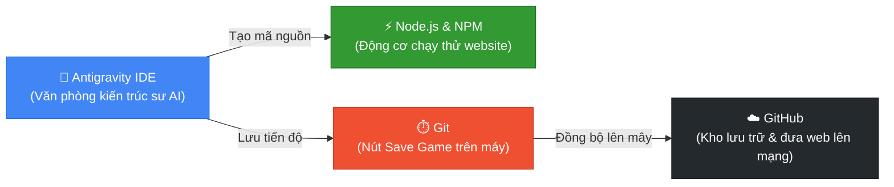
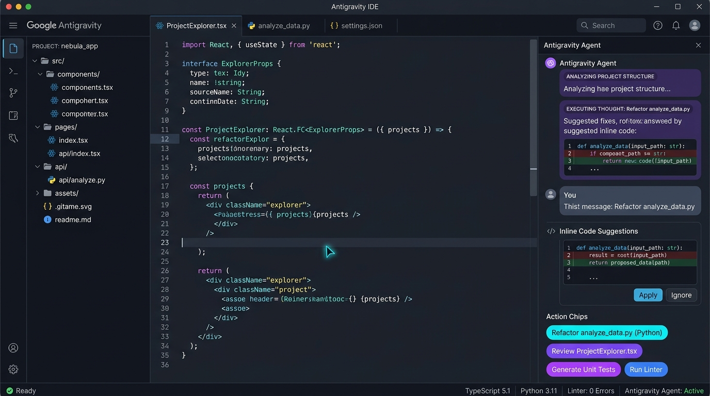
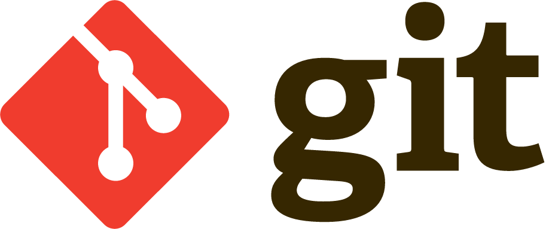
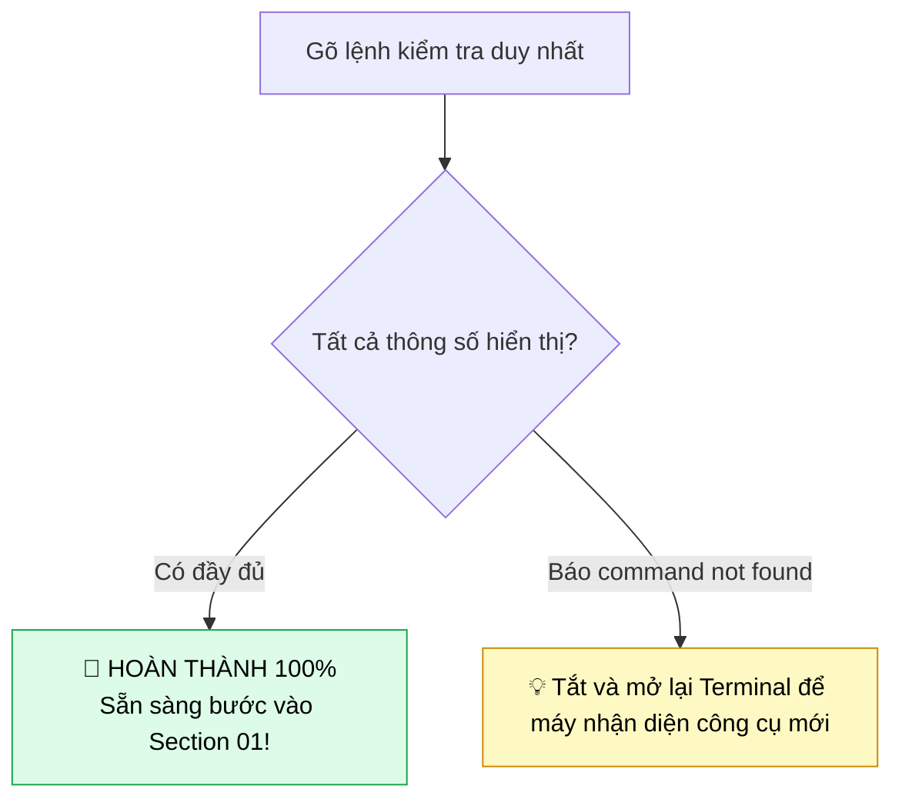

# 🛠️ Bài Học 00: Hướng Dẫn Cài Đặt Bộ Công Cụ & Môi Trường Vibe Coding

<p align="center">
  
  
  
</p>

> **1ài học duy nhất chuẩn bị toàn bộ "đồ nghề" để bạn tự tin bước vào hành trình Vibe Coding mà không cần biết viết code trước đó.**

---

## 🧭 Bức Tranh Tổng Thể: Tại Sao Cần 4 Công Cụ Này?

Khi làm quen với **Vibe Coding**, bạn không cần tự tay viết từng dòng code. Bạn giữ vai trò **Kiến trúc sư trưởng / Giám đốc sản phẩm**: đưa ra ý tưởng và đánh giá kết quả, còn **AI Agent** sẽ là **đội ngũ kỹ sư thi công**.

Để đội ngũ kỹ sư AI có thể làm việc ngay trên máy tính của bạn, chúng ta cần một "nhà xưởng" gồm 4 công cụ thiết yếu:



| #     | Công cụ             | Vai trò thực tế                                              | Ẩn dụ dễ hiểu cho Non-Dev               |
| ----- | ------------------- | ------------------------------------------------------------ | --------------------------------------- |
| **1** | **Antigravity IDE** | Nơi giao tiếp với AI, xem code, AI tự đọc/sửa file trực tiếp | **Văn phòng kiến trúc sư thông minh**   |
| **2** | **Node.js & NPM**   | Chạy thử nghiệm website ngay trên máy tính cá nhân           | **Động cơ nổ & Siêu thị phụ tùng Lego** |
| **3** | **Git**             | Lưu lại từng mốc lịch sử, quay lui khi AI làm lỗi            | **Nút Save Game thần thánh**            |
| **4** | **GitHub**          | Lưu trữ trên đám mây, kết nối đưa web lên Internet           | **Google Drive & Showroom toàn cầu**    |

---

## 1. Google Antigravity App & Antigravity IDE

<div align="center">
  
</div>

### 🎯 Tại sao bạn cần công cụ này?

- **Khác biệt hoàn toàn với ChatGPT/Claude trên web:** Thay vì bạn phải copy-paste code qua lại hàng chục lần và tự sửa lỗi, Antigravity là môi trường làm việc tích hợp (Agent-First IDE).
- AI Agent trong Antigravity có "tay và chân": tự tạo file, tự sửa code trực tiếp trên máy của bạn, tự đọc tài liệu dự án và tự chạy lệnh kiểm tra lỗi trước khi bạn kịp nhận ra.

### 📥 Link tải chính thức

👉 **[https://antigravity.google/download](https://antigravity.google/download)**

### ⚡ Hướng dẫn cài đặt nhanh:

- **macOS:** Tải file `.dmg` → Kéo biểu tượng Antigravity vào thư mục **Applications** → Mở app (chọn _Open_ nếu máy hỏi xác nhận bảo mật).
- **Windows:** Tải file `.exe` → Nhấp đúp mở bộ cài → Chọn _Yes_ khi Windows hỏi quyền Admin → Chờ vài giây để hoàn tất.
- **Kích hoạt tài khoản:** Bấm **Sign in with Google** trên màn hình mở đầu → Đăng nhập tài khoản Google của bạn trên trình duyệt → Quay lại IDE để bắt đầu sử dụng.

---

## 2. Node.js & NPM

<div align="center">
  
</div>

### 🎯 Tại sao bạn cần công cụ này?

- **Node.js (Động cơ nổ):** Mã JavaScript của trang web vốn chỉ chạy trên trình duyệt. Để chạy thử website ngay trong máy tính cá nhân của bạn (ở địa chỉ `http://localhost:3000`) trước khi công khai lên mạng, máy tính cần Node.js làm động cơ thực thi.
- **NPM (Siêu thị linh kiện Lego):** Đi kèm với Node.js là kho hàng triệu linh kiện đóng gói sẵn (hiệu ứng 3D, đồng hồ đếm giờ, nút thanh toán...). AI Agent chỉ cần gọi một lệnh ngắn là tải ngay linh kiện về lắp ráp trong 2 giây mà không cần tự viết từ đầu.

### 📥 Link tải chính thức

👉 **[https://nodejs.org/en](https://nodejs.org/en)**

> [!IMPORTANT]
> **Quy tắc vàng:** Luôn luôn chọn nút tải **LTS (Long-Term Support)**. Đây là phiên bản ổn định nhất, ít lỗi nhất, được khuyên dùng cho tất cả mọi người. Không nên chọn bản _Current_.

### ⚡ Hướng dẫn cài đặt nhanh:

- **Windows:** Mở file `.msi` vừa tải → Nhấn **Next** liên tục theo mặc định → Ở màn hình _"Tools for Native Modules"_, **không cần tích chọn** để tránh tải công cụ nặng thừa thãi → Nhấn **Install** → **Finish**.
- **macOS:** Mở file `.pkg` → Bấm **Continue** qua các bước → Quét Touch ID hoặc nhập mật khẩu máy để cài đặt.
- **Kiểm tra thành công:** Mở Terminal (Mac) hoặc PowerShell (Windows) và gõ:
  ```bash
  node -v
  npm -v
  ```
  _(Kết quả hiện ra số phiên bản dạng `v20.x.x` và `10.x.x` là thành công!)_

---

## 3. Tạo Tài Khoản GitHub

<div align="center">
  
</div>

### 🎯 Tại sao bạn cần công cụ này?

- **Két sắt an toàn trên mây:** Giữ toàn bộ sản phẩm của bạn an toàn trên máy chủ của Microsoft. Dù máy tính của bạn bị hỏng hay đổi máy mới, dự án vẫn nguyên vẹn 100%.
- **Bàn đạp đưa website lên mạng:** Các nền tảng hosting miễn phí như Vercel (học ở Section 07) liên kết trực tiếp với GitHub: Mỗi lần bạn lưu mã nguồn lên GitHub, website trực tuyến của bạn sẽ tự động cập nhật trong 30 giây.
- **Tương tác với AI:** Phục vụ cho bài học **GitHub MCP** (Section 06), nơi AI Agent có thể tự động tạo kho lưu trữ và quản lý dự án giúp bạn.

### 🌐 Trang chủ đăng ký

👉 **[https://github.com/signup](https://github.com/signup)**

### ⚡ Các bước đăng ký nhanh:

1. Nhập **Email** chính của bạn và tạo **Mật khẩu** an toàn.
2. Chọn một **Username** ngắn gọn, chuyên nghiệp (ví dụ: `hoangnam-dev`, `linh-vibecoder`).
3. Giải câu đố chống bot (Puzzle) và nhập mã xác nhận 6 số gửi về email của bạn.
4. **Bật xác thực 2 lớp (2FA):** Vào _Settings_ → _Password and authentication_ → Bấm _Enable two-factor authentication_ → Dùng app Authenticator trên điện thoại quét mã QR và **lưu lại mã phục hồi (Recovery Codes)** vào ghi chú an toàn.

---

## 4. Git (Cỗ Máy Thời Gian & Quản Lý Phiên Bản)

<div align="center">
  
</div>

### 🎯 Tại sao bạn cần công cụ này?

- **Phân biệt rõ:** **Git** là phần mềm offline chạy trên máy bạn, còn **GitHub** là trang web lưu trữ trên mây.
- **Nút "Save Game" thần thánh:** Bình thường bạn hay lưu file dạng `du_an_final.doc`, `du_an_final_sua_lan_2.doc`... vô cùng lộn xộn. Với Git, bạn chỉ có 1 thư mục duy nhất nhưng có thể "quay ngược thời gian" về bất kỳ mốc nào trước đó trong 1 giây nếu AI lỡ làm sai.

### 📥 Link tải chính thức

👉 **[https://git-scm.com/](https://git-scm.com/)**

### ⚡ Hướng dẫn cài đặt & Cấu hình nhanh:

- **Windows:** Tải **64-bit Git for Windows** → Nhấp đúp file `.exe` → Bấm **Next** giữ nguyên toàn bộ các lựa chọn mặc định của nhà phát triển cho đến khi bấm **Install**.
- **macOS:** Mở Terminal gõ `git --version` → Nếu máy chưa có, macOS sẽ tự hiện popup _"Install command line developer tools"_ → Chỉ cần bấm nút **Install**.
- **CẤU HÌNH DANH TÍNH BẮT BUỘC (Chỉ làm 1 lần duy nhất):**  
  Mở Terminal (Mac) hoặc PowerShell/Git Bash (Windows), gõ lần lượt 2 lệnh sau (nhớ thay tên và email trùng với tài khoản GitHub):
  ```bash
  git config --global user.name "Họ và Tên Của Bạn"
  git config --global user.email "email_cua_ban@gmail.com"
  ```

---

## 5. Kiểm Tra Toàn Diện Trong 1 Dòng Lệnh

Mở Terminal tích hợp trong **Antigravity IDE** bằng phím tắt `Ctrl + ~` (Windows) hoặc `Cmd + ~` (macOS), sau đó dán dòng lệnh sau và nhấn **Enter**:

```bash
echo "1. Node: $(node -v)" && echo "2. NPM: $(npm -v)" && echo "3. Git: $(git --version)" && echo "4. User: $(git config user.name)"
```

**Kết quả hiển thị đạt chuẩn:**

```text
1. Node: v20.18.0
2. NPM: 10.8.2
3. Git: git version 2.45.2
4. User: Họ và Tên Của Bạn
```



---

## 💡 Cẩm Nang Xử Lý 2 Sự Cố Thường Gặp Của Người Mới

1. **Lỗi `command not found: node` hoặc `'node' is not recognized`:**  
   _Cách sửa:_ Đừng lo lắng! Hãy tắt hoàn toàn cửa sổ Terminal hoặc tắt Antigravity IDE đi rồi mở lại. Máy tính cần mở phiên làm việc mới để cập nhật danh sách phần mềm vừa cài.
2. **Lỗi chữ đỏ trên Windows PowerShell (`running scripts is disabled`):**  
   _Cách sửa:_ Bấm phím Windows, tìm `PowerShell` → Chuột phải chọn _Run as Administrator_ → Dán lệnh sau rồi gõ `Y`:
   ```powershell
   Set-ExecutionPolicy RemoteSigned -Scope CurrentUser
   ```

---

<div align="center">

[🏠 Trang chủ](../../README.md) · [📑 Mục lục](../SUMMARY.md) · [Tiếp theo: Section 01 · Foundation Basics →](../section-01-foundation/README.md)

</div>
