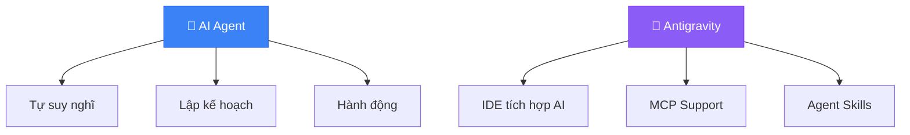

# 🧱 Section 1 · Foundation: AI Agent & Antigravity Basics

  
  
  
  

> **Xây nền tảng từ concept → setup → làm quen công cụ**

---

## 🎯 Mục tiêu Section

Sau section này, bạn sẽ:

- ✅ Hiểu **AI Agent** là gì và sự khác biệt với AI truyền thống
- ✅ Làm quen với **Google Antigravity** — nền tảng mới để build AI App
- ✅ Nắm được cách Agent **suy nghĩ, ra quyết định và hành động**
- ✅ Setup **môi trường development** hoàn chỉnh
- ✅ Hiểu **chi phí** khi build AI app và cách tối ưu

---

## 📚 Lectures

| # | Lecture | Mô tả | Thời lượng |
|---|---------|--------|------------|
| 1.1 | **AI Agent là gì? Tư duy Agentic AI cho Developer** | Hiểu đúng bản chất AI Agent và sự khác biệt với AI truyền thống. Nắm được cách Agent "suy nghĩ" và ứng dụng thực tế trong workflow của developer. | ~20 phút |
| 1.2 | **Google Antigravity là gì?** | Tổng quan về Antigravity và cách nó thay đổi cách xây dựng AI Agent. Hiểu vì sao đây là bước tiến tiếp theo trong AI-driven development. | ~20 phút |
| 1.3 | **Pricing Antigravity** | Hiểu rõ cost structure khi build AI app production. Cách tối ưu chi phí. | ~15 phút |
| 1.4 | **Setup Antigravity từ A-Z** | Hướng dẫn setup đầy đủ môi trường để bắt đầu build AI Agent. | ~20 phút |
| 1.5 | **Antigravity IDE** | Làm quen giao diện & các thành phần chính. Overview nhanh trước khi bắt đầu build. | ~15 phút |

---

## 🔑 Key Concepts

---

## 📋 Prerequisites

- ✅ Kiến thức cơ bản về programming (JavaScript / TypeScript)
- ✅ Hiểu cách làm việc với API, HTTP, JSON
- ❌ Không yêu cầu kiến thức về AI

---

[🏠 Home](../../README.md) · [📑 Mục lục](../SUMMARY.md) · [Section 2 →](../section-02-core-concepts/README.md)

