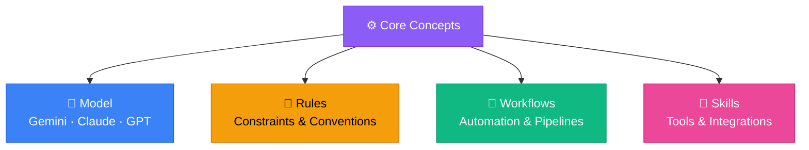

# ⚙️ Section 2 · Core Concepts: Model, Rules, Workflows & Skills

  
  
  
  

> **Từ hiểu → build → control → production mindset**

---

## 🎯 Mục tiêu Section

Sau section này, bạn sẽ:

- ✅ Biết cách chọn **Reasoning Model** phù hợp (Gemini, Claude, GPT-OSS)
- ✅ Tạo **Rules** để kiểm soát hành vi & coding style của Agent
- ✅ Xây dựng **Workflows** automation cho quy trình dev
- ✅ Mở rộng sức mạnh Agent với **Agent Skills**
- ✅ Build AI App chỉ với **1 câu lệnh**

---

## 📚 Lectures

| # | Lecture | Mô tả | Thời lượng |
|---|---------|--------|------------|
| 2.1 | **Model trong AI Agent** | Deep dive các model: Gemini, Claude, GPT-OSS. Cách chọn model đúng use case. | ~25 phút |
| 2.2 | **Agent Modes & Settings** | Hiểu cách Agent suy nghĩ và thực thi task. | ~20 phút |
| 2.3 | **Build AI App với 1 câu lệnh** | Demo sức mạnh Antigravity — build nhanh. | ~25 phút |
| 2.4 | **Rules trong AI Agent** | Tạo rules để kiểm soát output và hành vi. | ~25 phút |
| 2.5 | **Demo Rules: Trước vs Sau** | So sánh trực quan hiệu quả của Rules. | ~20 phút |
| 2.6 | **Workflows trong AI Agent** | Tự động hoá quy trình & tăng tốc development. | ~25 phút |
| 2.7 | **Workflows Demo** | Demo tạo Workflow hoàn chỉnh. | ~25 phút |
| 2.8 | **Agent Skills là gì?** | Mở rộng sức mạnh Agent với Tools. | ~25 phút |
| 2.9 | **Demo Agent Skills** | Demo Skills từ Vercel Labs trong thực tế. | ~25 phút |

---

## 🔑 Key Concepts

---

## 📋 Prerequisites

- ✅ Hoàn thành **Section 1** — Foundation

---

[← Section 1](../section-01-foundation/README.md) · [🏠 Home](../../README.md) · [📑 Mục lục](../SUMMARY.md) · [Section 3 →](../section-03-prompt-engineering/README.md)

