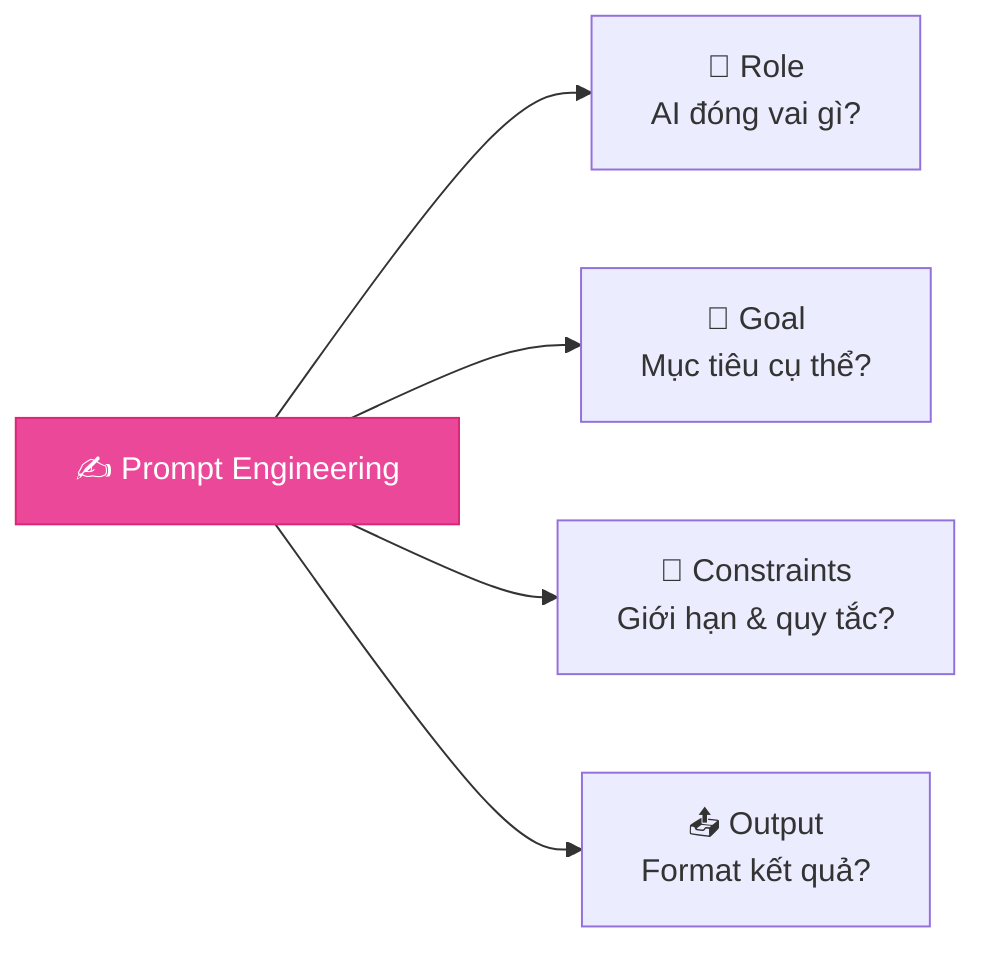

# ✍️ Section 3 · Prompt Engineering for AI Agents

  
  
  
  

> **Viết prompt hiệu quả cho AI Agent — không chỉ cho chatbot**

---

## 🎯 Mục tiêu Section

Sau section này, bạn sẽ:

- ✅ Hiểu **Prompt Engineering trong context AI Agent** — khác chatbot thông thường
- ✅ Nhận biết và tránh **lỗi phổ biến** khi viết prompt
- ✅ Nắm framework thiết kế prompt: **Role, Goal, Constraints, Output**
- ✅ Biết cách **debug & phân tích** prompt với Antigravity Kit

---

## 📚 Lectures

| # | Lecture | Mô tả | Thời lượng |
|---|---------|--------|------------|
| 3.1 | **Prompt Engineering cho AI Agent là gì?** | Hiểu cách prompt ảnh hưởng đến cách agent suy nghĩ, quyết định và hành động. | ~25 phút |
| 3.2 | **Các lỗi phổ biến khi viết Prompt** | Prompt mơ hồ, xung đột instruction, context quá dài khiến agent trả lời sai. | ~25 phút |
| 3.3 | **Cách thiết kế Prompt hiệu quả** | Framework: Role, Goal, Constraints, Output. | ~30 phút |
| 3.4 | **Debug & phân tích Prompt** | Sử dụng Antigravity Kit để debug & optimize. | ~25 phút |

---

## 🔑 Key Concepts

### So sánh Prompt tốt vs xấu

| ❌ Prompt xấu | ✅ Prompt tốt |
|---|---|
| "Tạo trang web học tiếng Anh" | "Tạo landing page với hero section có tiêu đề 'Master English', 3 feature cards, CTA button. Dùng React + TypeScript." |
| "Fix bug" | "Fix bug trong file `src/components/QuizCard.tsx` dòng 45-60: timer không reset khi chuyển câu hỏi" |

---

## 📋 Prerequisites

- ✅ Hoàn thành **Section 1-2** — Foundation & Core Concepts

---

[← Section 2](../section-02-core-concepts/README.md) · [🏠 Home](../../README.md) · [📑 Mục lục](../SUMMARY.md) · [Section 4 →](../section-04-context-engineering/README.md)

