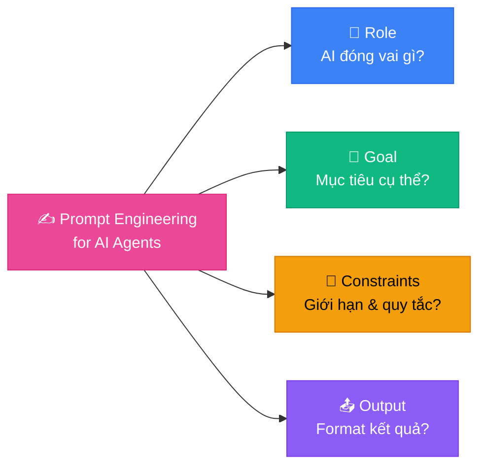

# ✍️ Section 3 · Prompt Engineering for AI Agents

  
  
  
  

> **Viết prompt hiệu quả cho AI Agent — không chỉ cho chatbot. Ra khỏi section này với bộ Prompt Library cá nhân dùng được ngay.**

---

## 🎯 Mục tiêu Section

Sau section này, bạn sẽ:

- ✅ Hiểu **Prompt Engineering trong context AI Agent** — khác chatbot thông thường như thế nào
- ✅ Nhận biết và tránh **lỗi phổ biến** khi viết prompt cho Agent
- ✅ Nắm framework thiết kế prompt: **Role, Goal, Constraints, Output (RGCO)**
- ✅ Thực hành **viết prompt từ Zero → Pro** qua 3 use case thực tế
- ✅ Tự xây dựng **Prompt Library cá nhân** — tài sản dùng được ngay trong dự án thực

---

## 📚 Lectures

| # | Loại | Lecture | Mô tả | Thời lượng |
|---|------|---------|--------|------------|
| 3.1 | 📖 Theory | **[Prompt Engineering cho AI Agent là gì?](lesson-01-what-is-prompt-engineering.md)** | Bản chất PE và sự khác biệt so với chatbot. | ~20 phút |
| 3.2 | 📖 Theory | **[Các lỗi phổ biến khi viết Prompt](lesson-02-common-prompt-mistakes.md)** | Prompt mơ hồ, xung đột, over-prompting, thiếu context. | ~20 phút |
| 3.3 | 🎬 **Demo** | **[🎬 Demo: Prompt tệ vs Prompt tốt](lesson-03-demo-bad-vs-good-prompt.md)** | Live side-by-side — cùng task, 2 prompt khác nhau, Agent phản ứng hoàn toàn khác. | ~25 phút |
| 3.4 | 📖 Theory | **[Cách thiết kế Prompt hiệu quả — Framework RGCO](lesson-04-rgco-framework.md)** | Role, Goal, Constraints, Output + template cho 4 use case phổ biến. | ~25 phút |
| 3.5 | 🎬 **Demo** | **[🎬 Demo: Viết Prompt từ Zero → Pro](lesson-05-demo-zero-to-pro.md)** | Thực hành live 3 use case thực tế. | ~30 phút |
| 3.6 | 🛠️ Workshop | **[🛠️ Workshop: Xây dựng Prompt Library cá nhân](lesson-06-workshop-prompt-library.md)** | Tự build bộ prompt reusable cho dự án thực. | ~30 phút |

---

## 🔑 Key Concepts

### So sánh Prompt tốt vs xấu

| ❌ Prompt xấu | ✅ Prompt tốt (RGCO) |
|---|---|
| "Tạo trang web học tiếng Anh" | "Bạn là Senior React Dev. Tạo landing page với hero section tiêu đề 'Master English', 3 feature cards, CTA button. Dùng TypeScript + Tailwind. Output: file tsx đơn lẻ." |
| "Fix bug" | "Bạn là code reviewer. Fix bug trong `src/components/QuizCard.tsx` dòng 45-60: timer không reset khi chuyển câu hỏi. Không thay đổi logic bên ngoài range đó." |
| "Review code của tôi" | "Bạn là Senior Engineer chuyên React. Review file `AuthForm.tsx` tập trung vào: security, performance, accessibility. Output: danh sách issues theo mức độ Critical/Major/Minor." |

---

## 🗂️ Prompt Library — Template RGCO

Sau bài Workshop 3.6, bạn sẽ có bộ template cho các tình huống này:

| Use Case | Template |
|----------|---------|
| 🖥️ Code Generation | Role: Senior Dev → Goal: tạo X → Constraints: tech stack, file limit → Output: file ready-to-use |
| 🔍 Code Review | Role: Reviewer → Goal: tìm issues → Constraints: focus area → Output: list Critical/Major/Minor |
| 🎨 UI Generation | Role: UI Designer → Goal: tạo component → Constraints: design system → Output: tsx + css |
| 🐛 Bug Fixing | Role: Debugger → Goal: fix Y → Constraints: chỉ sửa file X dòng A-B → Output: diff rõ ràng |

---

## 📋 Prerequisites

- ✅ Hoàn thành **Section 1-2** — Foundation & Core Concepts

---

[← Section 2](../section-02-core-concepts/README.md) · [🏠 Home](../../README.md) · [📑 Mục lục](../SUMMARY.md) · [Section 4 →](../section-04-context-engineering/README.md)

