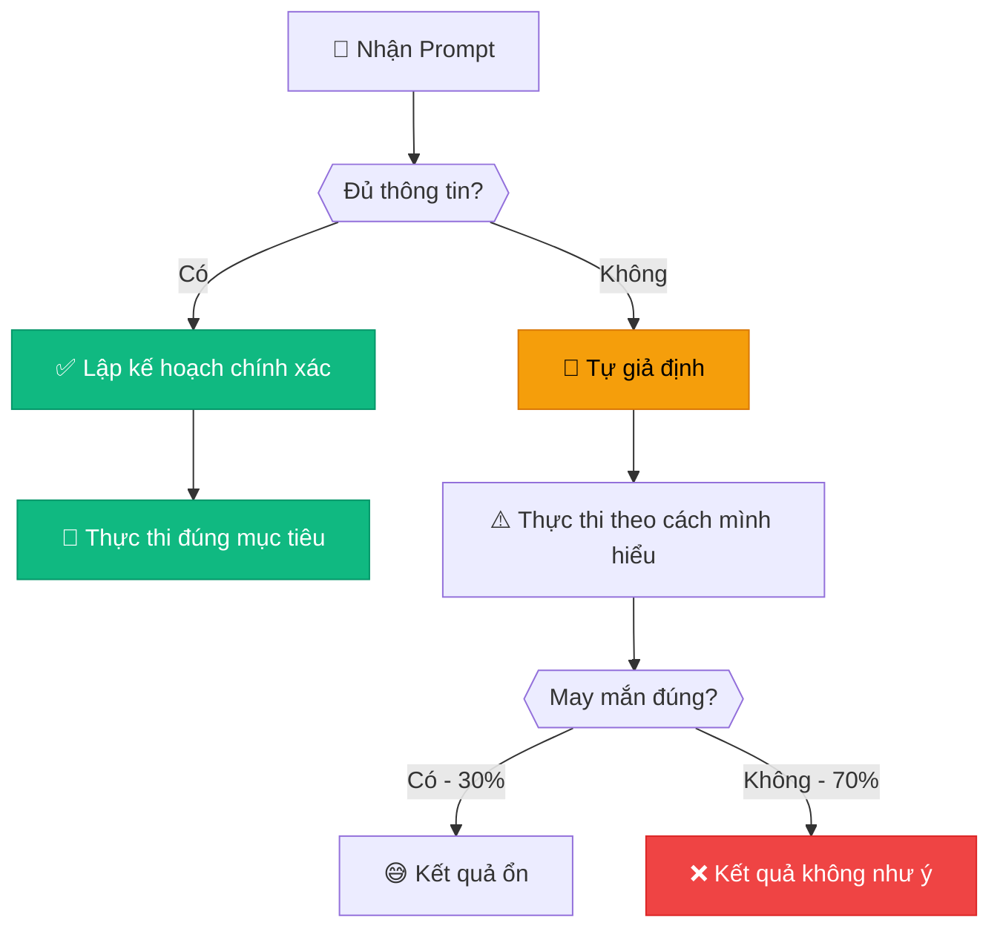

# 🎬 Bài 3.3: Demo — Prompt Tệ vs Prompt Tốt

> **Section 3** · Prompt Engineering for AI Agents
> **Thời lượng:** ~25 phút | 🎬 Demo thực chiến
> **Yêu cầu:** Đã hoàn thành Bài 3.1 và 3.2

---

## 🎯 Mục tiêu bài học

Sau bài này, bạn sẽ:

- ✅ **Thấy tận mắt** sự khác biệt khi Agent nhận prompt tệ vs prompt tốt
- ✅ Hiểu **cơ chế nội tâm** của Agent khi xử lý từng loại prompt
- ✅ Biết nhận diện output của Agent có "đi đúng hướng" không
- ✅ Sẵn sàng áp dụng kiến thức vào bài 3.4

---

## 🎬 Demo Setup

Trong bài này, chúng ta sẽ làm **3 demo side-by-side** với cùng một task — gửi prompt tệ và prompt tốt vào Antigravity, quan sát và phân tích sự khác biệt.

> 💡 **Cách theo dõi:** Mở Antigravity IDE bên cạnh tài liệu này. Gõ từng prompt theo hướng dẫn và quan sát output của Agent.

---

## Demo 1 — Tạo React Component

### 🔴 Prompt tệ

```
"Tạo một button component"
```

**Agent suy nghĩ gì?** (Trace thought process)

```
Nhận được: "Tạo một button component"
→ Framework? Không biết → Tự chọn: React (vì phổ biến nhất)
→ TypeScript? Không biết → Chọn JavaScript (đơn giản hơn)
→ Styling? Không biết → Chọn inline styles (an toàn nhất)
→ Tên file? Không biết → Button.jsx
→ Đặt ở đâu? Không biết → src/components/Button.jsx
→ Props gì? Không biết → chỉ tạo cơ bản nhất
```

**Output Agent tạo ra:**

```jsx
// src/components/Button.jsx
import React from 'react';

const Button = ({ label, onClick }) => {
  return (
    <button
      onClick={onClick}
      style={{
        padding: '8px 16px',
        backgroundColor: '#007bff',
        color: 'white',
        border: 'none',
        borderRadius: '4px',
        cursor: 'pointer'
      }}
    >
      {label}
    </button>
  );
};

export default Button;
```

**❌ Vấn đề:**
- Project đang dùng TypeScript → file `.jsx` không match
- Project đang dùng Tailwind → inline styles xung đột
- Không có variants (primary/secondary/danger)
- Props `label` trong khi codebase dùng `children`
- File ở `src/components/` trong khi convention là `src/components/ui/`

---

### ✅ Prompt tốt

```
Bạn là Senior React Developer.

Goal: Tạo Button component tái sử dụng được.

Context:
- Tech stack: React 18 + TypeScript + Tailwind CSS
- File location: src/components/ui/Button.tsx
- Naming: PascalCase component, camelCase props

Specs:
- Props: variant ('primary' | 'secondary' | 'danger'), size ('sm' | 'md' | 'lg'),
  disabled: boolean, onClick: () => void, children: React.ReactNode
- Mỗi variant có hover và focus state
- Disabled state: opacity-50, cursor-not-allowed

Output: File tsx hoàn chỉnh với TypeScript types, không cần test file.
```

**Agent suy nghĩ gì?**

```
Nhận được: Đầy đủ context
→ Framework: React 18 ✓
→ TypeScript: có ✓ → File .tsx
→ Styling: Tailwind ✓ → Dùng className
→ Location: src/components/ui/Button.tsx ✓
→ Props interface: rõ ràng ✓
→ Variants: 3 loại với states ✓
→ Bắt đầu viết code...
```

**Output Agent tạo ra:**

```tsx
// src/components/ui/Button.tsx
import React from 'react';

type ButtonVariant = 'primary' | 'secondary' | 'danger';
type ButtonSize = 'sm' | 'md' | 'lg';

interface ButtonProps {
  variant?: ButtonVariant;
  size?: ButtonSize;
  disabled?: boolean;
  onClick?: () => void;
  children: React.ReactNode;
}

const variantStyles: Record<ButtonVariant, string> = {
  primary: 'bg-blue-600 text-white hover:bg-blue-700 focus:ring-blue-500',
  secondary: 'bg-gray-200 text-gray-800 hover:bg-gray-300 focus:ring-gray-400',
  danger: 'bg-red-600 text-white hover:bg-red-700 focus:ring-red-500',
};

const sizeStyles: Record<ButtonSize, string> = {
  sm: 'px-3 py-1.5 text-sm',
  md: 'px-4 py-2 text-base',
  lg: 'px-6 py-3 text-lg',
};

export const Button: React.FC<ButtonProps> = ({
  variant = 'primary',
  size = 'md',
  disabled = false,
  onClick,
  children,
}) => {
  return (
    <button
      onClick={onClick}
      disabled={disabled}
      className={`
        rounded-md font-medium transition-colors
        focus:outline-none focus:ring-2 focus:ring-offset-2
        ${variantStyles[variant]}
        ${sizeStyles[size]}
        ${disabled ? 'opacity-50 cursor-not-allowed' : ''}
      `}
    >
      {children}
    </button>
  );
};

export default Button;
```

**✅ Kết quả:** File đúng vị trí, đúng tech stack, đúng conventions, production-ready.

---

## Demo 2 — Fix Bug

### 🔴 Prompt tệ

```
"App bị lỗi khi thêm item vào cart, fix giúp tôi"
```

**Output Agent:**

Agent sẽ hỏi ngược lại *"Lỗi gì? Error message là gì? File nào?"* — hoặc tệ hơn, nó sẽ **đoán** file Cart có thể là gì, tự đọc toàn bộ codebase (tốn nhiều token), hoặc đề xuất fix chung chung mà không giải quyết được vấn đề thực sự.

---

### ✅ Prompt tốt

```
Fix bug trong src/features/cart/cartSlice.ts

Error: TypeError: Cannot read properties of undefined (reading 'quantity')
Location: Line 47, trong function addToCart reducer

Behavior: Khi user thêm item đã có trong cart, quantity phải tăng thêm 1.
Hiện tại: crash vì existingItem có thể undefined nếu findIndex trả về -1.

Constraint: Chỉ sửa trong function addToCart, không thay đổi phần còn lại.
```

**Output Agent:** Tìm đúng file, đúng line, fix chính xác vấn đề null check, không thay đổi gì khác.

---

## Demo 3 — Tổng hợp: Điều gì xảy ra với Prompt "ở giữa"?

Đây là trường hợp thực tế nhất — prompt không tệ hoàn toàn, nhưng thiếu một số thông tin.

### 🟡 Prompt trung bình

```
"Thêm dark mode vào app"
```

**Agent nhận được:** Biết task là gì, nhưng thiếu:
- Component nào cần update?
- Dùng CSS variables hay Tailwind dark: prefix?
- Toggle button đặt ở đâu?
- Có lưu preference vào localStorage không?

**Hành vi của Agent:** Tự quyết định tất cả, có thể đúng hoặc không đúng convention của bạn.

### ✅ Prompt sau khi cải thiện

```
Bạn là Frontend Developer.

Goal: Thêm dark mode toggle cho app.

Context:
- Dùng Tailwind CSS với class strategy: 'class'
- tailwind.config.js đã có darkMode: 'class'
- Toggle button đặt trong src/components/layout/Navbar.tsx
- Lưu preference vào localStorage key: 'theme'

Implementation:
1. Tạo custom hook useTheme tại src/hooks/useTheme.ts
   - Read/write localStorage
   - Apply class 'dark' lên <html> element
2. Update Navbar.tsx để import và dùng hook đó
3. Thêm dark: variants cho các component chính:
   src/components/ui/Button.tsx, Card.tsx, Input.tsx

Không tạo thêm file nào khác ngoài hook đó.
```

---

## 🧠 Phân Tích: Điều gì xảy ra trong "đầu" Agent?



**Insight quan trọng:** Khi Agent thiếu thông tin, nó không báo lỗi — nó tự điền vào. Bạn chỉ phát hiện ra kết quả sai sau khi Agent đã chạy xong.

---

## 💡 Tự Thực Hành

Hãy mở Antigravity và thử với project của bạn:

1. **Thử prompt tệ trước:** Gửi một prompt chỉ 3-5 chữ về một task bạn muốn làm
2. **Quan sát:** Agent làm gì? Nó tự quyết định điều gì?
3. **Thử prompt tốt:** Viết lại prompt với đầy đủ context
4. **So sánh:** Kết quả khác nhau ra sao?

---

## 🔑 Tóm tắt bài học

| | Prompt tệ | Prompt tốt |
|--|-----------|-----------|
| **Agent hiểu** | Task một phần | Task hoàn chỉnh |
| **Agent làm** | Tự giả định | Thực thi theo spec |
| **Kết quả** | 30% đúng | 90%+ đúng |
| **Thời gian fix** | Nhiều | Ít hoặc không cần |
| **Token tốn** | Nhiều hơn (phải redo) | Ít hơn (right the first time) |

> **Key insight:** Prompt tốt không chỉ cho kết quả đúng hơn — nó còn **tiết kiệm token và thời gian** vì không cần redo.

---

## ⏭️ Bài tiếp theo

Bạn đã thấy tận mắt sự khác biệt. Bài 3.4 sẽ dạy bạn **Framework RGCO** — công thức có cấu trúc để luôn viết được prompt ở mức "tốt".

👉 **[Bài 3.4 → Framework RGCO: Role, Goal, Constraints, Output](lesson-04-rgco-framework.md)**

---

*📚 Section 3 · Prompt Engineering for AI Agents · Google Antigravity: Xây dựng AI Agent, AI App & Vibe Coding*
