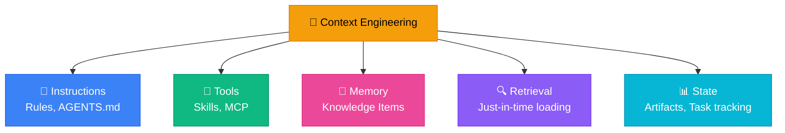

# 🧠 Section 4 · Context Engineering for AI Agents

  
  
  
  

> **Giúp AI Agent "Nhớ" & Tối Ưu Token — Kỹ thuật quan trọng nhất khi Vibe Coding**

---

## 🎯 Mục tiêu Section

Sau section này, bạn sẽ:

- ✅ Hiểu **Context Engineering** là gì và tại sao nó quan trọng hơn Prompt Engineering
- ✅ Biết tại sao Agent hay **"quên"** và cách phòng tránh
- ✅ Tạo được **bộ context documents** hoàn chỉnh: AGENTS.md, ARCHITECTURE.md, PLAN.md
- ✅ Nắm kỹ thuật **Summarize Context** và **Context Compaction**
- ✅ **Giảm 50-80% token usage** so với cách thông thường

---

## 🧩 Vấn đề giải quyết

| Vấn đề | Biểu hiện | Giải pháp |
|--------|----------|-----------|
| Agent quên context | Code xung đột, không theo convention | AGENTS.md + ARCHITECTURE.md |
| Token bùng nổ | Agent analyze cả source mỗi lần | Layered Context + Targeted References |
| Mất liên tục giữa phiên | Conversation mới = Agent trống | Handoff Documents + Knowledge Items |
| Context rot | Thông tin cũ, lỗi thời | Context Compaction + Quarantine |

---

## 📚 Lectures

| # | Lecture | Mô tả | Thời lượng |
|---|---------|--------|------------|
| 4.1 | [**Context Engineering là gì?**](lesson-01-what-is-context-engineering.md) | Khác gì Prompt Engineering. 5 trụ cột. | ~35 phút |
| 4.2 | **Context Window là gì?** | Giới hạn "RAM" của Agent. | ~20 phút |
| 4.3 | **5 trụ cột Context Engineering** | Instructions, Tools, Memory, Retrieval, State | ~30 phút |
| 4.4 | **Token là gì? Tại sao quan trọng?** | Chi phí, tốc độ, giới hạn. | ~20 phút |
| 4.5 | [**Context Documents — Bộ nhớ ngoài**](lesson-02-project-context-documents.md) | AGENTS.md, ARCHITECTURE.md, PLAN.md | ~45 phút |
| 4.6 | **AGENTS.md – File quan trọng nhất** | Convention, tech stack, do's & don'ts | ~25 phút |
| 4.7 | **ARCHITECTURE.md – Bản đồ dự án** | Kiến trúc hệ thống | ~20 phút |
| 4.8 | **PLAN.md – Trạng thái dự án** | Task list & priorities | ~15 phút |
| 4.9 | [**Kỹ thuật Summarize Context**](lesson-03-summarize-context-techniques.md) | Giữ Agent "tỉnh táo" phiên dài | ~40 phút |
| 4.10 | **Context Compaction** | "Nén" conversation, handoff documents | ~30 phút |

---

## 🔑 Key Concepts

---

## 💰 Token Savings Summary

| Kỹ thuật | Token tiết kiệm |
|----------|-----------------|
| AGENTS.md | ~30% |
| ARCHITECTURE.md | ~40% |
| Handoff Document | ~60% |
| Targeted References | ~70% |
| Layered Context | ~80% |
| Knowledge Items | ~90% |

---

## 📋 Prerequisites

- ✅ Hoàn thành **Section 1-3** — Foundation, Core Concepts, Prompt Engineering

---

[← Section 3](../section-03-prompt-engineering/README.md) · [🏠 Home](../../README.md) · [📑 Mục lục](../SUMMARY.md) · [Section 5 →](../section-05-multi-agent/README.md)

