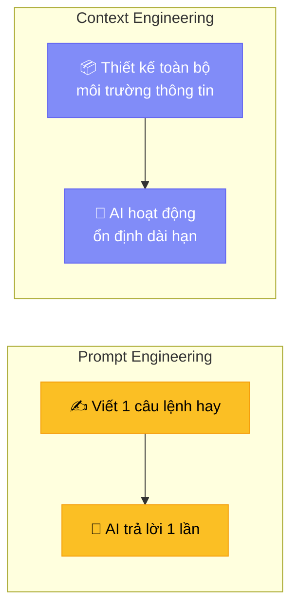
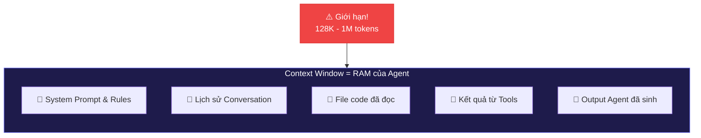
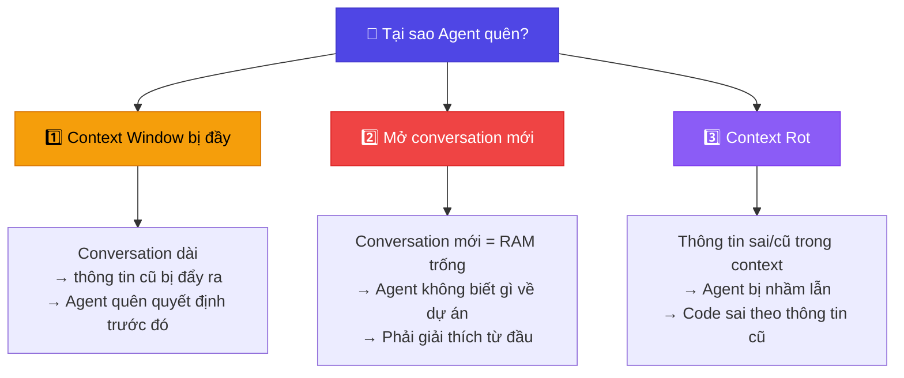
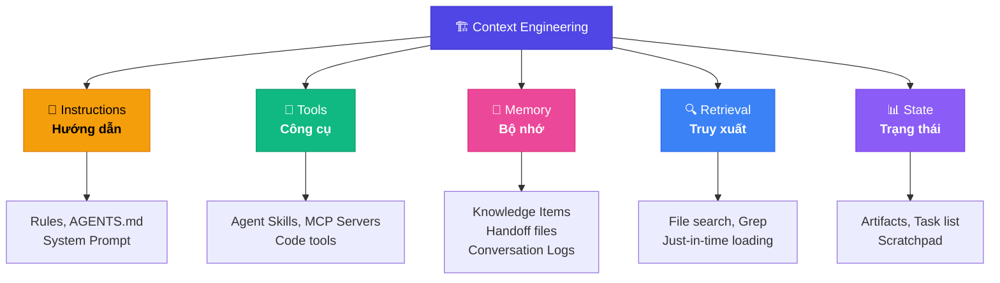
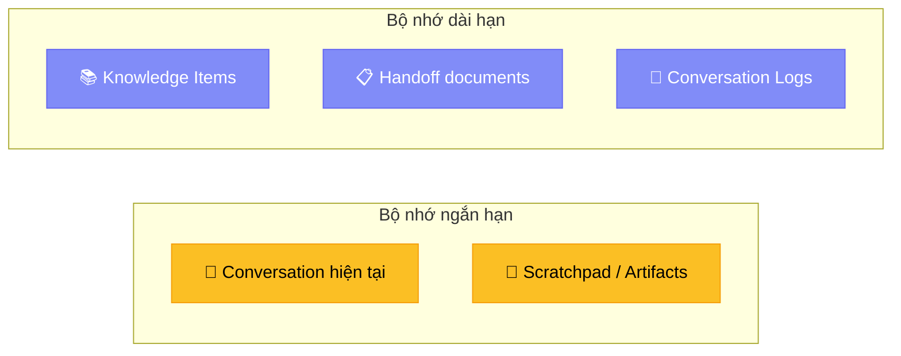
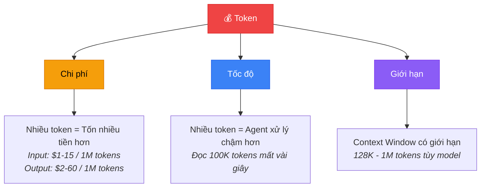
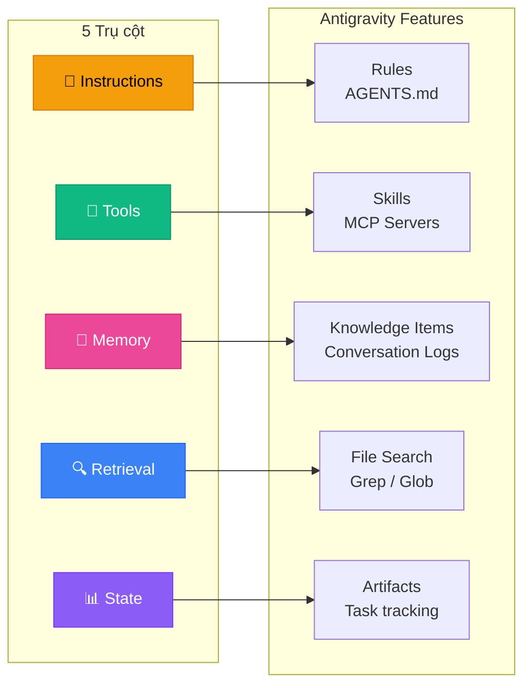

# 📘 Bài 1: Context Engineering là gì? Tại sao Agent hay "quên"?

> **Section:** Context Engineering – Giúp AI Agent "Nhớ" & Tối Ưu Token  
> **Thời lượng:** 30-40 phút  
> **Yêu cầu:** Đã hoàn thành Section 1-3

---

## 🎯 Mục tiêu bài học

Sau bài này, bạn sẽ:

- ✅ Hiểu **Context Engineering** là gì và khác gì Prompt Engineering
- ✅ Biết **tại sao AI Agent hay "quên"** và cơ chế đằng sau
- ✅ Nắm **5 trụ cột** của Context Engineering
- ✅ Hiểu **Token** là gì và tại sao nó ảnh hưởng đến chi phí & hiệu suất

---

## 1. Vấn đề thực tế: Agent hay "quên"

### 1.1 Bạn đã từng gặp tình huống này chưa?

Hãy tưởng tượng bạn đang Vibe Coding một dự án web:

```
🗣️ Phiên 1: "Tạo component Header với logo, navigation menu, dark mode toggle"
✅ Agent tạo Header.tsx hoàn hảo

🗣️ Phiên 2 (ngày hôm sau): "Thêm trang About với Header giống trang chủ"
❌ Agent tạo Header MỚI, khác hoàn toàn Header cũ!
   → Khác style, khác cấu trúc, thậm chí khác tên class
```

**Tại sao lại thế?** Vì Agent **không nhớ** gì từ phiên trước. Mỗi conversation mới, Agent bắt đầu với "bộ nhớ trống".

### 1.2 Các biểu hiện Agent "quên"

| Biểu hiện | Ví dụ cụ thể |
|-----------|-------------|
| **Tạo code trùng lặp** | Viết hàm `formatDate()` ở 3 file khác nhau |
| **Không theo convention** | Lúc dùng camelCase, lúc dùng snake_case |
| **Xung đột kiến trúc** | Trang mới dùng style khác hoàn toàn trang cũ |
| **Hỏi lại thông tin** | "Dự án dùng framework gì?" (dù đã nói trước đó) |
| **Hallucinate** | Tự bịa ra file, function không tồn tại |

> 💡 **Sự thật:** Theo nghiên cứu, **~80% lỗi của AI Agent là do thiếu context**, không phải do model kém. Agent không "ngu" – Agent chỉ "quên".

---

## 2. Context Engineering là gì?

### 2.1 Từ Prompt Engineering đến Context Engineering

Bạn đã học **Prompt Engineering** ở Section 3 — kỹ năng viết câu lệnh hay để AI cho kết quả tốt. Nhưng khi làm dự án thực tế, prompt hay thôi **chưa đủ**.



> **Context Engineering** là kỹ thuật **thiết kế, quản lý và tối ưu toàn bộ thông tin** mà AI Agent nhận được — bao gồm instructions, tools, memory, data — để Agent luôn hoạt động **chính xác, nhất quán và tiết kiệm**.

### 2.2 Ẩn dụ dễ hiểu

**Andrej Karpathy** (cựu Director of AI tại Tesla, co-founder OpenAI) giải thích:

> *"LLM giống như CPU, và Context Window giống như RAM. Context Engineering là nghệ thuật nạp đúng thông tin vào RAM đó."*

Hãy hình dung thế này:

| Ẩn dụ | Prompt Engineering | Context Engineering |
|-------|-------------------|-------------------|
| **Giao việc cho nhân viên mới** | Viết 1 email brief hay | Chuẩn bị **cả ba lô** cho họ: tài liệu dự án, quy trình, contacts, tools |
| **Đầu bếp nấu ăn** | Cho công thức (recipe) | Chuẩn bị **cả gian bếp**: nguyên liệu sẵn, dao kéo đúng chỗ, gia vị có nhãn |
| **Học sinh đi thi** | Cho đề thi rõ ràng | Cho phép mang theo **tài liệu tham khảo** đúng, đủ, không thừa |

### 2.3 So sánh chi tiết

| | **Prompt Engineering** | **Context Engineering** |
|---|---|---|
| **Phạm vi** | 1 câu lệnh, 1 lượt tương tác | Toàn bộ hệ thống thông tin xung quanh |
| **Mục tiêu** | Có output tốt lần đầu | AI hoạt động ổn định dài hạn |
| **Tư duy** | "Viết câu gì cho hay?" | "Agent cần biết gì để làm đúng?" |
| **Quan hệ** | Là 1 phần nhỏ | Bao trùm cả Prompt Engineering |
| **Khi nào cần** | Chat đơn lẻ | Dự án dài hạn, nhiều phiên, nhiều tính năng |

> 💡 **Nhớ:** Prompt Engineering ⊂ Context Engineering. Bạn vẫn cần prompt hay, nhưng prompt chỉ là **1 mảnh** trong bức tranh lớn.

---

## 3. Tại sao Agent hay "quên"? — Hiểu cơ chế Context Window

### 3.1 Context Window là gì?

Mỗi AI model có một **Context Window** — giới hạn lượng thông tin nó có thể "nhìn thấy" tại 1 thời điểm.



**Giống như RAM của máy tính:**
- RAM **có giới hạn** — không thể chứa vô hạn
- Khi **đầy** → phải xoá bớt hoặc bị chậm
- Thông tin bên ngoài RAM → **không nhìn thấy**

### 3.2 Tại sao Agent "quên"?

Có **3 nguyên nhân chính**:



#### Nguyên nhân 1: Context Window bị đầy

```
Conversation bắt đầu:
┌─────────────────────────────┐
│ System Prompt    (500 tk)   │
│ Tin nhắn 1       (200 tk)   │
│ Code file A      (800 tk)   │  ← Còn rộng rãi, Agent nhớ hết
│ Response 1       (500 tk)   │
│                             │
│ ... (còn trống 125K tk)     │
└─────────────────────────────┘

Sau 2 giờ làm việc:
┌─────────────────────────────┐
│ System Prompt    (500 tk)   │
│ 50 tin nhắn   (25,000 tk)  │
│ 20 file code  (40,000 tk)  │  ← Gần đầy! Agent bắt đầu
│ 50 responses  (50,000 tk)  │     "quên" thông tin ban đầu
│ Tool outputs  (10,000 tk)  │
│ ... (chỉ còn 2,500 tk)     │
└─────────────────────────────┘
```

#### Nguyên nhân 2: Mở conversation mới

```
Phiên 1:                          Phiên 2 (ngày hôm sau):
┌──────────────────────┐          ┌──────────────────────┐
│ ✅ Biết tech stack    │          │ ❓ Tech stack gì?     │
│ ✅ Biết convention    │   ──✖──▶ │ ❓ Convention nào?    │
│ ✅ Biết kiến trúc     │  RESET!  │ ❓ Kiến trúc ra sao?  │
│ ✅ Biết đã làm gì     │          │ ❓ Đã làm gì rồi?    │
└──────────────────────┘          └──────────────────────┘
```

#### Nguyên nhân 3: Context Rot (Thông tin thối)

Khi conversation dài, thông tin cũ có thể **mâu thuẫn** với thông tin mới:

```
Tin nhắn #5:  "Dùng Tailwind CSS cho styling"
Tin nhắn #30: "Chuyển sang dùng CSS Modules"

→ Agent có thể nhầm lẫn, sinh code trộn lẫn cả Tailwind và CSS Modules!
```

---

## 4. Năm trụ cột của Context Engineering

Context Engineering gồm **5 trụ cột** — mỗi trụ cột giải quyết 1 khía cạnh của việc cung cấp thông tin cho Agent:



### Chi tiết từng trụ cột

#### 📜 1. Instructions (Hướng dẫn)

**"Cho Agent biết phải làm gì và KHÔNG làm gì"**

| Công cụ trong Antigravity | Vai trò |
|--------------------------|---------|
| **Rules** | Convention, coding style áp dụng mọi conversation |
| **AGENTS.md** | Tài liệu dự án: tech stack, architecture, do's & don'ts |
| **System Prompt** | Hướng dẫn ở mức session |

**Ví dụ Rules:**
```
- Luôn dùng TypeScript strict mode
- Component React dùng functional component + hooks
- Tên file component: PascalCase (VD: UserProfile.tsx)
- Tên hàm/biến: camelCase
- KHÔNG dùng any type
```

→ Agent tự tuân theo mà **không cần nhắc lại** mỗi lần.

---

#### 🔧 2. Tools (Công cụ)

**"Cho Agent khả năng HÀNH ĐỘNG, không chỉ nói"**

| Công cụ | Khả năng |
|---------|---------|
| **Agent Skills** | stitch-design, react-components, enhance-prompt |
| **MCP Servers** | Stitch MCP (design UI), GitHub MCP (quản lý git) |
| **Built-in tools** | File read/write, terminal, browser, grep |

→ Agent có đúng tools → giải quyết đúng việc → **không phải workaround** → tiết kiệm token.

---

#### 🧠 3. Memory (Bộ nhớ)

**"Cho Agent nhớ thông tin xuyên phiên làm việc"**



→ Sẽ học chi tiết ở **Bài 3 và Bài 5**.

---

#### 🔍 4. Retrieval (Truy xuất)

**"Chỉ lấy thông tin CẦN THIẾT, không dump tất cả"**

```
❌ Sai: Paste toàn bộ 50 file vào prompt       → 100K+ tokens
✅ Đúng: Chỉ reference file đang cần sửa        → 2K tokens
```

→ Nguyên tắc **"Minimal Viable Context"** — sẽ học chi tiết ở **Bài 4**.

---

#### 📊 5. State (Trạng thái)

**"Theo dõi Agent đã làm gì, đang làm gì, sắp làm gì"**

| Công cụ | Vai trò |
|---------|---------|
| **Implementation Plan** | Kế hoạch chi tiết trước khi code |
| **Task list** | Checklist đã làm / đang làm / chưa làm |
| **Walkthrough** | Tóm tắt sau khi hoàn thành |

→ Giúp Agent **không lặp lại** việc đã làm, **không bỏ sót** việc chưa làm.

---

## 5. Token là gì? Tại sao quan trọng?

### 5.1 Token — "Đơn vị tiền tệ" của AI

**Token** là đơn vị nhỏ nhất mà AI model xử lý. Mỗi lần Agent đọc code, đọc prompt, sinh output — đều tính bằng token.

**Quy tắc nhanh:**

| Ngôn ngữ | Ước tính |
|----------|---------|
| Tiếng Anh | ~1 token ≈ 4 ký tự ≈ ¾ từ |
| Tiếng Việt | ~1 token ≈ 1-2 ký tự (Unicode tốn hơn) |
| Code | 1 file 100 dòng ≈ 500-800 tokens |

**Ví dụ cụ thể:**

```
"Hello world"          → 2 tokens
"Xin chào thế giới"   → 7 tokens  (tiếng Việt tốn hơn!)
1 file React 200 dòng → ~1,500 tokens
```

### 5.2 Tại sao Token quan trọng?



### 5.3 Ví dụ chi phí thực tế

Giả sử bạn Vibe Coding 1 ngày (8 giờ) **không tối ưu**:

| Hoạt động | Token ước tính | Lần/ngày | Tổng |
|-----------|---------------|---------|------|
| Agent scan toàn bộ source | 30,000 input | 20 lần | 600,000 |
| Agent sinh code response | 5,000 output | 20 lần | 100,000 |
| Giải thích lại dự án | 2,000 input | 10 lần | 20,000 |
| **Tổng** | | | **720,000 tokens** |

**Sau khi áp dụng Context Engineering:**

| Hoạt động | Token ước tính | Lần/ngày | Tổng |
|-----------|---------------|---------|------|
| Agent đọc AGENTS.md (thay vì scan) | 500 input | 20 lần | 10,000 |
| Agent sinh code response | 5,000 output | 20 lần | 100,000 |
| Không cần giải thích lại | 0 | 0 | 0 |
| **Tổng** | | | **110,000 tokens** |

> 🎯 **Tiết kiệm ~85% tokens** — chỉ bằng cách quản lý context tốt hơn!

---

## 6. Mapping với Antigravity

Mỗi trụ cột Context Engineering đều có **tính năng tương ứng** trong Antigravity:



| Trụ cột | Antigravity Feature | Bạn đã học ở | Sẽ học sâu ở |
|---------|-------------------|--------------|----|
| Instructions | Rules, System Prompt | Section 2 | Bài 2 (AGENTS.md) |
| Tools | Skills, MCP | Section 2, 5 | — |
| Memory | Knowledge Items | — | **Bài 3, 5** |
| Retrieval | File search, grep | — | **Bài 4** |
| State | Artifacts | Section 2 | **Bài 3** |

---

## 📝 Tóm tắt bài học

| Khái niệm | Nội dung chính |
|-----------|---------------|
| **Context Engineering** | Thiết kế toàn bộ môi trường thông tin cho Agent |
| **Khác Prompt Engineering** | PE = viết 1 câu lệnh. CE = thiết kế cả hệ thống |
| **Tại sao Agent quên** | Context Window đầy, phiên mới reset, context rot |
| **5 trụ cột** | Instructions, Tools, Memory, Retrieval, State |
| **Token** | Đơn vị chi phí — Context Engineering giúp tiết kiệm ~85% |

---

## ⏭️ Bài tiếp theo

**Bài 2: Project Context Documents – "Bộ nhớ ngoài" cho Agent** — Chúng ta sẽ tạo các file AGENTS.md, ARCHITECTURE.md để Agent hiểu dự án ngay lập tức, không cần scan toàn bộ code.

---

*📚 Context Engineering · Google Antigravity: Xây dựng AI Agent, AI App & Vibe Coding*
