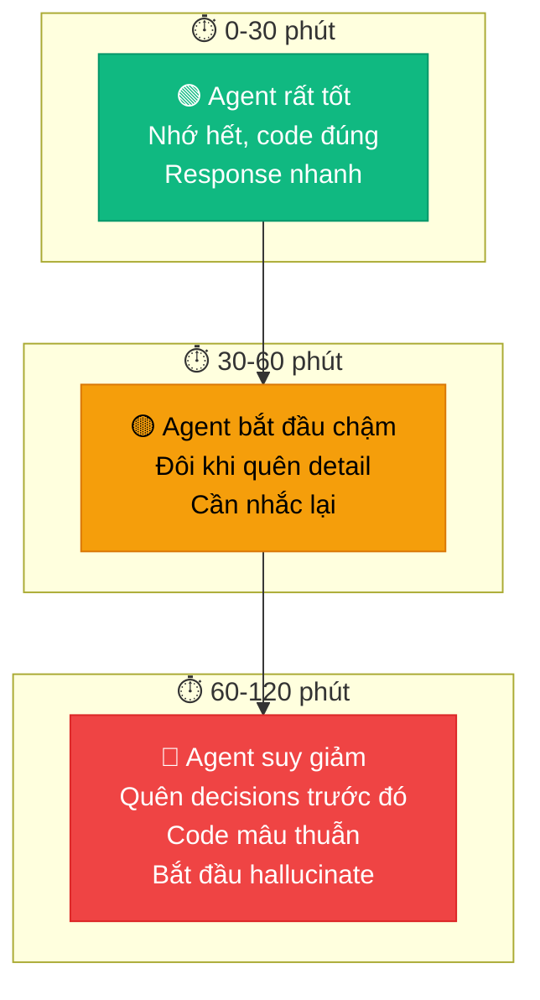
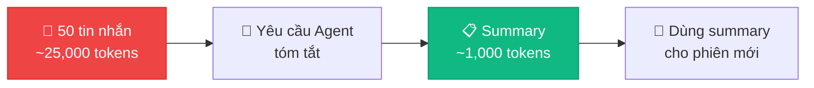
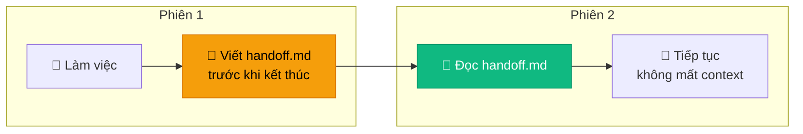
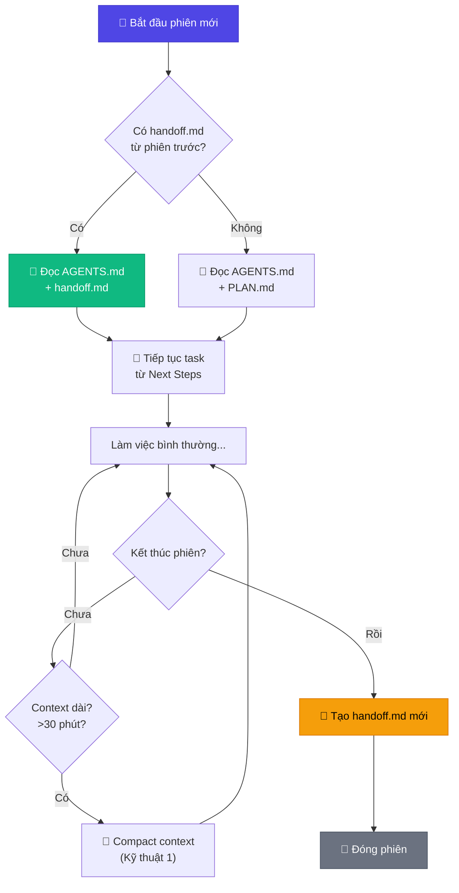
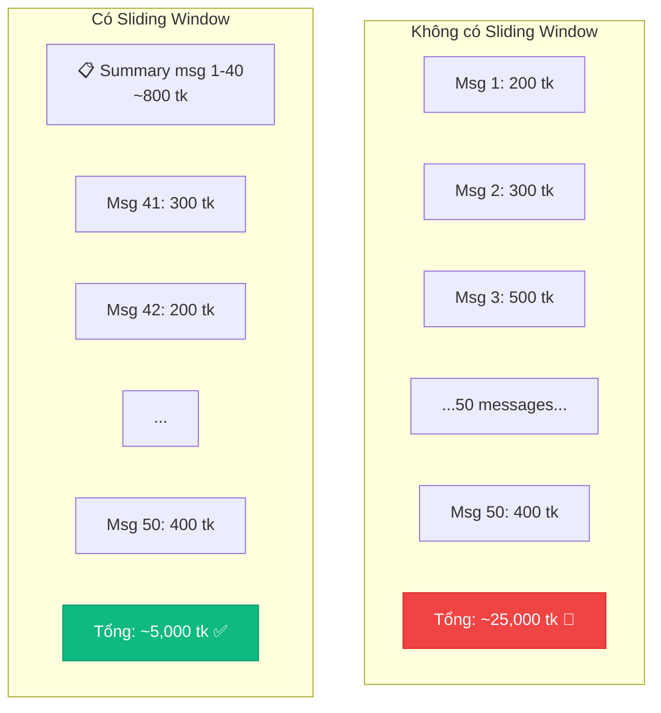
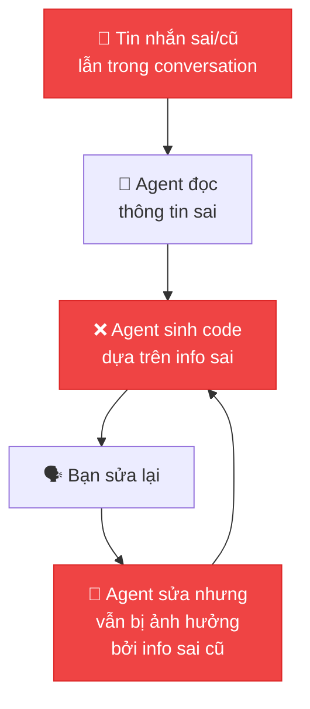
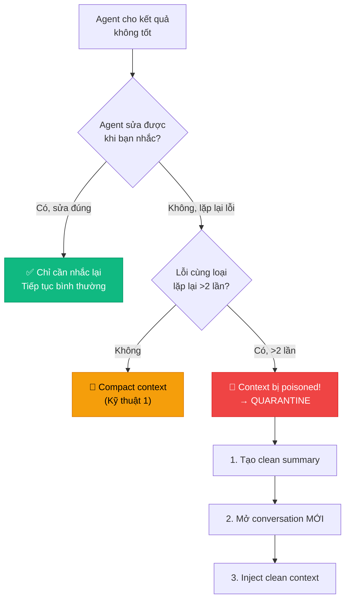
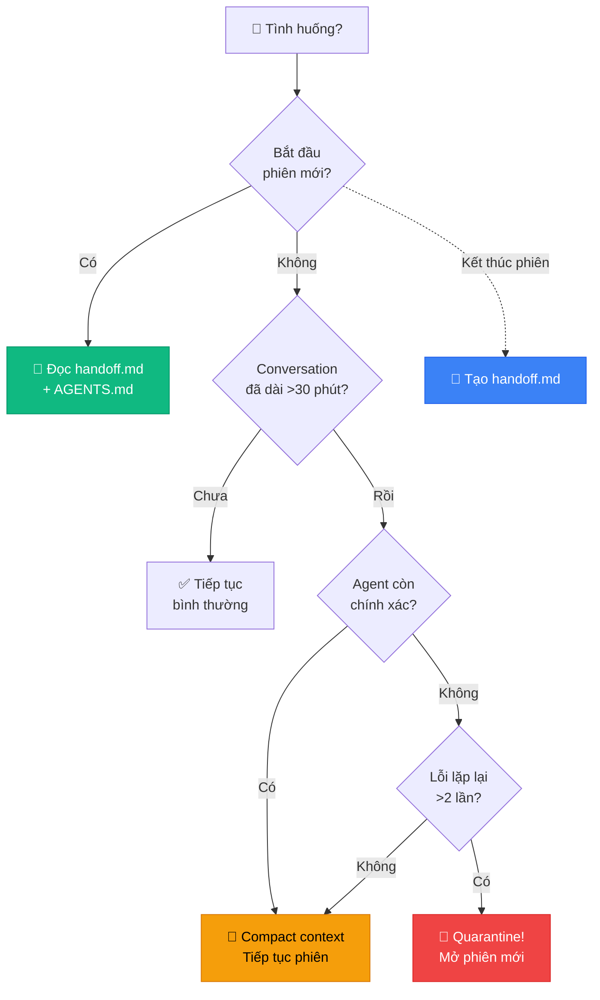

# 📘 Bài 3: Kỹ thuật Summarize Context – Giữ Agent "tỉnh táo" trong phiên dài

> **Section:** Context Engineering – Giúp AI Agent "Nhớ" & Tối Ưu Token  
> **Thời lượng:** 40-50 phút  
> **Yêu cầu:** Đã học Bài 2 – Project Context Documents

---

## 🎯 Mục tiêu bài học

Sau bài này, bạn sẽ:

- ✅ Biết **4 kỹ thuật** để giữ Agent hiệu quả trong phiên làm việc dài
- ✅ Tạo được **Handoff Document** để bàn giao context giữa các phiên
- ✅ Nhận biết dấu hiệu **Context Rot** và biết cách xử lý
- ✅ Có **prompt mẫu** copy-paste cho từng kỹ thuật

---

## 1. Vấn đề: Conversation dài → Agent "mệt mỏi"

### 1.1 Diễn biến một phiên Vibe Coding dài



### 1.2 Tại sao điều này xảy ra?

Khi conversation dài, **context window dần bị lấp đầy**:

```
Bắt đầu phiên:
┌──────────────────────────────────────────┐
│ 📜 System (500 tk) │ 💬 Chat (200 tk)   │
│                                          │
│        🟢 CÒN RỘNG - Agent nhớ hết      │
│                                          │
└──────────────────────────────────────────┘

Sau 1 giờ:
┌──────────────────────────────────────────┐
│ 📜 System │ 💬 50 messages │ 📂 20 files │
│ 🔧 Tool outputs │ 📝 Responses          │
│                                          │
│    🔴 GẦN ĐẦY - Agent bắt đầu quên     │
│                                          │
└──────────────────────────────────────────┘
```

**3 hệ quả:**
1. **Quên decision cũ:** Lúc đầu quyết định dùng `useState`, sau lại tạo Redux store
2. **Lặp lại code:** Viết hàm `formatDate()` ở file mới dù đã có sẵn
3. **Hallucinate:** Tham chiếu đến file/function không tồn tại

> 💡 **Giải pháp:** Không phải "cố gắng hơn" — mà là **quản lý context thông minh hơn** bằng 4 kỹ thuật dưới đây.

---

## 2. Kỹ thuật 1: Context Compaction – "Nén" lại conversation

### 2.1 Ý tưởng

Giống như bạn **tóm tắt buổi họp** thành meeting notes, thay vì giữ nguyên bản ghi âm 2 tiếng.



### 2.2 Khi nào cần Compact?

| Dấu hiệu | Hành động |
|----------|----------|
| Conversation đã dài hơn 30 phút | Nên compact |
| Agent bắt đầu quên chi tiết trước đó | Compact ngay |
| Sắp chuyển sang feature khác | Compact trước khi chuyển |
| Agent respond chậm hơn bình thường | Context window gần đầy, compact ngay |

### 2.3 Prompt mẫu: Compact Context

**Cách 1: Compact toàn bộ phiên**

```
Hãy tóm tắt toàn bộ phiên làm việc hiện tại theo format sau:

## Những gì đã hoàn thành
- (liệt kê tasks đã xong)

## Decisions đã đưa ra
- (liệt kê các quyết định quan trọng về architecture, tech, approach)

## Trạng thái hiện tại
- Đang làm dở: (task nào)
- File đã thay đổi: (danh sách file)

## Vấn đề còn tồn tại
- (bugs, blockers, TODO)
```

**Kết quả mẫu Agent trả về:**

```markdown
## Những gì đã hoàn thành
- Tạo QuizCard component với 4 đáp án
- Tạo mock data 20 câu hỏi grammar
- Implement logic chọn đáp án đúng/sai

## Decisions đã đưa ra  
- Dùng useState cho quiz state (không Redux vì scope nhỏ)
- Timer dùng useEffect + setInterval
- Score lưu trong component state, không persist

## Trạng thái hiện tại
- Đang làm dở: Timer countdown component
- File đã thay đổi: QuizCard.tsx, grammar-questions.ts, GrammarPage.tsx

## Vấn đề còn tồn tại
- Timer chưa dừng khi chọn đáp án
- Chưa có UI cho kết quả cuối quiz
```

**Cách 2: Compact và tiếp tục trong phiên mới**

```
Dựa trên summary sau đây, hãy tiếp tục công việc:

[Paste summary ở trên vào đây]

Đọc AGENTS.md trước, sau đó tiếp tục task đang dở: Timer countdown component.
```

→ Agent sẽ hiểu ngay context chỉ với **~1,000 tokens** thay vì phải đọc lại toàn bộ 25,000 tokens.

---

## 3. Kỹ thuật 2: Handoff Document – Bàn giao giữa các phiên

### 3.1 Ý tưởng

**Handoff Document** giống như **biên bản bàn giao ca trực** ở bệnh viện: bác sĩ ca trước ghi lại tình trạng bệnh nhân để bác sĩ ca sau tiếp tục chăm sóc mà không bỏ sót.



### 3.2 Khác gì Context Compaction?

| | Context Compaction | Handoff Document |
|---|---|---|
| **Khi nào dùng** | Giữa phiên, khi cần "nén" lại | Cuối phiên, trước khi đóng |
| **Mục đích** | Giảm tokens trong phiên hiện tại | Bàn giao context cho phiên sau |
| **Lưu ở đâu** | Paste trong conversation | Lưu thành file `.md` trong dự án |
| **Ai đọc** | Agent trong phiên hiện tại | Agent trong phiên mới |

### 3.3 Prompt mẫu: Tạo Handoff Document

**Cuối mỗi phiên, chạy prompt này:**

```
Trước khi kết thúc, hãy tạo file handoff.md với nội dung sau:

# Handoff – [Ngày hôm nay]

## Session Summary
(Tóm tắt 2-3 câu về phiên làm việc)

## Completed Tasks
- (Liệt kê tasks đã hoàn thành)

## Work in Progress  
- (Task đang dở + trạng thái cụ thể)
- (File nào đã sửa, đang sửa)

## Key Decisions
- (Các quyết định architecture/tech quan trọng + lý do)

## Blockers & Issues
- (Bugs phát hiện, vấn đề chưa giải quyết)

## Next Steps (Prioritized)
1. (Việc cần làm tiếp theo - quan trọng nhất)
2. (Việc tiếp theo)
3. (Việc tiếp theo)

## Files Changed
- (Danh sách file đã thay đổi trong phiên này)
```

### 3.4 Prompt mẫu: Đọc Handoff để tiếp tục

**Đầu phiên mới:**

```
Đọc file AGENTS.md và handoff.md.
Tiếp tục phát triển dự án từ nơi phiên trước dừng lại.
Bắt đầu với task ưu tiên cao nhất trong "Next Steps".
```

### 3.5 Workflow hoàn chỉnh với Handoff



> 💡 **Mẹo:** Lưu handoff files theo ngày trong thư mục `.handoff/` để có lịch sử:
> ```
> .handoff/
> ├── 2026-04-25.md
> ├── 2026-04-26.md
> └── 2026-04-27.md   ← Mới nhất
> ```

---

## 4. Kỹ thuật 3: Sliding Window – Cửa sổ trượt

### 4.1 Ý tưởng

Thay vì giữ **toàn bộ** lịch sử conversation (rất tốn token), chỉ giữ:
- **N tin nhắn gần nhất** (chi tiết đầy đủ)
- **Summary** của các tin nhắn cũ hơn



### 4.2 Cách áp dụng trong thực tế

Antigravity tự động quản lý conversation history, nhưng bạn có thể **chủ động** áp dụng Sliding Window:

**Khi conversation dài hơn 20-30 tin nhắn:**

```
Hãy tóm tắt toàn bộ conversation từ đầu đến giờ thành 1 đoạn summary ngắn gọn.
Chỉ giữ lại: decisions quan trọng, files đã thay đổi, trạng thái hiện tại.
Bỏ qua: các bước trung gian, code đã fix xong, discussions không còn relevant.
Sau đó tiếp tục task hiện tại.
```

### 4.3 Nguyên tắc: Giữ gì, bỏ gì?

| ✅ Giữ lại | ❌ Bỏ đi |
|-----------|---------|
| Decisions quan trọng (tech choices) | Các bước debug trung gian |
| Trạng thái hiện tại | Code cũ đã bị thay thế |
| Files đã thay đổi | Tool outputs dài (scan results) |
| Bugs/issues chưa fix | Conversations thăm dò không dẫn đến kết quả |
| Convention đã thống nhất | Giải thích lý thuyết đã hiểu |

---

## 5. Kỹ thuật 4: Context Quarantine – "Cách ly" context bị nhiễm

### 5.1 Context Poisoning là gì?

**Context Poisoning** xảy ra khi thông tin **sai hoặc lỗi thời** trong conversation khiến Agent bị "nhiễm" — liên tục sinh code sai theo thông tin sai đó.



### 5.2 Dấu hiệu nhận biết Context Poisoning

| 🚩 Dấu hiệu | Ví dụ |
|-------------|-------|
| Agent lặp lại cùng một lỗi dù đã sửa | Fix xong bug A, làm feature mới lại mắc bug A |
| Agent tham chiếu file/function không tồn tại | "Tôi sẽ import từ `utils/helpers.ts`" (file này không có) |
| Agent trộn lẫn 2 approaches | Lúc dùng Tailwind, lúc dùng CSS Modules trong cùng component |
| Agent "quên" quyết định gần đây | Bạn vừa nói "dùng useState", Agent tạo Redux store |
| Agent sinh code ngày càng kém | Quality giảm dần theo thời gian conversation |

### 5.3 Cách xử lý: Context Quarantine

**Bước 1: Dừng lại** — Đừng cố sửa trong conversation hiện tại.

**Bước 2: Tạo summary sạch** — Compact chỉ giữ thông tin ĐÚNG:

```
Tóm tắt lại phiên làm việc, CHỈ BAO GỒM:
- Những gì đã HOÀN THÀNH ĐÚNG
- Decisions CUỐI CÙNG (không phải decisions đã bị thay đổi)
- Trạng thái THỰC TẾ hiện tại của code

KHÔNG bao gồm:
- Các approaches đã bị reject
- Code sai đã bị xoá/sửa
- Discussions không dẫn đến kết quả
```

**Bước 3: Mở conversation MỚI** với clean context:

```
Đọc file AGENTS.md.

Context từ phiên trước:
[Paste summary sạch ở đây]

Tiếp tục với task: [task cụ thể]
```

### 5.4 Khi nào nên Quarantine vs Compact?



---

## 6. Tổng hợp: Chọn kỹ thuật nào, khi nào?

### Decision Tree



### Bảng tóm tắt 4 kỹ thuật

| Kỹ thuật | Khi nào dùng | Prompt mẫu | Token tiết kiệm |
|----------|-------------|-----------|-----------------|
| **Compaction** | Phiên dài >30 phút | "Tóm tắt phiên làm việc..." | ~50% |
| **Handoff** | Cuối phiên / đầu phiên mới | "Tạo handoff.md..." | ~60% |
| **Sliding Window** | Conversation >20 messages | "Tóm tắt msgs cũ, giữ msgs mới..." | ~70% |
| **Quarantine** | Agent lặp lỗi, hallucinate | Mở conversation mới + clean context | ~90% |

---

## 7. Thực hành: Workflow phiên Vibe Coding tối ưu

### Checklist cho mỗi phiên

**🌅 Bắt đầu phiên:**
- [ ] Đọc `handoff.md` (nếu có) hoặc `PLAN.md`
- [ ] Prompt: "Đọc AGENTS.md và handoff.md, tiếp tục..."

**🔨 Trong phiên:**
- [ ] Mỗi 30 phút: Đánh giá Agent có còn chính xác không
- [ ] Nếu context dài: Compact lại
- [ ] Nếu Agent lỗi lặp: Quarantine ngay

**🌙 Kết thúc phiên:**
- [ ] Tạo `handoff.md` mới
- [ ] Cập nhật `PLAN.md` (đánh dấu tasks done)
- [ ] Cập nhật `AGENTS.md` nếu có convention mới

### Ví dụ 1 ngày Vibe Coding tối ưu

```
09:00 - Bắt đầu
  └─ Đọc handoff.md + AGENTS.md
  └─ Tiếp tục Timer component (từ phiên trước)

09:30 - Xong Timer, bắt đầu ScoreBoard
  └─ Agent vẫn tốt, tiếp tục

10:00 - Context bắt đầu dài
  └─ Compact context (Kỹ thuật 1)
  └─ Tiếp tục trong cùng phiên

10:30 - Xong ScoreBoard, chuyển sang ResultScreen
  └─ Agent vẫn ổn sau compact

11:00 - Agent bắt đầu quên convention
  └─ Compact lần 2

11:30 - Agent lặp lỗi (dùng inline style thay vì Tailwind)
  └─ 🔴 QUARANTINE! Mở conversation mới
  └─ Inject clean context + handoff

12:00 - Kết thúc buổi sáng
  └─ Tạo handoff.md
  └─ Cập nhật PLAN.md
```

---

## 📝 Tóm tắt bài học

| Kỹ thuật | Ý tưởng cốt lõi | Khi nào dùng |
|----------|-----------------|-------------|
| **Compaction** | "Nén" conversation thành summary ngắn | Phiên dài >30 phút |
| **Handoff** | Bàn giao context giữa các phiên | Cuối phiên → đầu phiên mới |
| **Sliding Window** | Giữ msgs mới + summary msgs cũ | Conversation >20 messages |
| **Quarantine** | Mở phiên mới khi context bị "nhiễm" | Agent lặp lỗi >2 lần |

**Nguyên tắc chung:** Đừng đợi Agent "quên" rồi mới xử lý. **Chủ động** compact và handoff **trước** khi vấn đề xảy ra.

---

## ⏭️ Bài tiếp theo

**Bài 4: Just-in-Time Context – Chỉ cho Agent biết điều cần biết** — Bạn sẽ học cách giảm 80% token bằng Targeted File References, Layered Context, và Smart Prompting.

---

*📚 Context Engineering · Google Antigravity: Xây dựng AI Agent, AI App & Vibe Coding*
