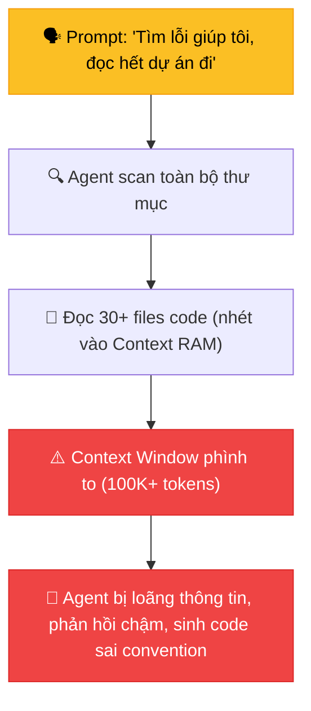
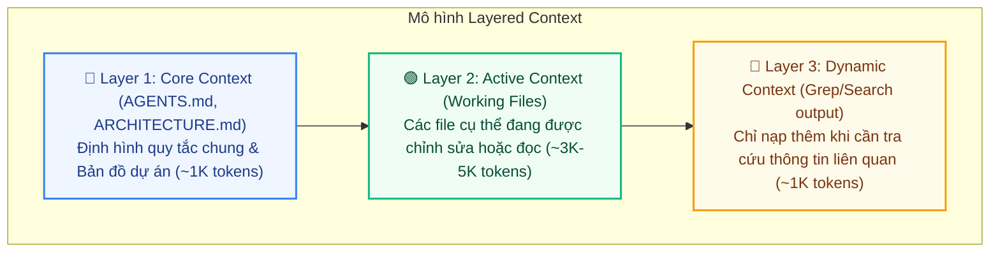
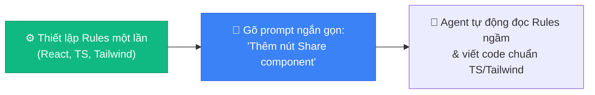

# 📘 Bài 4: Just-in-Time Context – Chỉ cho Agent biết điều cần biết

> **Section:** Context Engineering – Giúp AI Agent "Nhớ" & Tối Ưu Token  
> **Thời lượng:** 35-45 phút  
> **Yêu cầu:** Đã học Bài 3 – Kỹ thuật Summarize Context

---

## 🎯 Mục tiêu bài học

Sau bài này, bạn sẽ:

- ✅ Hiểu rõ tác hại của **Context Inflation** (Bùng nổ context) gây nhiễu Agent.
- ✅ Làm chủ nguyên tắc **"Minimal Viable Context" (MVC)** để tối ưu hóa token.
- ✅ Thành thạo kỹ thuật **Targeted File References** và chỉ định dòng code chính xác.
- ✅ Thiết kế mô hình **Layered Context** (Context phân tầng) 3 lớp cho mọi task.
- ✅ Biết cách viết **Smart Prompts** và tận dụng **Rules/Instructions** để tiết kiệm 50% - 80% token.
- ✅ Tự tin thực hành kiểm soát token cost mà không ảnh hưởng tới chất lượng code.

---

## 1. Vấn đề: "Context Inflation" – Khi cái gì cũng nhét vào context

### 1.1 Bạn đã từng gieo "nhiễu" cho Agent chưa?

Khi làm việc với các Agent AI tiên tiến như Antigravity, chúng ta thường có xu hướng cực đoan: **Sợ Agent thiếu hiểu biết nên nạp tất cả mọi thứ vào prompt**.

```
🗣️ Ví dụ prompt tệ:
"Tôi đang phát triển dự án này. Hãy đọc toàn bộ code của dự án và tìm giúp tôi tại sao khi bấm vào nút 'Luyện tập' ở trang chủ nó không chuyển hướng sang trang Quiz. Tôi không nhớ file đó ở đâu, bạn tự tìm nhé."
```

Khi nhận yêu cầu này, Agent sẽ phải dùng công cụ scan toàn bộ thư mục, đọc hàng chục file code từ components, hooks cho đến configs.



### 1.2 Ba hậu quả nghiêm trọng của Context Inflation

1. **Token bùng nổ (Tốn chi phí):** Mỗi tin nhắn bạn gửi đi kèm theo toàn bộ lịch sử và các file đã đọc trước đó. Nếu context nặng 80,000 tokens, chỉ cần chat qua lại 5 lượt, bạn đã tiêu tốn **400,000 tokens**!
2. **Suy giảm chất lượng (Hallucination & Loãng):** LLM càng phải đọc nhiều thông tin không liên quan thì khả năng bỏ sót chi tiết quan trọng (Lost in the Middle) càng cao. Agent dễ sinh code sai logic, import nhầm file hoặc dùng nhầm biến.
3. **Phản hồi chậm chạp:** Thời gian xử lý (Reasoning & Generation) của model tỷ lệ thuận với lượng token đầu vào. Context quá lớn khiến bạn phải chờ đợi lâu cho mỗi response.

---

## 2. Nguyên tắc vàng: "Minimal Viable Context" (MVC)

### 2.1 Định nghĩa MVC

> **Minimal Viable Context (Context tối thiểu khả dụng)** là nguyên tắc: **Chỉ cung cấp đúng và đủ thông tin cần thiết nhất để Agent hoàn thành nhiệm vụ hiện tại.**

Thay vì mang cả thư viện tài liệu đi thi, bạn chỉ mang đúng trang giấy chứa công thức cần dùng.

```
┌─────────────────────────────────────────────────────────┐
│                    CONTEXT WINDOW                       │
│                                                         │
│  ❌ Context Inflation:                                   │
│  [ AGENTS.md ] [ Code A ] [ Code B ] [ Code C ] [ Code D ] [ Code E ] [ Code F ] │
│  👉 Tốn 80,000 tokens - Agent bị rối thông tin.         │
│                                                         │
│  ✅ Minimal Viable Context (MVC):                       │
│  [ AGENTS.md ] [ File cần sửa: Code A ] [ File liên quan: Code B ]             │
│  👉 Chỉ 5,000 tokens - Agent tập trung, code cực chuẩn.  │
└─────────────────────────────────────────────────────────┘
```

### 2.2 So sánh hiệu quả tư duy

| Tiêu chí            | ❌ Context Inflation (Cũ)            | ✅ Minimal Viable Context (Mới)         |
| ------------------- | ------------------------------------ | --------------------------------------- |
| **Lượng thông tin** | Toàn bộ source code + toàn bộ assets | Chỉ những file trực tiếp chịu ảnh hưởng |
| **Cách chọn file**  | Để Agent tự quét hoặc dump bừa       | Chọn lọc thủ công qua relative path     |
| **Token tiêu thụ**  | Cực kỳ nhiều (~50K - 100K tokens)    | Rất ít (~3K - 8K tokens)                |
| **Độ chính xác**    | Trung bình (Dễ lẫn lộn files)        | Rất cao (Tập trung tối đa)              |
| **Tốc độ phản hồi** | Chậm (Chờ xử lý context lớn)         | Nhanh chóng (Gần như tức thì)           |

---

## 3. Kỹ thuật 1: Targeted File References – Tham chiếu đích danh

Đây là kỹ thuật cơ bản nhất nhưng lại đem lại hiệu quả tiết kiệm token lớn nhất.

### 3.1 Sử dụng đường dẫn file chính xác

Thay vì để Agent tự đoán file nào cần sửa, hãy **chỉ rõ đường dẫn tuyệt đối hoặc tương đối** của file đó trong prompt. Trong các IDE tích hợp AI như Antigravity, bạn có thể dùng ký tự `@` để tạo liên kết trực tiếp tới file.

- **Prompt kiểu cũ:** _"Sửa lỗi nút Timer không đếm ngược"_
- **Prompt kiểu JIT:** _"Sửa lỗi Timer không đếm ngược trong file `src/components/Timer.tsx`"_

### 3.2 Chỉ định dòng code cụ thể (Line Range)

Khi file code quá dài (ví dụ file utils chứa 1000 dòng code), việc bắt Agent đọc cả file là lãng phí. Hãy chỉ định khoảng dòng chứa đoạn code lỗi.

```
🗣️ Prompt mẫu:
"Tôi cần sửa logic tính điểm Bonus. Hãy xem file src/utils/scoreHelper.ts từ dòng 120 đến 150 và sửa hàm calculateBonus:
- Thêm hệ số nhân x1.5 nếu user trả lời dưới 5 giây."
```

Bằng cách này, Agent chỉ nạp **30 dòng code** thay vì **1000 dòng code** vào RAM.

---

## 4. Kỹ thuật 2: Layered Context – Mô hình phân tầng thông tin

Để áp dụng MVC một cách hệ thống, chúng ta tổ chức context thành **3 tầng** rõ rệt:



### 4.1 Chi tiết 3 tầng context:

- **Layer 1: Core Context (Luôn mang theo)**
  - _Nội dung:_ [AGENTS.md](file:///Users/tanthanh/Documents/Project/antigravity-vibe-coding-course/docs/section-04-context-engineering/lesson-02-project-context-documents.md#L106-L189) và [ARCHITECTURE.md](file:///Users/tanthanh/Documents/Project/antigravity-vibe-coding-course/docs/section-04-context-engineering/lesson-02-project-context-documents.md#L191-L260).
  - _Mục đích:_ Giúp Agent hiểu quy tắc viết code (conventions) và kiến trúc tổng quan mà không cần scan code thực tế.
  - _Dung lượng:_ Cực kỳ nhẹ (~500 - 1000 tokens).

- **Layer 2: Active Context (Tải khi làm việc)**
  - _Nội dung:_ File bạn đang code chính + các file phụ thuộc trực tiếp (ví dụ: file Component và file CSS/Types liên quan).
  - _Mục đích:_ Cung cấp chi tiết triển khai cụ thể để Agent tiến hành sửa đổi.
  - _Dung lượng:_ Vừa phải (~2K - 5K tokens).

- **Layer 3: Dynamic Context (Tải khi cần tìm kiếm)**
  - _Nội dung:_ Kết quả từ lệnh `grep_search` hoặc danh sách file từ `list_dir`.
  - _Mục đích:_ Khi Agent cần tìm kiếm một hàm helper hoặc xem cấu trúc folder con để tạo file mới.
  - _Dung lượng:_ Tạm thời, biến mất khi hết task.

> [!IMPORTANT]
> **Quy tắc vàng:** Không bao giờ nạp Layer 3 trực tiếp dưới dạng file code đầy đủ vào context nếu chưa xác định chính xác file đó có cần sửa đổi hay không.

---

## 5. Kỹ thuật 3: Smart Prompting để tối ưu token

Cách bạn diễn đạt prompt ảnh hưởng rất lớn đến số lượng token mà Agent sinh ra ở phần phản hồi (Output tokens).

### 5.1 Chỉ định output ngắn gọn, có cấu trúc

Yêu cầu Agent tránh giải thích dông dài và chỉ trả về đoạn code thay đổi hoặc file diff.

```
🗣️ Prompt mẫu:
"Hãy sửa hàm formatCurrency trong src/utils/format.ts để handle thêm tiền tệ VND:
- Yêu cầu: Trả về phần code thay đổi dưới dạng diff hoặc chỉ viết lại hàm formatCurrency. Không viết lại toàn bộ file."
```

- **Không tối ưu:** Agent viết lại cả file 300 dòng → Tốn 2,500 output tokens.
- **Có tối ưu:** Agent chỉ viết đúng hàm 10 dòng → Chỉ tốn 150 output tokens.

### 5.2 Sử dụng Path Reference thay vì Copy-Paste thủ công

Đừng bao giờ copy nội dung code từ file rồi dán thẳng vào ô chat. Hãy dùng tính năng reference file của IDE. Khi bạn paste code thủ công, IDE không thể tối ưu hóa và đôi khi tạo ra các bản sao context trùng lặp.

---

## 6. Kỹ thuật 4: Tận dụng Rules/Instructions thay vì nhắc lại

### 6.1 Sự lãng phí khi nhắc lại convention

Nhiều developer có thói quen viết các dòng này trong mọi prompt:

- _"Hãy viết code bằng TypeScript"_
- _"Nhớ dùng Tailwind CSS nhé"_
- _"Đặt tên component theo kiểu PascalCase"_

Mỗi lần nhắc lại như vậy tốn khoảng 50 - 100 tokens. Qua 100 lượt chat, bạn mất **5,000 - 10,000 tokens** chỉ để nói những điều hiển nhiên.

### 6.2 Giải pháp: Dùng Rules hệ thống

Trong Antigravity, bạn có thể thiết lập **Rules** (tương tự file `.cursorrules` hoặc file cấu hình Agent). Hệ thống sẽ tự động gửi các quy tắc này kèm theo yêu cầu dưới dạng System Prompt ngầm.



Nhờ có Rules, prompt của bạn cực kỳ sạch sẽ và chỉ tập trung vào nghiệp vụ (business logic) của task đó.

---

## 7. Demo thực tế: So sánh Token Cost và chất lượng code

Hãy cùng so sánh hai cách tiếp cận khi thực hiện cùng một task: **"Thêm hiệu ứng hover và âm thanh khi click cho nút chọn đáp án ở QuizCard.tsx"**.

### 7.1 Trường hợp A: Không áp dụng JIT Context (Để Agent tự quét)

- **Prompt:** _"Tôi muốn thêm hiệu ứng hover và âm thanh khi click cho QuizCard. Bạn làm giúp tôi nhé."_
- **Hành động của Agent:**
  1. Quét toàn bộ thư mục `src/` để tìm file `QuizCard.tsx`.
  2. Đọc toàn bộ file `QuizCard.tsx` (800 dòng).
  3. Đọc thêm `App.tsx`, `index.css`, `soundHelper.ts` để chắc chắn.
  4. Trả về toàn bộ file `QuizCard.tsx` đã sửa kèm giải thích chi tiết.
- **Token tiêu thụ:**
  - Input: **45,000 tokens** (do đọc nhiều file thừa và scan thư mục).
  - Output: **6,000 tokens** (viết lại cả file dài).
  - **Tổng chi phí:** ~51,000 tokens.

### 7.2 Trường hợp B: Áp dụng JIT Context (Just-in-Time)

- **Prompt:**
  ```
  Đọc AGENTS.md.
  Hãy thêm hiệu ứng hover (dùng Tailwind) và âm thanh click (dùng hàm playClickSound từ @src/utils/audio.ts) vào nút chọn đáp án trong src/components/QuizCard.tsx (dòng 80-120).
  Chỉ trả về đoạn code thay đổi trong component, không viết lại toàn bộ file.
  ```
- **Hành động của Agent:**
  1. Đọc Layer 1: `AGENTS.md` (~400 tokens).
  2. Đọc đoạn code cụ thể trong `QuizCard.tsx` dòng 80-120 (~300 tokens).
  3. Viết code thay đổi (~200 tokens).
- **Token tiêu thụ:**
  - Input: **900 tokens**.
  - Output: **250 tokens**.
  - **Tổng chi phí:** **1,150 tokens**.

> [!TIP]
> **Kết quả:** Tiết kiệm **~97.7% tokens**! Đồng thời, Agent phản hồi gần như ngay lập tức và code sinh ra chính xác 100%, không bị lẫn lộn các import thừa.

---

## 8. Thực hành: Tối ưu hoá Workflow với JIT Context

### 8.1 Checklist 4 bước trước khi gõ prompt (Quy tắc JIT)

Trước khi gửi bất kỳ yêu cầu nào cho Agent, hãy nhẩm nhanh checklist sau:

- [ ] **1. Đích danh (Targeted):** Mình đã chỉ rõ file nào cần chỉnh sửa chưa? (Dùng `@` hoặc ghi rõ path).
- [ ] **2. Khoanh vùng (Scoping):** Có thể giới hạn dòng code (line range) để giảm tải không?
- [ ] **3. Tiết kiệm (Output control):** Đã yêu cầu Agent chỉ trả về phần code thay đổi (diff/partial) chưa?
- [ ] **4. Tận dụng Rules:** Những convention chung (Framework, Styling) đã được đưa vào `AGENTS.md`/Rules chưa? (Tránh viết lại trong prompt).

### 8.2 Bài tập thực hành

Hãy mở dự án English Practice Hub của bạn và thực hiện task sau theo chuẩn JIT Context:

1. **Yêu cầu:** Thêm một hàm helper `shuffleArray` vào file `src/utils/arrayUtils.ts` để trộn các câu hỏi trắc nghiệm.
2. **Nhiệm vụ của bạn:**
   - Hãy viết một câu prompt tối ưu nhất áp dụng các kỹ thuật JIT đã học.
   - Đo thử số lượng token tiêu tốn của session đó so với một session bình thường trước đây.

---

## 📝 Tóm tắt bài học

| Khái niệm                        | Ý nghĩa cốt lõi                               | Cách triển khai                                                    |
| -------------------------------- | --------------------------------------------- | ------------------------------------------------------------------ |
| **Minimal Viable Context (MVC)** | Chỉ cung cấp thông tin tối thiểu cần thiết.   | Loại bỏ file thừa, tập trung vào file chính.                       |
| **Targeted References**          | Chỉ định chính xác file và khoảng dòng code.  | Dùng `@filename` và chỉ rõ `dòng X-Y`.                             |
| **Layered Context**              | Phân tầng thông tin thành 3 lớp.              | Layer 1 (Core Docs) -> Layer 2 (Active Files) -> Layer 3 (Search). |
| **Smart Prompting**              | Tối ưu hóa prompt đầu vào và cấu trúc đầu ra. | Yêu cầu trả về code diff/đoạn code ngắn gọn.                       |
| **System Rules**                 | Tránh lặp lại các convention chung.           | Đưa convention vào Rules hệ thống/AGENTS.md.                       |

**Chìa khóa thành công:** Hãy làm việc với Agent giống như cách bạn giao việc cho một lập trình viên chuyên nghiệp: **Rõ ràng, trực diện, không lan man.**

---

## ⏭️ Bài tiếp theo

[**Bài 5: Knowledge Items & Memory – Bộ nhớ dài hạn trong Antigravity**](lesson-05-knowledge-items-memory.md) — Bạn sẽ học cách sử dụng Knowledge Items (KI) để lưu trữ các kiến thức cốt lõi bền vững xuyên suốt các cuộc hội thoại, giúp Agent không bao giờ quên kiến trúc dự án của bạn.

---

_📚 Context Engineering · Google Antigravity: Xây dựng AI Agent, AI App & Vibe Coding_
