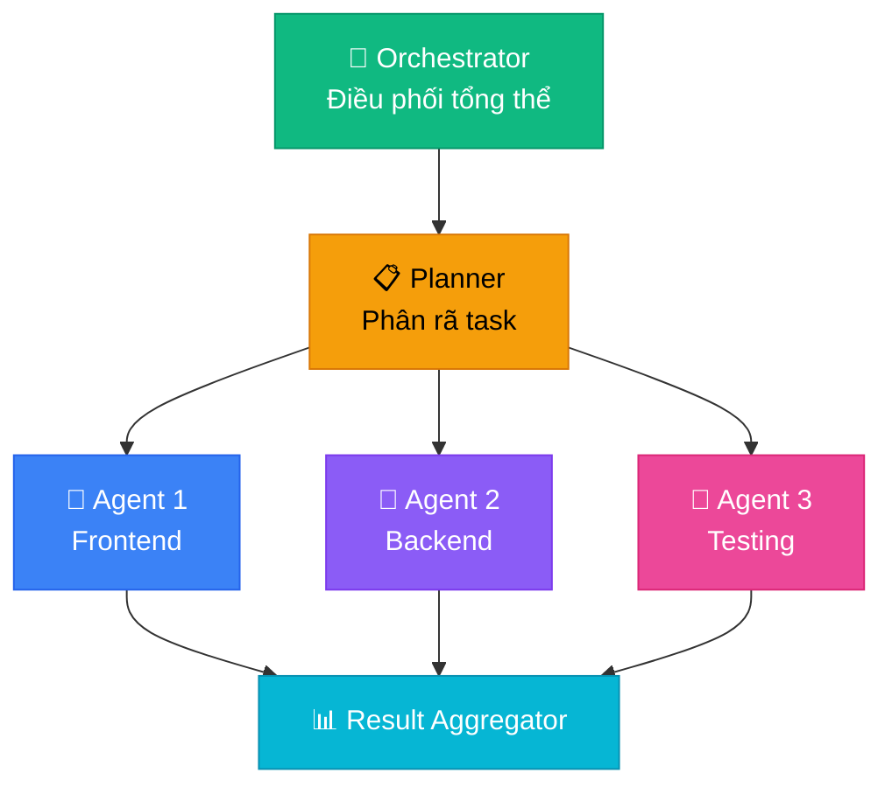

# 🤖 Section 5 · Multi-Agent Systems & Orchestration

  
  
  
  

> **Thiết kế hệ thống nhiều Agent phối hợp giải quyết bài toán phức tạp**

---

## 🎯 Mục tiêu Section

Sau section này, bạn sẽ:

- ✅ Hiểu cách nhiều **AI Agents phối hợp** để giải quyết bài toán phức tạp
- ✅ Biết cách thiết kế **Orchestrator** để điều phối agents
- ✅ Nắm được cách **Planner** phân rã task và xác định dependency
- ✅ Hiểu **Parallel Agent Execution** — chạy nhiều agents song song

---

## 📚 Lectures

| # | Lecture | Mô tả | Thời lượng |
|---|---------|--------|------------|
| 5.1 | **Multi-Agent System là gì?** | Hiểu cách nhiều AI agents phối hợp với nhau. | ~30 phút |
| 5.2 | **Thiết kế Orchestrator** | Xây dựng Orchestrator điều phối agents, quản lý workflow và tổng hợp kết quả. | ~45 phút |
| 5.3 | **Thiết kế Planner** | Phân tích yêu cầu, chia nhỏ thành tasks, xác định dependency, phân công agent. | ~45 phút |
| 5.4 | **Parallel Agent Execution** | Agent Manager — chạy nhiều agents song song. | ~30 phút |

---

## 🔑 Key Concepts

---

## 📋 Prerequisites

- ✅ Hoàn thành **Section 1-4** — Đặc biệt Context Engineering

---

[← Section 4](../section-04-context-engineering/README.md) · [🏠 Home](../../README.md) · [📑 Mục lục](../SUMMARY.md) · [Section 6 →](../section-06-mcp/README.md)

