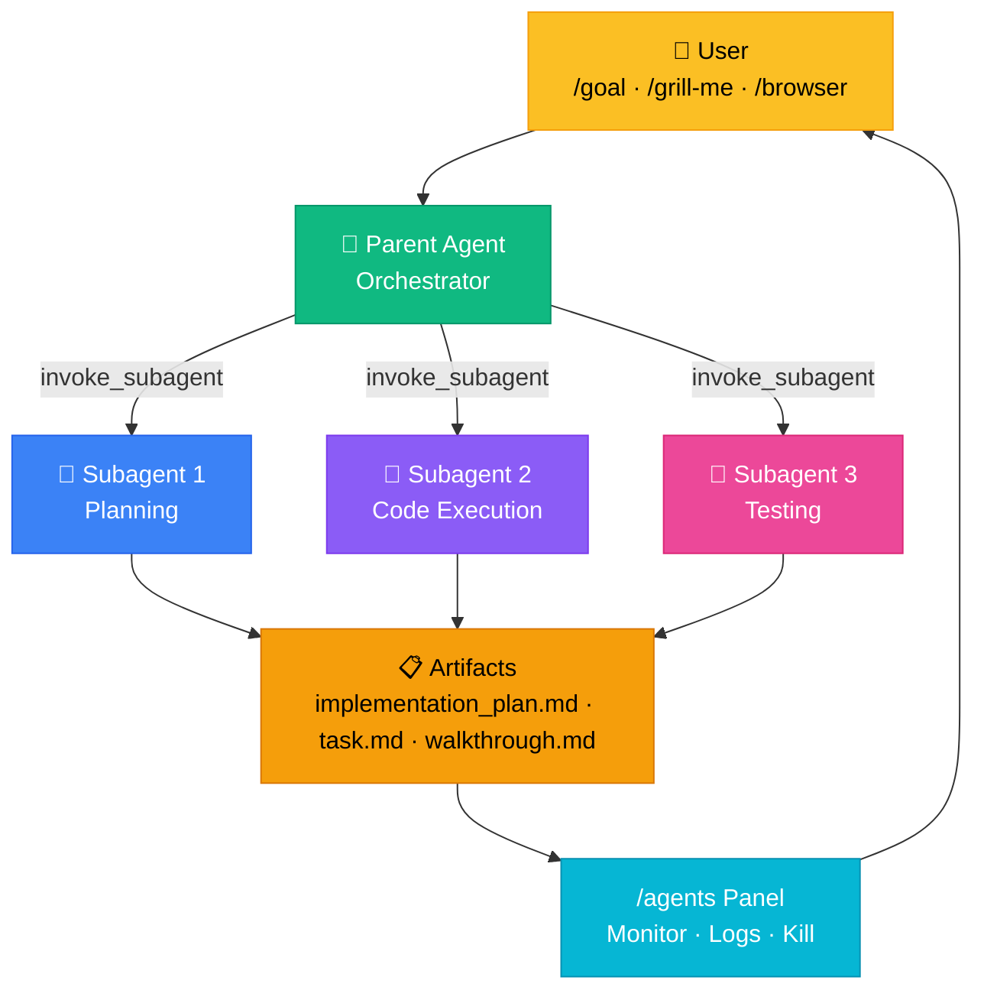

# 🤖 Section 5 · Multi-Agent Systems & Orchestration

  
  
  
  

> **Thiết kế hệ thống nhiều Agent phối hợp giải quyết bài toán phức tạp — Tận dụng sức mạnh Multi-Agent của Antigravity 2.0**

---

## 🎯 Mục tiêu Section

Sau section này, bạn sẽ:

- ✅ Hiểu cách nhiều **AI Agents phối hợp** để giải quyết bài toán phức tạp
- ✅ Nắm kiến trúc **Subagents** trong Antigravity 2.0 — `invoke_subagent` spawn Agent con
- ✅ Hiểu **Artifacts System** — Agent giao tiếp kết quả qua plan.md, task.md, walkthrough.md
- ✅ Sử dụng **`/goal`**, **`/grill-me`**, **`/browser`** và **`/schedule`** để orchestrate agents thực chiến
- ✅ Thực hành **build feature phức tạp** với Multi-Agent workflow

---

## 🧩 Vấn đề thực tế mà Section này giải quyết

| Vấn đề | Biểu hiện | Giải pháp |
|--------|----------|-----------|
| Task quá phức tạp cho 1 Agent | Context window đầy, Agent quên bước trước | Chia thành Subagents — mỗi agent xử lý 1 phần |
| Agent không có plan rõ ràng | Code lung tung, không theo kiến trúc | Planning Mode → Implementation Plan → Approve |
| Quên chạy test hoặc lặp lại thủ công | Dễ sinh bug mới khi thay đổi code liên tục | Thiết lập lịch tự động với `/schedule` |
| Không track được Agent đang làm gì | Mất kiểm soát, khó review | Artifacts System — plan.md, task.md, walkthrough.md |

---

## 📚 Lectures

| # | Lecture | Loại | Mô tả | Thời lượng |
|---|---------|------|--------|------------|
| 5.1 | **[Antigravity 2.0 — Triết lý Agent-First](lesson-01-agent-first.md)** | 📖 Theory | Triết lý Agent-first và sự dịch chuyển từ Chat sang Agent. | ~15 phút |
| 5.2 | **[Antigravity 2.0 — Giao diện & Thành phần](lesson-02-interface-and-components.md)** | 📖 Theory | Hướng dẫn sử dụng giao diện Antigravity 2.0, các khu vực chức năng chính. | ~20 phút |
| 5.3 | **[Multi-Agent System là gì?](lesson-03-what-is-multi-agent.md)** | 📖 Theory | Từ Single Agent → Multi-Agent. Các patterns phổ biến. | ~30 phút |
| 5.4 | **[Trái tim của hệ thống: Subagents Spawning](lesson-04-subagents-spawning.md)** | 📖 Theory | `invoke_subagent`, Context Isolation, Local vs Worktree Mode. | ~35 phút |
| 5.5 | **[Demo: Subagents — Quy Trình Phối Hợp](lesson-05-demo-subagents.md)** | 🎬 Demo | Spawn subagent, review artifacts, approve plan, `/agents` panel. | ~40 phút |
| 5.6 | **[Demo — Slash Commands: /goal, /grill-me, /browser](lesson-06-demo-slash-commands.md)** | 🎬 Demo | `/goal` autonomous, `/grill-me` align, `/browser` test. | ~45 phút |

---

## 🔑 Key Concepts

---

## 🚀 Antigravity 2.0 Features trong Section này

| Feature | Mô tả | Lesson |
|---------|--------|--------|
| **`invoke_subagent`** | Parent agent spawn child agents, context isolation, nesting 10 levels | 5.4, 5.5 |
| **Local vs Worktree Mode** | Local Mode: làm việc trực tiếp trên folder. Worktree Mode: isolated Git worktree | 5.4 |
| **Artifacts System** | `implementation_plan.md`, `task.md`, `walkthrough.md` — Google Docs-style comments | 5.5 |
| **`/goal`** | Chạy autonomous đến khi xong, không hỏi intermediate input | 5.6 |
| **`/grill-me`** | Hỏi clarifying questions để align trước khi implement | 5.6 |
| **`/browser`** | Agent sử dụng browser primitives để test & verify (cần Chrome) | 5.6 |
| **`/schedule`** | One-time timer hoặc recurring cron schedule | 5.6 |
| **`/agents` panel** | Monitor subagents — xem logs, tool calls, kill agents | 5.2, 5.4, 5.5 |

---

## 📋 Prerequisites

- ✅ Hoàn thành **Section 1-4** — Đặc biệt Context Engineering
- ✅ Cài đặt **Antigravity 2.0** (standalone app hoặc IDE extension)

---

## 📖 Tài liệu bổ sung

- [Curriculum chi tiết](curriculum.md)

---

[← Section 4](../section-04-context-engineering/README.md) · [🏠 Home](../../README.md) · [📑 Mục lục](../SUMMARY.md) · [Section 6 →](../section-06-mcp/README.md)

