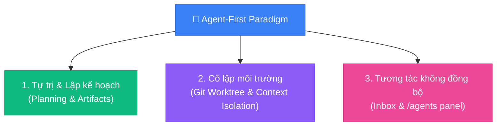

# 📘 Bài 1: Antigravity 2.0 — Triết Lý Agent-First

> **Section:** Multi-Agent Systems & Orchestration — Hệ thống nhiều Agent phối hợp  
> **Thời lượng:** 15-20 phút  
> **Yêu cầu:** Đã hoàn thành Section 1-4

---

## 🎯 Mục tiêu bài học

Sau bài này, bạn sẽ:

- ✅ Hiểu rõ sự dịch chuyển từ tư duy **Chat-first** (Hỏi-Đáp) sang **Agent-first** (Tự trị).
- ✅ Nắm được cấu trúc hoạt động cốt lõi của một hệ thống **Agent-first** trong Antigravity 2.0.
- ✅ Biết cách chuẩn bị và thay đổi mindset khi làm việc với AI ở cấp độ hệ thống thay vì chat đơn thuần.

---

## 1. Sự dịch chuyển: Chat-First vs Agent-First

Trong kỷ nguyên đầu của lập trình hỗ trợ bởi AI, hầu hết các công cụ (như ChatGPT, GitHub Copilot) hoạt động theo mô hình **Chat-first**:

*   **Chat-first (Hỏi - Đáp liên tục):**
    *   Bạn đưa ra yêu cầu (prompt).
    *   AI sinh ra code hoặc hướng dẫn.
    *   Bạn copy-paste hoặc nhấn apply để áp dụng vào file hiện tại.
    *   Mọi hành động xảy ra tuần tự, bạn luôn phải túc trực trước màn hình để copy/dán hoặc approve từng dòng sửa đổi.
    *   Nếu gặp lỗi biên dịch, bạn phải copy log lỗi ném ngược lại vào khung chat để AI sửa tiếp.

Antigravity 2.0 giới thiệu một triết lý hoàn toàn mới: **Agent-first**:

*   **Agent-first (Ủy quyền & Tự trị):**
    *   Bạn giao cho AI một **Mục tiêu lớn** (Goal) thay vì chỉ một câu lệnh sửa code nhỏ.
    *   AI tự động kích hoạt chế độ **Planning Mode**, phân tích dự án, viết ra kế hoạch thực thi (`implementation_plan.md`) và danh sách các đầu việc (`task.md`).
    *   AI tự động thực thi các công việc trong môi trường isolated (như Git Worktree), tự động chạy test, phát hiện lỗi build và tự sửa lỗi (Self-Healing) mà không cần sự can thiệp của bạn.
    *   Bạn chỉ đóng vai trò là người giám sát (Supervisor), duyệt kế hoạch ở đầu quy trình và nghiệm thu kết quả (`walkthrough.md`) ở cuối quy trình.

---

## 2. Các cột trụ của Triết lý Agent-First trong Antigravity 2.0

Để hiện thực hóa triết lý này, Antigravity 2.0 xây dựng 3 cột trụ kỹ thuật chính:

### 2.1 Tự trị và Lập kế hoạch thông qua Artifacts
Thay vì lưu trữ tiến độ trong lịch sử chat dài dặc và dễ trôi tin nhắn, Agent-first sử dụng **Artifacts** để ghi lại trạng thái:
*   `implementation_plan.md`: Bản thiết kế kiến trúc trước khi viết code.
*   `task.md`: Bảng Kanban theo dõi tiến độ công việc real-time.
*   `walkthrough.md`: Báo cáo nghiệm thu kết quả, kèm hình ảnh/video trực quan.

### 2.2 Cô lập hoàn toàn (Isolation)
Agent không làm việc trực tiếp trên workspace đang mở của bạn trừ khi được yêu cầu. Nó hoạt động trong một **Worktree độc lập** với Context Window sạch sẽ. Điều này giúp ngăn chặn hoàn toàn việc ghi đè code bậy bạ lên file bạn đang code dở và giảm chi phí token xuống mức tối đa.

### 2.3 Giao tiếp không đồng bộ (Asynchronous)
Bạn không cần ngồi nhìn Agent viết từng dòng code. Bạn có thể giao task, đóng IDE hoặc chuyển sang làm việc khác. Khi Agent hoàn thành hoặc cần quyền đặc biệt (như duyệt API key, approve merge), nó sẽ gửi thông báo vào **Inbox** trong `/agents` panel để bạn xử lý sau.

---

## 📝 Tóm tắt bài học

| Khía cạnh | Chat-first | Agent-first (Antigravity 2.0) |
|---|---|---|
| **Vai trò của bạn** | Lập trình viên trực tiếp chỉ đạo | Quản lý dự án & Người duyệt (Supervisor) |
| **Cách giao việc** | Prompt chi tiết cho từng dòng code | Đưa ra mục tiêu tổng thể (Goal) |
| **Tiến trình** | Đồng bộ (Synchronous) - Bạn phải đợi AI phản hồi | Không đồng bộ (Asynchronous) - Chạy ngầm |
| **Kiểm soát lỗi** | Bạn tự copy log lỗi và hỏi lại AI | Agent tự debug, tự chạy tests (Self-healing) |

---

## ⏭️ Bài tiếp theo

**[Bài 2: Antigravity 2.0: Làm quen giao diện & các thành phần chính](lesson-02-interface-and-components.md)** — Chúng ta sẽ đi sâu vào giao diện mới của Antigravity 2.0 để xem các khu vực Inbox, `/agents` panel điều hướng và cách khởi chạy Agent-first trên thực tế.

---

*📚 Multi-Agent Systems & Orchestration · Google Antigravity: Xây dựng AI Agent, AI App & Vibe Coding*
