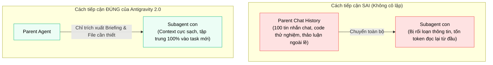
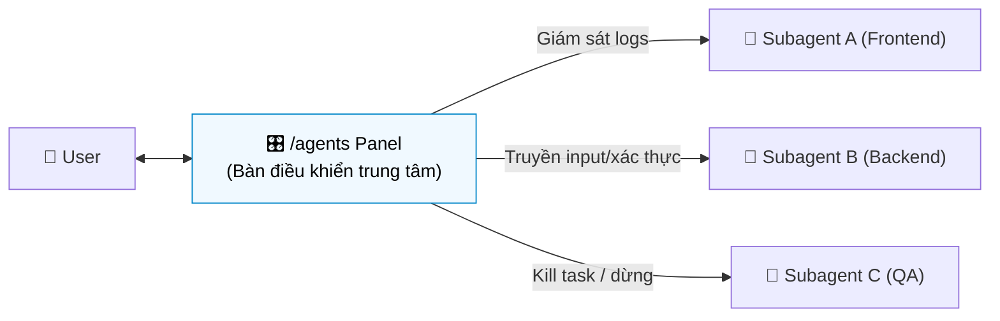

# 📘 Bài 2: Kiến trúc Multi-Agent trong Antigravity 2.0

> **Section:** Multi-Agent Systems & Orchestration — Hệ thống nhiều Agent phối hợp  
> **Thời lượng:** 30-35 phút  
> **Yêu cầu:** Đã hoàn thành Bài 1

---

## 🎯 Mục tiêu bài học

Sau bài này, bạn sẽ:

- ✅ Hiểu sâu cơ chế **Subagents** hoạt động dưới nắp máy của Antigravity 2.0
- ✅ Nắm vững khái niệm **Context Isolation (Cô lập ngữ cảnh)** và tầm quan trọng của nó trong việc tiết kiệm chi phí
- ✅ Phân biệt rõ ràng **Local Mode** vs **New Worktree Mode** khi bắt đầu một Agent
- ✅ Thành thạo cách giám sát và điều khiển các Agent con thông qua **`/agents` panel**

---

## 1. Trái tim của hệ thống: Subagents Spawning

Trong Antigravity 2.0, khi bạn (hoặc Parent Agent) bắt đầu một nhiệm vụ phức tạp, hệ thống sẽ sử dụng công cụ hệ thống `invoke_subagent` để sinh ra (spawn) các Agent con. 

### 1.1 Nguyên lý Phân rã Đa tầng (Nesting)

Nhiệm vụ lớn sẽ được chia nhỏ thành các nhiệm vụ con theo hình cây (Tree structure). Antigravity 2.0 cho phép lồng ghép các Subagent lên tới **10 levels**:

```
Parent Agent (Cấp 1 - Orchestrator toàn hệ thống)
   └── Subagent: API Backend (Cấp 2 - Phụ trách Backend)
          ├── Subagent: Database Schema (Cấp 3 - Code SQL/ORM)
          └── Subagent: Express Routes (Cấp 3 - Code API Endpoints)
                 └── Subagent: Route Validator (Cấp 4 - Viết Zod Schema)
```

**Tại sao việc phân cấp này lại tối ưu?**
- Mỗi cấp độ chỉ cần biết thông tin (context) của cấp độ ngay trên nó và nhiệm vụ cụ thể được giao.
- Khi Subagent cấp 4 hoàn thành, nó trả kết quả lên cho cấp 3 và tự động tắt (terminate), giải phóng RAM/Token ngay lập tức.

---

## 2. Context Isolation (Cô lập ngữ cảnh)

Một trong những sai lầm lớn nhất của các hệ thống Multi-Agent tự chế (custom) là chuyển toàn bộ lịch sử chat của Parent Agent cho Subagent con. Điều này gây ra hiện tượng **Context Pollution (Ô nhiễm ngữ cảnh)**.



### 2.1 Lợi ích vượt trội của Context Isolation trong Antigravity:

- 💸 **Tiết kiệm đến 85% chi phí (Tokens):** Subagent chỉ đọc đúng file nó cần sửa và phần mô tả ngắn gọn (briefing) từ parent.
- ⚡ **Tốc độ phản hồi cực nhanh:** Nhờ dung lượng context nhỏ, subagents có thể phân tích và sinh code trong vài giây.
- 🎯 **Độ chính xác cao:** Không bị xao nhãng bởi các cuộc thảo luận cũ của user và parent agent.

---

## 3. Khởi chạy Agent: Local Mode vs New Worktree Mode

Khi bạn tạo một cuộc hội thoại mới và giao việc cho Agent trong Antigravity 2.0, một cửa sổ modal sẽ hiện lên yêu cầu bạn chọn **Mode**. Đây là quyết định kiến trúc cực kỳ quan trọng:

```
  ┌────────────────────────────────────────────────────────┐
  │  🚀 BOOT UP AGENT                                      │
  ├────────────────────────────────────────────────────────┤
  │  Chọn chế độ hoạt động cho Agent của bạn:              │
  │                                                        │
  │  [ Local Mode ]                                        │
  │  - Hoạt động trực tiếp trên thư mục làm việc hiện tại. │
  │  - Phù hợp cho task nhỏ, sửa nhanh, debug nhanh.      │
  │                                                        │
  │  [ New Worktree Mode ]  (Khuyên dùng cho Multi-Agent)   │
  │  - Tạo một nhánh Git Worktree cô lập hoàn toàn.        │
  │  - Chạy an toàn background, không lo xung đột file.   │
  └────────────────────────────────────────────────────────┘
```

### Bảng so sánh chi tiết:

| Tiêu chí | 🏠 Local Mode | 🌲 New Worktree Mode (Khuyên dùng) |
|---|---|---|
| **Thư mục hoạt động** | Trực tiếp trên project folder hiện tại của bạn. | Trong một thư mục Git Worktree ẩn và cô lập. |
| **Xử lý file song song** | Dễ bị ghi đè hoặc xung đột file nếu nhiều agents chạy cùng lúc. | An toàn tuyệt đối. Mỗi agent/subagent sửa trên worktree riêng. |
| **Tác động tới code của bạn** | Code thay đổi ngay lập tức trên màn hình IDE của bạn. | Chỉ thay đổi khi bạn phê duyệt (Approve) và Merge code vào main branch. |
| **Trải nghiệm lập trình** | Phù hợp khi bạn muốn ngồi quan sát và xem Agent sửa code trực tiếp. | Hoàn hảo khi bạn muốn giao task dài chạy ngầm (background) rồi đi uống cafe. |

---

## 4. `/agents` panel — Dashboard giám sát real-time

Khi hệ thống bắt đầu chạy Multi-Agent, bạn cần một nơi để kiểm soát dòng chảy công việc. Antigravity 2.0 cung cấp giao diện trực quan **`/agents` panel**:



### Các tính năng chính trong `/agents` panel:

1. **Inbox-style Notifications:** Khi một Subagent cần quyền đọc ghi file đặc biệt hoặc cần bạn xác nhận thiết kế giao diện (qua `/browser` screenshot), panel sẽ hiển thị thông báo để bạn phê duyệt.
2. **Real-time Live Logs:** Bạn có thể click vào từng Subagent đang chạy để xem chi tiết nó đang gọi tool gì, đang đọc file nào và đang nghĩ gì (Thinking process).
3. **Task Cancellation (Kill Command):** Nếu phát hiện Subagent đang đi sai hướng hoặc bị lặp vô hạn (looping), bạn có thể click nút **Kill** để dừng ngay lập tức nhằm tránh lãng phí token.
4. **Artifacts Integration:** Xem nhanh các file trạng thái của subagents như `implementation_plan.md` hay `task.md` được cập nhật liên tục theo thời gian thực.

---

## 📝 Tóm tắt bài học

| Khái niệm | Bài học cốt lõi |
|---|---|
| **`invoke_subagent`** | Công cụ dùng để spawn Agent con, hỗ trợ lồng nhau lên đến 10 cấp. |
| **Context Isolation** | Giữ context sạch sẽ cho Agent con, giúp tăng 85% độ chính xác và tiết kiệm token. |
| **Worktree Mode** | Tạo nhánh Git độc lập để chạy nhiều Agent cùng lúc mà không lo xung đột code. |
| **`/agents` panel** | Trung tâm giám sát và điều khiển toàn bộ vòng đời của các subagents. |

---

## ⏭️ Bài tiếp theo

**[Bài 3: Demo — Subagents: Ủy quyền task cho Agent con](lesson-03-demo-subagents.md)** — Chúng ta sẽ bắt tay vào thực hành! Bạn sẽ quan sát cách giao một task siêu lớn cho Agent, xem cách nó tự động phân chia công việc thành các Subagents, cách nó tạo ra các Artifacts (`implementation_plan.md`, `task.md`) và cách bạn phê duyệt kế hoạch đó.

---

*📚 Multi-Agent Systems & Orchestration · Google Antigravity: Xây dựng AI Agent, AI App & Vibe Coding*
