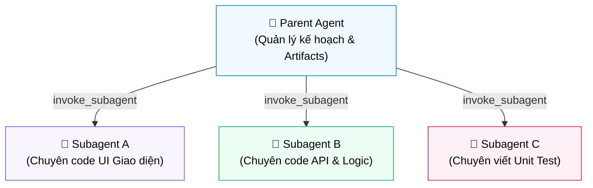

# 🎬 Bài 3: Demo — Subagents: Ủy quyền task cho Agent con

> **Section:** Multi-Agent Systems & Orchestration — Hệ thống nhiều Agent phối hợp  
> **Thời lượng:** 35-40 phút  
> **Loại:** 🎬 Thực hành / Demo  
> **Yêu cầu:** Đã hoàn thành Bài 1 và 2

---

## 🎯 Mục tiêu bài học

Sau bài thực hành này, bạn sẽ:

- ✅ Biết cách kích hoạt quy trình **Subagents spawning** tự động từ một prompt lớn
- ✅ Thành thạo việc đọc, phân tích và chỉnh sửa bản kế hoạch **`implementation_plan.md`** của Agent
- ✅ Hiểu cách theo dõi tiến độ công việc real-time qua **`task.md`**
- ✅ Nắm rõ quy trình nghiệm thu kết quả thông qua **`walkthrough.md`**

---

## 1. Kịch bản thực tế: Xây dựng Module Authentication nâng cao

Để học viên thấy rõ sức mạnh của Subagents, chúng ta sẽ giao một nhiệm vụ rất phức tạp cho Agent:

> **"Hãy xây dựng một Module Authentication hoàn chỉnh cho ứng dụng web hiện tại. Nhiệm vụ bao gồm: Thiết kế UI các trang Login/Register/Forgot Password, xây dựng API Integration kết nối tới server giả lập, và viết đầy đủ Unit Tests cho toàn bộ logic."**

Nếu dùng một Single Agent thông thường, nó sẽ cố gắng code tất cả file cùng lúc, dẫn tới code bị thiếu logic, thiếu test, hoặc bị lỗi cú pháp vì context bị đầy. Hãy xem cách Antigravity 2.0 giải quyết!

---

## 2. Quy trình Demo từng bước (Step-by-Step)

### Bước 1: Khởi động với một Prompt siêu lớn

Trong giao diện chat của Antigravity 2.0, bạn nhập prompt trên và nhấn **Enter**. Chọn chế độ **New Worktree Mode** trong bảng tùy chọn để đảm bảo code chạy an toàn trong môi trường biệt lập.

```
💬 Prompt của bạn:
"Hãy xây dựng một Module Authentication hoàn chỉnh..."
```

### Bước 2: Kích hoạt Planning Mode & Lập kế hoạch

Ngay khi nhận được prompt, Parent Agent (Orchestrator) sẽ phân tích và nhận thấy task này quá phức tạp. Thay vì code ngay, nó sẽ tự động kích hoạt **Planning Mode**:

1. Nó tạo ra file kế hoạch mang tên `implementation_plan.md` trong thư mục `.system_generated/` (hoặc artifacts directory).
2. Bản kế hoạch này sẽ mô tả chi tiết:
   - Các file sẽ được tạo mới `[NEW]` (ví dụ: `Login.tsx`, `authService.ts`, `auth.test.ts`).
   - Các file sẽ bị chỉnh sửa `[MODIFY]` (ví dụ: `App.tsx` để thêm routing).
   - Kế hoạch kiểm thử (automated unit tests).

> [!IMPORTANT]
> **Quy tắc vàng:** Trong Antigravity 2.0, Agent **không được phép viết code** khi bản `implementation_plan.md` chưa được bạn (User) nhấn nút **Approve (Phê duyệt)**.

### Bước 3: Spawn Subagents để chuẩn bị công việc

Sau khi phác thảo kế hoạch, Parent Agent sẽ gọi tool `invoke_subagent` để chia nhỏ task và spawn ra các Agent con chuyên trách:



Bạn có thể mở giao diện **`/agents` panel** trên IDE để thấy cả 3 Subagents này được khởi tạo và đang ở trạng thái chờ lệnh.

### Bước 4: Kiểm tra và Phê duyệt Kế hoạch (Review & Approve)

Lúc này, một thông báo nổi lên trên màn hình chat của bạn:
> **"I have prepared an implementation plan for the Authentication Module. Please review the artifacts."**

Bạn mở file [implementation_plan.md](file:///Users/thanhdo/.gemini/antigravity-ide/brain/69d4ed3c-4e70-43f6-8d88-20901484e27f/implementation_plan.md) lên để review:
- Bản kế hoạch được trình bày cực kỳ khoa học dưới dạng Markdown.
- Bạn có thể viết comment trực tiếp lên các dòng trong file này (giống như Google Docs) để yêu cầu sửa đổi: *"Này Agent, hãy dùng thư viện React Hook Form cho phần login nhé!"*
- Agent sẽ tự động đọc comment của bạn, cập nhật lại bản kế hoạch.
- Khi đã hoàn toàn hài lòng, bạn nhấn nút **Approve Plan** ở khung chat.

### Bước 5: Theo dõi tiến trình song song qua `task.md`

Ngay khi bạn Approve, các Subagents sẽ đồng loạt bắt đầu làm việc. Parent Agent tạo ra file [task.md](file:///Users/thanhdo/.gemini/antigravity-ide/brain/69d4ed3c-4e70-43f6-8d88-20901484e27f/task.md) để bạn theo dõi tiến độ thời gian thực:

```markdown
# 📋 Task: Xây dựng Module Authentication

- [x] Tạo cấu trúc thư mục Auth
- [/] Subagent A: Build UI Login & Register (Đang thực hiện...)
- [/] Subagent B: Tích hợp Mock API Service (Đang thực hiện...)
- [ ] Subagent C: Viết Unit Tests (Chưa bắt đầu - Chờ Subagent A & B xong)
```

- Các dấu ngoặc vuông sẽ tự động chuyển đổi từ `[ ]` (chưa làm) → `[/]` (đang làm) → `[x]` (đã xong) ngay trước mắt bạn.
- Bạn không cần can thiệp, các Subagents tự động phối hợp và trao đổi thông tin thông qua cơ chế chia sẻ Artifacts trung gian.

### Bước 6: Nghiệm thu với `walkthrough.md`

Khi tất cả các checklist trong `task.md` đều đã được đánh dấu `[x]`, Parent Agent sẽ thu hồi toàn bộ kết quả từ các Subagent con, tiến hành chạy thử nghiệm tự động.

Cuối cùng, nó tạo ra file `walkthrough.md` tổng hợp:
1. **Các file đã được tạo mới và chỉnh sửa:** Kèm link trực tiếp để bạn click vào xem nhanh.
2. **Kết quả chạy thử nghiệm (Test results):** Báo cáo tất cả unit tests đều đã pass.
3. **Hướng dẫn sử dụng nhanh (Quick start):** Cách import module và chạy thử trên trình duyệt.

Bạn kiểm tra lại toàn bộ code, nếu tất cả đều hoàn hảo, bạn nhấn **Merge** để hoàn tất nhiệm vụ!

---

## 🎯 Điểm mấu chốt học viên cần quan sát

1. **Sự tập trung của Subagents:** Khi mở logs của Subagent A (làm UI), bạn sẽ thấy context của nó cực kỳ gọn gàng. Nó không hề có các thông tin thừa về thư viện Unit Test hay Mock API, giúp nó viết CSS/HTML cực kỳ nhanh và chuẩn xác.
2. **Khả năng tự động Debug:** Nếu Subagent C viết test và phát hiện lỗi logic từ Subagent B, nó sẽ tự động phản hồi lại để Subagent B sửa code mà không cần bạn phải can thiệp hay chỉ ra lỗi.

---

## 📝 Tóm tắt bài học

| Bước trong Workflow | Tài liệu (Artifact) tương ứng | Hành động của User |
|---|---|---|
| **1. Lên kế hoạch** | `implementation_plan.md` | Đọc, nhận xét (comment) và **Approve**. |
| **2. Thực thi** | `task.md` | Giám sát tiến độ cập nhật real-time. |
| **3. Nghiệm thu** | `walkthrough.md` | Xem tóm tắt thay đổi, kiểm tra code và **Merge**. |

---

## ⏭️ Bài tiếp theo

**[Bài 4: Demo — Slash Commands: `/goal`, `/grill-me` & `/browser`](lesson-04-demo-slash-commands.md)** — Chúng ta sẽ tìm hiểu bộ ba slash commands quyền lực nhất trong Antigravity 2.0 dành cho người dùng Pro để tự động hóa toàn bộ quy trình coding và kiểm thử giao diện trực quan trên Chrome.

---

*📚 Multi-Agent Systems & Orchestration · Google Antigravity: Xây dựng AI Agent, AI App & Vibe Coding*
