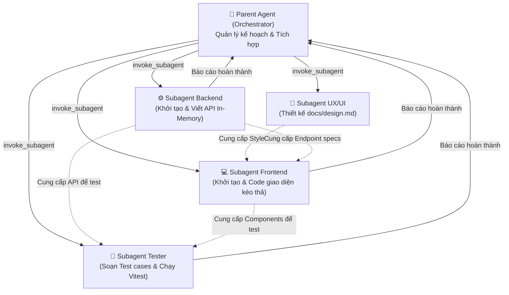

# 🎬 Bài 3: Demo — Subagents: Quy trình phối hợp của một Software Team 4 vai trò

> **Section:** Multi-Agent Systems & Orchestration — Hệ thống nhiều Agent phối hợp  
> **Thời lượng:** 35-40 phút  
> **Loại:** 🎬 Thực hành / Demo  
> **Yêu cầu:** Đã hoàn thành Bài 1 và 2

---

## 🎯 Mục tiêu bài học

Sau bài thực hành này, bạn sẽ:

- ✅ Biết cách kích hoạt quy trình **Subagents spawning** tự động bằng một prompt phức tạp yêu cầu giả lập các vai trò và cấu trúc dự án.
- ✅ Hiểu sâu sắc cơ chế phân phối công việc và chia sẻ tài liệu giữa 4 vai trò: **UX/UI Designer, Backend Dev, Frontend Dev và Tester**.
- ✅ Nắm vững cách giám sát toàn bộ dự án qua bộ ba Artifacts chuẩn: `implementation_plan.md`, `task.md`, và `walkthrough.md`.

---

## 1. Kịch bản thực tế: Xây dựng Kanban Board bằng Multi-Agent Team

Để thấy rõ sức mạnh của cơ chế Multi-Agent trong một dự án thực tế, chúng ta sẽ bắt đầu từ con số 0 để xây dựng một ứng dụng quản lý dự án dạng Kanban Board (giống GitHub Projects) theo mô hình phát triển phần mềm Agile/Scrum chuyên nghiệp. 

Thay vì chỉ có một coder duy nhất, Parent Agent (Orchestrator) sẽ đóng vai trò quản lý dự án, điều phối một đội ngũ bao gồm:
1. **Subagent UX/UI**: Thiết kế Design System, phối màu HSL, quy chuẩn hiệu ứng Glassmorphism và layout.
2. **Subagent Backend**: Khởi tạo thư mục và phát triển REST API Server (Node/Express) lưu trữ dữ liệu **in-memory** tạm thời.
3. **Subagent Frontend**: Khởi tạo dự án React-TS (Vite), code giao diện Kanban, tích hợp kéo thả (Drag-and-Drop) và gọi API.
4. **Subagent Tester**: Soạn kịch bản test cases, viết và chạy các bộ unit/integration test tự động.

---

## 2. Quy trình Demo từng bước (Step-by-Step)

### Bước 1: Nhập Prompt siêu phức tạp gộp khởi tạo và phân chia công việc

Trong chat của Antigravity, chúng ta nhập một prompt cực kỳ chi tiết, yêu cầu tường minh việc khởi tạo cấu trúc dự án monorepo và tự động spawn các Subagent chuyên trách:

```
💬 Prompt của bạn:
"Hãy thiết lập và xây dựng một dự án quản lý dự án dạng Kanban Board full-stack (tương tự như GitHub Projects) trong thư mục 'github-kanban-board'. 

Hãy phân chia công việc (invoke subagent) cho 4 agent con chuyên trách để phối hợp thực hiện:
1. Subagent UX/UI: Thiết kế Design System chi tiết (lưu vào docs/design.md) bao gồm bảng màu HSL tinh tế, phong cách kính mờ Glassmorphism, hiệu ứng micro-animations mượt mà khi hover/drag thẻ, hỗ trợ Light/Dark mode.
2. Subagent Backend: Khởi tạo thư mục dự án Node.js/Express bằng TypeScript ở thư mục 'backend/', phát triển các API REST GET, POST, PUT, DELETE cho /api/tasks và /api/columns, sử dụng dữ liệu in-memory lưu trữ tạm thời.
3. Subagent Frontend: Khởi tạo dự án React + TypeScript bằng Vite trong thư mục 'frontend/', xây dựng giao diện Kanban Board kéo thả, kết nối gọi API từ backend, và cài đặt giao diện chuẩn theo thiết kế từ docs/design.md.
4. Subagent Tester: Lập kịch bản test cases và viết các bộ unit/integration test sử dụng Vitest để kiểm thử toàn diện API backend và logic kéo thả trên UI frontend.

Sau khi các Subagents hoàn thành, hãy chạy thử toàn bộ hệ thống (FE + BE), kiểm tra lỗi biên dịch (build errors) và báo cáo kết quả tích hợp trong walkthrough.md."
```

---

### Bước 2: Lập kế hoạch tổng thể (Planning Mode)

Nhận yêu cầu này, Parent Agent sẽ phân tích cấu trúc monorepo và tạo ngay file [implementation_plan.md](file:///Users/thanhdo/.gemini/antigravity-ide/brain/c62c4a45-9410-45a2-9c34-7c65bb6df5aa/implementation_plan.md) để phân rã cấu trúc tệp tin sẽ tạo:

- `[NEW]` [docs/design.md](file:///Users/thanhdo/Documents/Project/antigravity-vibe-coding-course/github-kanban-board/docs/design.md) (UX/UI thiết kế)
- `[NEW]` [backend/src/server.ts](file:///Users/thanhdo/Documents/Project/antigravity-vibe-coding-course/github-kanban-board/backend/src/server.ts) (Backend khởi tạo và code)
- `[NEW]` [frontend/src/components/KanbanBoard.tsx](file:///Users/thanhdo/Documents/Project/antigravity-vibe-coding-course/github-kanban-board/frontend/src/components/KanbanBoard.tsx) (Frontend khởi tạo và code)
- `[NEW]` [frontend/src/tests/Kanban.test.tsx](file:///Users/thanhdo/Documents/Project/antigravity-vibe-coding-course/github-kanban-board/frontend/src/tests/Kanban.test.tsx) (Tester viết)

> [!IMPORTANT]
> Parent Agent sẽ tạm dừng hoạt động và chờ bạn phê duyệt. Chỉ khi bạn nhấn **Approve Plan** hoặc gửi tin nhắn đồng ý, các subagent mới thực sự được tạo ra để bắt đầu làm việc.

---

### Bước 3: Spawn 4 Subagents & Phối hợp Agile

Khi nhận được sự chấp thuận từ bạn, Parent Agent bắt đầu gọi `invoke_subagent` để tạo ra 4 luồng xử lý:



1. **Subagent UX/UI** làm việc trước tiên để phác thảo `docs/design.md` nhằm định hình phong cách giao diện và bảng màu chung.
2. **Subagent Backend** khởi tạo cấu trúc thư mục Node.js/Express và tạo cơ sở dữ liệu in-memory để cung cấp API endpoint nhanh nhất có thể.
3. **Subagent Frontend** khởi tạo dự án React + TS bằng Vite, đọc các yêu cầu thiết kế từ UX/UI, sử dụng mock API hoặc kết nối trực tiếp đến backend do Backend Agent cung cấp để lập trình kéo thả.
4. **Subagent Tester** viết các ca kiểm thử dựa trên tính năng kéo thả của Frontend và dữ liệu API của Backend, đảm bảo không có lỗ hổng logic nào xảy ra.

---

### Bước 4: Giám sát real-time qua `task.md`

Tại thư mục artifacts, file [task.md](file:///Users/thanhdo/.gemini/antigravity-ide/brain/c62c4a45-9410-45a2-9c34-7c65bb6df5aa/task.md) phân chia rõ ràng trách nhiệm của từng phòng ban:

```markdown
# 📋 Task: Dự án Kanban Board Full-stack Monorepo

## 1. Thiết kế & Chuẩn bị
- [x] UX/UI Subagent: Hoàn thiện Design System docs/design.md

## 2. Phát triển (Khởi tạo & Lập trình)
- [/] Backend Subagent: Khởi tạo và xây dựng API server Express in-memory (Đang code API POST/PUT...)
- [/] Frontend Subagent: Khởi tạo và thiết kế React Components kéo thả (Đang code UI columns...)

## 3. Kiểm thử & Tích hợp (Testing & Integration)
- [ ] Tester Subagent: Soạn và chạy bộ test suite Vitest
- [ ] Tích hợp chạy thử toàn hệ thống
```

---

### Bước 5: Tự động phát hiện lỗi và tự sửa (Self-Healing)

Một điểm cực kỳ thú vị khi làm việc với Multi-Agent Team là khả năng **tự sửa lỗi chéo**:
1. Trong lúc Tester chạy test tự động, phát hiện ra lỗi: *Khi thêm mới một Task từ FE, Backend bị crash do thiếu trường `assignee` khiến server in-memory trả về lỗi `500`*.
2. Tester Agent không dừng lại để hỏi bạn, mà nó tự gửi log lỗi này về cho **Backend Agent** thông qua cơ chế trao đổi lỗi trong Workspace.
3. Backend Agent đọc log, sửa lỗi gán giá trị mặc định cho `assignee` trong file `backend/src/server.ts`, khởi động lại server.
4. Tester Agent chạy lại test suite, tất cả đều pass `green` ✅.
5. Cuối cùng, Parent Agent nhận báo cáo sạch sẽ từ QA, gộp code và xuất bản [walkthrough.md](file:///Users/thanhdo/.gemini/antigravity-ide/brain/c62c4a45-9410-45a2-9c34-7c65bb6df5aa/walkthrough.md).

---

## 🎯 Điểm mấu chốt học viên cần quan sát

1. **Hiệu suất song song:** Việc FE và BE tự khởi tạo và code song song rút ngắn thời gian làm việc xuống còn một nửa.
2. **Quy trình đóng gói (Clean Monorepo):** Agent tự khởi tạo các project con trong cấu trúc thư mục con một cách gọn gàng, tự quản lý node_modules riêng biệt cho FE và BE mà không gây xung đột dependency.
3. **Môi trường In-Memory an toàn:** Backend chạy lưu dữ liệu in-memory giúp khởi động nhanh, không cần cấu hình Docker hay Database phức tạp, rất phù hợp cho việc demo nhanh ý tưởng (rapid prototyping).

---

## 📝 Tóm tắt bài học

| Vai trò (Subagent) | Nhiệm vụ chính | Sản phẩm đầu ra (Artifacts) |
|---|---|---|
| **UX/UI** | Thiết kế giao diện & Theme | `docs/design.md` |
| **Backend** | Khởi tạo server & API In-memory | `backend/` |
| **Frontend** | Khởi tạo app & Code UI Drag-Drop | `frontend/` |
| **Tester** | Viết Test & Validate hệ thống | `tests/` hoặc `frontend/src/tests/` |

---

## ⏭️ Bài tiếp theo

**[Bài 4: Demo — Slash Commands: `/goal`, `/grill-me` & `/browser`](lesson-04-demo-slash-commands.md)** — Tìm hiểu bộ ba lệnh slash command quyền lực nhất trong Antigravity để tự động hóa kiểm thử giao diện trực tiếp trên trình duyệt Chrome và phỏng vấn làm rõ ý đồ thiết kế.

---

*📚 Multi-Agent Systems & Orchestration · Google Antigravity: Xây dựng AI Agent, AI App & Vibe Coding*
