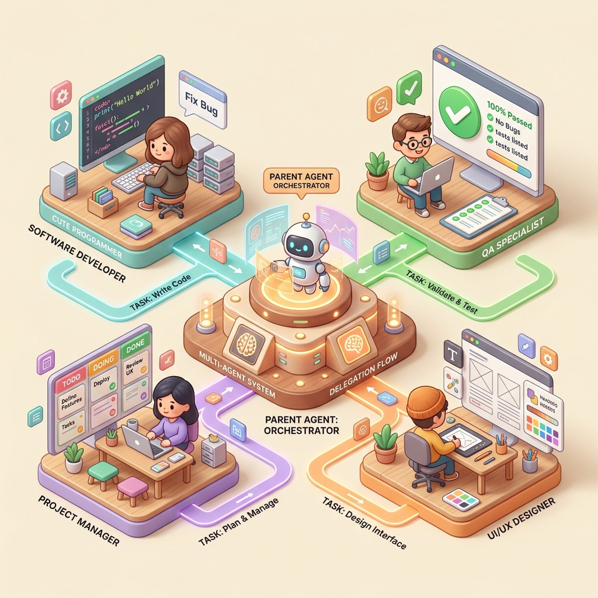
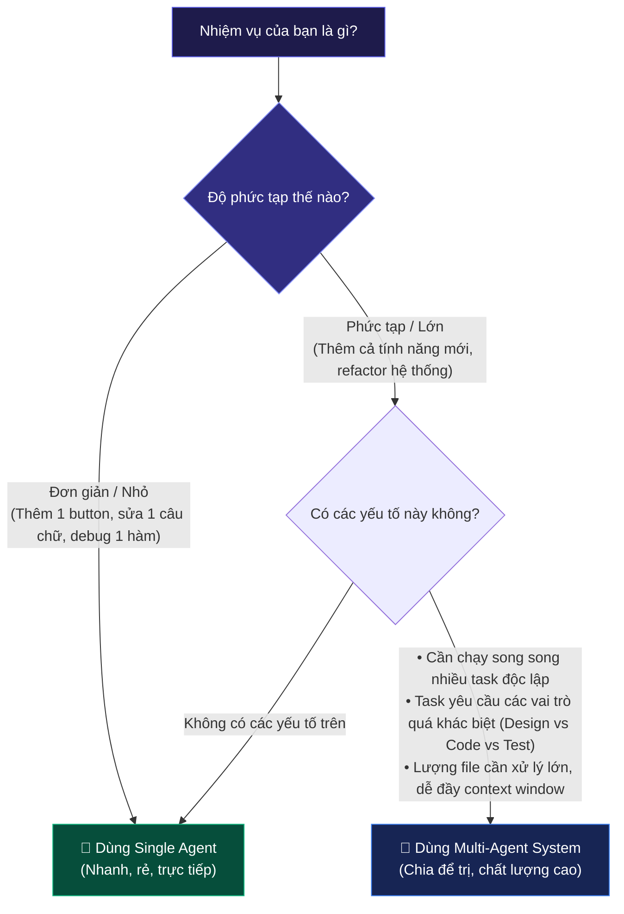
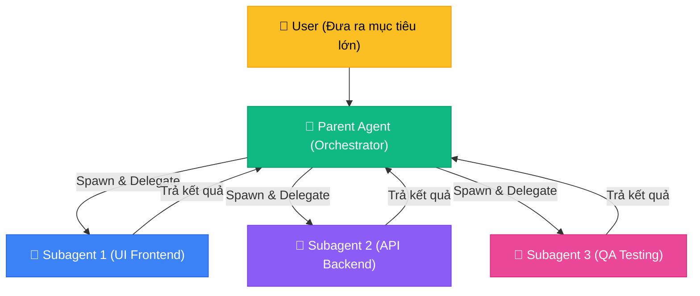
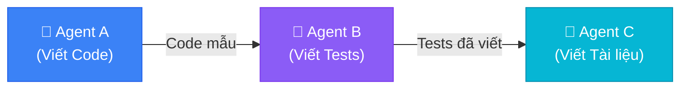
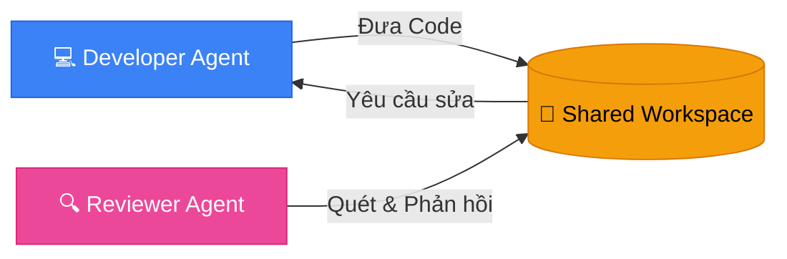
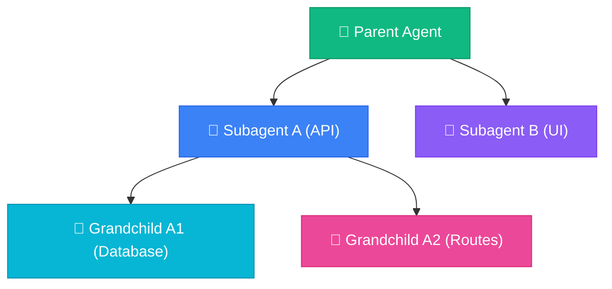

# 📘 Bài 3: Multi-Agent System là gì? Từ Single Agent → Multi-Agent

> **Section:** Multi-Agent Systems & Orchestration — Hệ thống nhiều Agent phối hợp  
> **Thời lượng:** 25-30 phút  
> **Yêu cầu:** Đã hoàn thành Bài 2

---

## 🎯 Mục tiêu bài học

Sau bài này, bạn sẽ:

- ✅ Hiểu tại sao **1 Agent đơn** dễ bị quá tải khi dự án phình to
- ✅ Định nghĩa được **Multi-Agent System** và cách nó chia sẻ gánh nặng công việc
- ✅ Biết chính xác **khi nào nên dùng Multi-Agent** vs khi nào Single Agent đã đủ
- ✅ Nắm rõ **4 Multi-Agent Patterns phổ biến** trong phát triển phần mềm bằng AI
- ✅ Hiểu cách Antigravity 2.0 áp dụng các pattern này vào thực tế

---

## 1. Vấn đề thực tế: Giới hạn của Single Agent

Trong các Section trước, bạn đã làm việc với **Single Agent** (1 Agent duy nhất đảm nhận mọi việc). Cách tiếp cận này hoạt động rất tốt đối với các task nhỏ hoặc trung bình. Tuy nhiên, khi dự án phình to, bạn sẽ nhanh chóng vấp phải những giới hạn sau:

### 1.1 Quá tải Context Window (RAM của Agent bị tràn)
Khi bạn yêu cầu 1 Agent làm từ giao diện (UI), kết nối API (Backend), viết Unit Test cho tới cập nhật tài liệu kỹ thuật trong cùng một cuộc hội thoại:
- Lịch sử chat sẽ cực kỳ dài.
- Agent phải đọc lại toàn bộ code của nhiều file mỗi khi phản hồi.
- Kết quả là Agent bắt đầu **hallucinate (ảo tưởng)**, quên các logic đã thỏa thuận ở đầu cuộc hội thoại và viết code bị lỗi.

### 1.2 "Một nghề thì chín, chín nghề thì..."
Một Agent cố gắng làm tất cả mọi thứ thường giống như một lập trình viên cố ôm đồm:
- Vừa phải suy nghĩ logic nghiệp vụ (business logic).
- Vừa phải căn chỉnh pixel giao diện (CSS styling).
- Vừa phải viết kiểm thử (testing).
- Vừa phải viết tài liệu.

→ **Hậu quả:** Agent dễ bị nhầm lẫn giữa các vai trò, dẫn đến chất lượng code giảm sút.

> [!WARNING]
> **Sự thật từ chuyên gia:** Các mô hình ngôn ngữ lớn (LLM) hoạt động hiệu quả nhất khi được giao **một vai trò rõ ràng** và **một nhiệm vụ duy nhất** trong một ngữ cảnh (context) sạch.

---

## 2. Multi-Agent System là gì?

> 💡 **Định nghĩa:**  
> **Multi-Agent System (Hệ thống nhiều Agent)** là một mạng lưới gồm **nhiều AI Agent chuyên biệt**, mỗi Agent đảm nhận một vai trò và nhiệm vụ cụ thể, phối hợp và giao tiếp với nhau để giải quyết một bài toán lớn và phức tạp.

### 2.1 Ẩn dụ thực tế: Full-Stack Solo vs Engineering Team

Để dễ hình dung khi giảng dạy, hãy giúp học viên so sánh hai mô hình làm việc sau:

| Khía cạnh | 🧑‍💻 Mô hình Single Agent (Full-Stack Solo) | 👥 Mô hình Multi-Agent (Engineering Team) |
|---|---|---|
| **Cơ cấu nhân sự** | 1 Lập trình viên duy nhất làm tất cả mọi thứ. | Một đội nhóm gồm: **PM** (quản lý), **Frontend Dev**, **Backend Dev**, và **QA** (kiểm thử). |
| **Cách xử lý task** | Viết backend → Quay sang code frontend → Tự viết test → Tự sửa bug. | PM lên kế hoạch → Backend build API → Frontend tích hợp UI → QA chạy test & báo bug cho Dev sửa. |
| **Context (Bộ nhớ)** | Đầu óc quay cuồng với cả database schema, CSS class, và test framework cùng lúc. | Frontend chỉ cần tập trung vào UI/UX; QA chỉ tập trung vào việc tìm lỗi và viết test case. |
| **Hiệu suất** | Dễ kiệt sức, dễ bỏ sót lỗi, chậm chạp khi dự án lớn. | Chạy song song nhanh chóng, kiểm soát chất lượng cực kỳ chặt chẽ. |

---

## 3. Khi nào cần nâng cấp lên Multi-Agent?

Đừng lạm dụng Multi-Agent khi không cần thiết! Việc spawn nhiều agent sẽ tiêu tốn tài nguyên và tăng thời gian chờ đợi. Hãy sử dụng bảng hướng dẫn sau để đưa ra quyết định:

---

## 4. Bốn Multi-Agent Patterns phổ biến

Trong kiến trúc phần mềm AI, có 4 mô hình phối hợp phổ biến giữa các Agent. Hãy giảng giải chi tiết từng mô hình dưới đây cho học viên:

### 4.1 Orchestrator-Worker (Người điều phối & Công nhân)
Đây là pattern phổ biến nhất và cũng là **trọng tâm của Antigravity 2.0**.
- **Orchestrator (Parent Agent):** Nhận goal lớn từ user, phân tích, lập kế hoạch (`implementation_plan.md`), sau đó tạo ra các worker chuyên biệt.
- **Workers (Subagents):** Nhận task nhỏ từ Orchestrator, thực thi độc lập và trả kết quả về cho Orchestrator tổng hợp.

### 4.2 Pipeline (Dây chuyền sản xuất)
Output của Agent trước là Input của Agent sau.
- **Ví dụ:** `Agent viết code` ──▶ `Agent viết test` ──▶ `Agent viết tài liệu`.

### 4.3 Peer-to-Peer (Hội đồng phản biện)
Các Agent ngang hàng cùng làm việc trên một Shared State để phản biện và cải tiến kết quả của nhau.
- **Ví dụ:** `Developer Agent` viết code, `Reviewer Agent` phân tích lỗi bảo mật và yêu cầu viết lại cho đến khi đạt tiêu chuẩn.

### 4.4 Hierarchical (Đa tầng phân cấp)
Tương tự như cấu trúc doanh nghiệp lớn. Parent Agent spawn Subagents, Subagents lại tiếp tục spawn Grandchild Agents nếu subtask vẫn quá phức tạp.
- **Antigravity 2.0** hỗ trợ nesting lên tới **10 cấp độ** để giải quyết các siêu dự án một cách khoa học.

---

## 5. Kiến trúc Multi-Agent trong Antigravity 2.0

Antigravity 2.0 được thiết kế quanh pattern **Orchestrator-Worker (Parent-Subagent)** để mang lại trải nghiệm Vibe Coding mượt mà nhất:

1. **Parent Agent** đóng vai trò là kiến trúc sư trưởng. Nó luôn duy trì một bức tranh toàn cảnh về dự án thông qua hệ thống **Artifacts** (`implementation_plan.md`, `task.md`).
2. Khi gặp task phức tạp, Parent Agent sẽ gọi tool `invoke_subagent` để ủy quyền.
3. Mỗi **Subagent** hoạt động trong một môi trường cô lập, sở hữu một Context Window hoàn toàn mới và sạch sẽ, tập trung 100% sức mạng để giải quyết subtask được giao.
4. Khi Subagent hoàn thành, nó cập nhật trạng thái vào `task.md` và trả kết quả về để Parent Agent nghiệm thu và trình lên cho bạn (User) phê duyệt.

---

## 📝 Tóm tắt bài học

| Khái niệm | Chi tiết cần nhớ |
|---|---|
| **Giới hạn Single Agent** | Dễ đầy context window, dễ ảo tưởng (hallucination) khi làm task lớn. |
| **Multi-Agent System** | Mạng lưới các AI Agent chuyên môn hóa phối hợp giải quyết bài toán lớn. |
| **Khi nào dùng** | Khi task lớn, cần chia nhỏ, cần chạy song song, hoặc context quá lớn. |
| **Orchestrator-Worker** | Pattern chủ đạo của Antigravity (Parent Agent điều phối các Subagents). |

---

## ⏭️ Bài tiếp theo

**[Bài 4: Trái tim của hệ thống: Subagents Spawning](lesson-04-subagents-spawning.md)** — Chúng ta sẽ đi sâu vào cơ chế hoạt động thực sự dưới nắp máy của Antigravity 2.0: Cách subagents được cách ly context, sự khác biệt giữa Local Mode và New Worktree Mode, và cách giám sát qua `/agents` panel.

---

*📚 Multi-Agent Systems & Orchestration · Google Antigravity: Xây dựng AI Agent, AI App & Vibe Coding*
