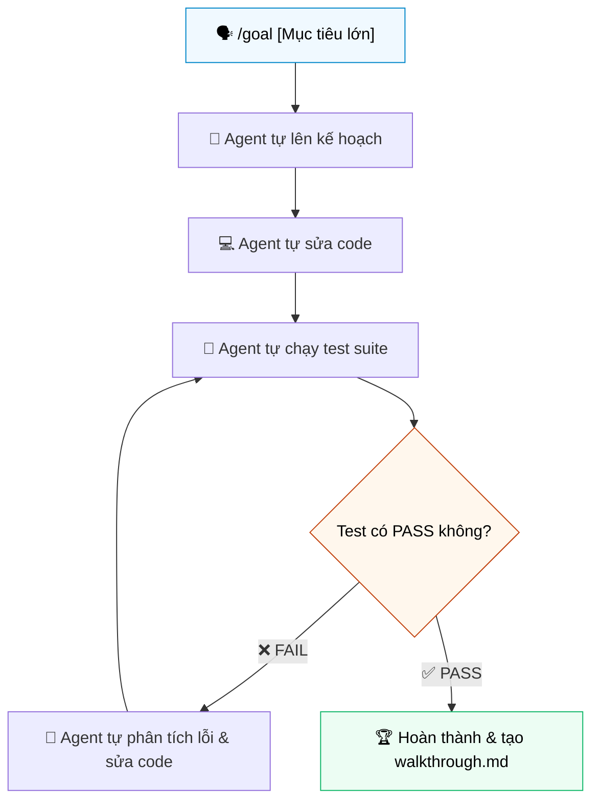

# 🎬 Bài 6: Demo — Slash Commands: /goal, /grill-me, /browser

> **Section:** Multi-Agent Systems & Orchestration — Hệ thống nhiều Agent phối hợp  
> **Thời lượng:** 40-45 phút  
> **Loại:** 🎬 Thực hành / Demo  
> **Yêu cầu:** Đã hoàn thành Bài 5

---

## 🎯 Mục tiêu bài học

Sau bài thực hành này, bạn sẽ:

- ✅ Làm chủ bộ bốn Slash Commands mạnh mẽ nhất của Antigravity 2.0 dành cho gói Pro: **`/goal`**, **`/grill-me`**, **`/browser`**, và **`/schedule`**
- ✅ Biết cách chạy một tác vụ hoàn toàn tự động (autonomous) không gián đoạn bằng **`/goal`**
- ✅ Hiểu cách dùng **`/grill-me`** để thiết lập quy chuẩn và làm rõ yêu cầu, hạn chế tối đa việc hiểu sai đề bài
- ✅ Ứng dụng công cụ **`/browser`** để Agent tự tương tác và kiểm thử giao diện trực quan trên trình duyệt Chrome
- ✅ Thiết lập được lịch trình tự động bằng lệnh **`/schedule`** (chạy một lần hoặc lặp lại theo cron)

---

## 1. `/goal` — Kích hoạt Chế độ Tự động hóa Không giới hạn

Bình thường khi bạn chat với Agent, sau mỗi bước hoặc khi gặp phân vân, Agent sẽ dừng lại và hỏi ý kiến của bạn. Điều này rất tốt để kiểm soát chất lượng, nhưng lại gây phiền phức khi bạn muốn giao một task dài và không muốn ngồi canh màn hình.

> **`/goal`** là lệnh biến Agent thành một thực thể **tự trị hoàn toàn (autonomous)**. Nó sẽ tự động lặp lại quy trình: **Lập kế hoạch ──▶ Thực thi ──▶ Chạy thử nghiệm ──▶ Debug tự động** cho đến khi đạt được mục tiêu cuối cùng mới dừng lại.



### Kịch bản thực chiến với `/goal`:
Bạn gõ vào thanh chat:
```bash
/goal Refactor toàn bộ API layer — thêm error handling chặt chẽ, kiểm tra input validation bằng Zod schema cho mọi endpoints và viết Unit Tests.
```

- **Quan sát:** Agent sẽ không dừng lại để hỏi bạn từng dòng code. Nó tự tạo file plan, tự động chạy qua từng endpoint, tự chạy test suite. Nếu test báo lỗi, nó tự đọc log lỗi, tự sửa code của mình và chạy lại test cho đến khi mọi thứ xanh lè!
- **Kết quả:** Sau khoảng 10-15 phút chạy ngầm, bạn nhận được một Pull Request hoàn chỉnh kèm báo cáo test thành công vượt mong đợi.

---

## 2. `/grill-me` — Phỏng vấn Thiết kế & Align yêu cầu

Có bao giờ bạn đưa ra một yêu cầu quá ngắn gọn và Agent tự viết code theo ý nó, dẫn tới kết quả không đúng mong muốn của bạn chưa? Để khắc phục đó, hãy dùng `/grill-me` trước khi code.

> **`/grill-me` (Phỏng vấn tôi đi!)** đặt Agent vào trạng thái "chủ động đặt câu hỏi". Nó sẽ từ chối viết code ngay lập tức, thay vào đó phân tích các điểm mơ hồ trong đề bài của bạn và đưa ra một danh sách các câu hỏi sâu sắc để hai bên cùng thống nhất.

```
💬 Khởi động:
"/grill-me Thêm tính năng Reset Password cho hệ thống."

🤖 Agent phản hồi:
"Để xây dựng tính năng này chuẩn nhất, tôi cần bạn làm rõ 4 điểm sau:
 1. Chúng ta sẽ gửi mã khôi phục qua Email hay SMS?
 2. Mã OTP này nên có hiệu lực trong bao lâu (ví dụ: 5 phút, 15 phút)?
 3. Khi người dùng click vào link reset, họ sẽ thực hiện trên một trang riêng biệt (Page) hay mở một cửa sổ nhỏ (Modal)?
 4. Bạn đã có sẵn template email gửi đi chưa, hay tôi tự thiết kế?"
```

### Cách thực hành:
- Bạn chỉ cần gõ câu trả lời ngắn gọn cho từng câu hỏi (ví dụ: "1. Email, 2. 10 phút, 3. Trang riêng, 4. Hãy tự tạo template đơn giản bằng Tailwind").
- Agent sẽ thu thập các câu trả lời này, kết hợp với cấu trúc dự án hiện tại để tạo ra một bản `implementation_plan.md` chuẩn xác đến 99%, không còn bất kỳ sự mơ hồ nào.

---

## 3. `/browser` — Tự động hóa kiểm thử giao diện (Visual QA)

Viết code backend hay test logic thì dễ, nhưng làm thế nào để AI biết giao diện nó viết ra có bị méo, bị lệch nút, hay bị che mất chữ trên thực tế hay không? Đó là lúc bạn cần đến lệnh `/browser`.

> Lệnh **`/browser`** cho phép Agent tự khởi chạy một trình duyệt Chrome ngầm trên máy của bạn (hoặc sandbox), truy cập vào trang web đang chạy thử nghiệm, tự động tương tác (click, điền form) và chụp ảnh màn hình (screenshot) để tiến hành phân tích giao diện trực quan.

```
          🤖 Agent chạy lệnh /browser
                       │
                       ▼
       🌐 Tự động mở Chrome ngầm & truy cập http://localhost:5173
                       │
                       ▼
      🖱️ Tự động click vào nút "Login" -> Điền username/password
                       │
                       ▼
    📸 Chụp ảnh màn hình (Screenshot) -> Phân tích bố cục bằng Vision
                       │
                       ▼
     🔍 Kiểm tra xem nút có bị đè chữ không -> Báo cáo kết quả
```

### Kịch bản thực tế:
1. Agent vừa code xong trang Login.
2. Nó gọi công cụ browser để truy cập `http://localhost:5173/login`.
3. Nó điền thử form: nhập email sai định dạng → chụp ảnh màn hình để kiểm tra xem thông báo lỗi màu đỏ có xuất hiện đúng vị trí và có dễ đọc không.
4. Nó điền đúng email/password → nhấn Login → chụp ảnh màn hình trang Dashboard để xác nhận đã đăng nhập thành công.

---

## 4. `/schedule` — Hẹn giờ & Lên lịch trình tự động

Một tính năng cực kỳ mạnh mẽ dành cho các tác vụ lặp đi lặp lại hoặc giám sát hệ thống là **`/schedule`** (Hẹn giờ/Đặt lịch). Lệnh này giúp bạn thiết lập các công việc chạy ngầm theo thời gian mà không cần can thiệp thủ công.

Nó hỗ trợ 2 chế độ hoạt động chính:

### Chế độ 1: One-shot timer (Hẹn giờ chạy 1 lần)
Sử dụng khi bạn muốn hẹn giờ một công việc diễn ra sau một khoảng thời gian chờ đợi (ví dụ: đợi build code hoặc kiểm tra deploy).
- **Cú pháp:** `/schedule DurationSeconds=300, Prompt="Hãy check xem trang web đã deploy xong chưa và báo cáo lại."`
- **Hoạt động:** Sau 300 giây (5 phút), Agent sẽ được đánh thức để thực thi prompt được giao.

### Chế độ 2: Recurring cron (Chạy định kỳ lặp lại)
Sử dụng cú pháp tiêu chuẩn 5 trường của Cron (phút, giờ, ngày, tháng, thứ) để tự động hóa các tác vụ lặp đi lặp lại.
- **Cú pháp:** `/schedule CronExpression="*/15 * * * *", Prompt="Chạy linter và unit tests để kiểm tra xem có lỗi cú pháp nào mới không."`
- **Hoạt động:** Hệ thống sẽ tự động kích hoạt Agent chạy ngầm tác vụ này mỗi 15 phút.

---

## 📊 Bảng so sánh: Chọn lệnh nào cho tình huống nào?

| Bạn muốn làm gì? | Lệnh phù hợp | Cơ chế hoạt động |
|---|---|---|
| **Sửa nhanh, thảo luận từng bước** | `Chat thông thường` | Hỏi-đáp từng lượt, dừng lại sau mỗi câu trả lời để chờ user. |
| **Giao việc lớn, tự chạy tự debug khi bạn bận** | **`/goal`** | Chạy lặp liên tục (autonomous loop) cho đến khi hoàn thành mục tiêu. |
| **Làm rõ yêu cầu, thống nhất thiết kế trước khi code** | **`/grill-me`** | Phỏng vấn ngược lại user để xóa bỏ mọi điểm mơ hồ trong đề bài. |
| **Kiểm tra xem giao diện web hiển thị có chuẩn không** | **`/browser`** | Mở trình duyệt Chrome, tương tác và chụp ảnh màn hình để QA. |
| **Hẹn giờ hoặc chạy lặp lại định kỳ** | **`/schedule`** | Đặt one-shot timer hoặc recurring cron để chạy tác vụ tự động. |

---

## 📝 Tóm tắt bài học

- **`/goal`** là công cụ tối thượng cho tự động hóa (Autonomous Coding), tiết kiệm thời gian ngồi canh Agent.
- **`/grill-me`** giúp align tư duy giữa người và máy trước khi code, giảm 90% lỗi do hiểu nhầm đề bài.
- **`/browser`** mang lại khả năng "nhìn" cho Agent, giúp kiểm thử giao diện thực tế một cách trực quan sinh động.
- **`/schedule`** giúp hẹn giờ hoặc thiết lập lịch định kỳ (cron) để tự động hóa các tác vụ lặp đi lặp lại hoặc kiểm tra hệ thống.

---

## ⏭️ Section tiếp theo

**[Section 6: Model Context Protocol (MCP) — Kết nối AI Agents với External System](../section-06-mcp/README.md)** — Bạn sẽ được tìm hiểu về giao thức MCP (Model Context Protocol), giúp mở rộng khả năng của AI Agent để gọi tool, kết nối database và các API bên ngoài.

---

*📚 Multi-Agent Systems & Orchestration · Google Antigravity: Xây dựng AI Agent, AI App & Vibe Coding*
