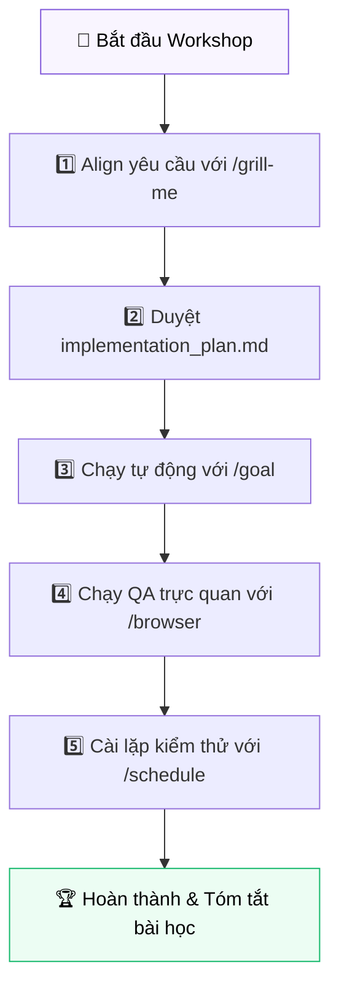

# 🛠 Bài 6: Workshop — Build feature phức tạp với Multi-Agent

> **Section:** Multi-Agent Systems & Orchestration — Hệ thống nhiều Agent phối hợp  
> **Thời lượng:** 45-50 phút  
> **Loại:** 🛠 Thực hành / Workshop tổng hợp  
> **Yêu cầu:** Đã hoàn thành Bài 1 đến Bài 5

---

## 🎯 Mục tiêu bài học

Sau bài Workshop thực hành tổng hợp này, bạn sẽ:

- ✅ Đủ năng lực tự tin thiết kế và xây dựng một **tính năng lớn, phức tạp** từ A-Z
- ✅ Tận dụng tối đa sự phối hợp nhịp nhàng giữa **Parent Agent và Subagents**
- ✅ Thành thạo kỹ năng kết hợp bộ ba lệnh: **`/grill-me` ──▶ `/goal` ──▶ `/browser`**
- ✅ Biết cách kiểm soát chất lượng code, xử lý lỗi và nghiệm thu dự án thực tế

---

## 🧩 Đề bài Workshop: Xây dựng tính năng "Progress Tracking"

Trong dự án **English Practice Hub** (Hệ thống luyện tiếng Anh mà chúng ta phát triển xuyên suốt khóa học), chúng ta cần bổ sung một tính năng lớn và có độ phức tạp cao: **Progress Tracking (Theo dõi tiến độ học tập)**.

### Yêu cầu chi tiết của tính năng:
1. **Phần giao diện (UI):** Hiển thị Streak (số ngày học liên tục), Tỷ lệ hoàn thành mục tiêu (Completion Rate) dưới dạng biểu đồ tròn và một Biểu đồ cột (Weekly Chart) hiển thị thời gian học của từng ngày trong tuần qua.
2. **Phần Logic & API:** Lưu trữ lịch sử học tập vào LocalStorage hoặc Mock API, tính toán logic streak (tự động reset nếu bỏ lỡ 1 ngày) và xuất báo cáo học tập định kỳ.
3. **Phần Kiểm thử (QA):** Đảm bảo test coverage đạt trên 80% đối với phần tính toán logic streak.

---

## 🚀 Hướng dẫn thực hành từng bước



---

### Bước 1: Thiết lập chuẩn mực và Align yêu cầu với `/grill-me`

Đừng vội vã code ngay! Hãy sử dụng lệnh `/grill-me` để đảm bảo Agent hiểu đúng ý đồ thiết kế biểu đồ và cấu trúc dữ liệu của bạn.

1. Nhập câu lệnh sau vào ô chat:
   ```bash
   /grill-me Hãy thiết kế và build tính năng Progress Tracking cho English Practice Hub.
   ```
2. Agent sẽ phỏng vấn bạn một số câu hỏi kỹ thuật. Hãy trả lời ngắn gọn:
   - *Biểu đồ dùng thư viện gì?* → Dùng thư viện Recharts hoặc CSS thuần để vẽ cột đơn giản.
   - *Cách tính Streak?* → Mỗi ngày học viên hoàn thành ít nhất 1 bài tập sẽ tính là +1 streak.
   - *Lưu dữ liệu ở đâu?* → Lưu tạm thời vào LocalStorage của trình duyệt.

3. Agent sẽ tạo ra file `implementation_plan.md`. Bạn mở file ra, kiểm tra các tệp tin dự kiến tạo mới như `ProgressChart.tsx`, `streakHelper.ts`, `streak.test.ts`. Sau đó nhấn nút **Approve Plan**.

---

### Bước 2: Chạy tự động hóa quy trình bằng `/goal`

Sau khi đã thống nhất kế hoạch, hãy để Agent tự vận hành và phối hợp các Subagents chạy ngầm.

1. Khởi động chế độ tự trị bằng lệnh:
   ```bash
   /goal Bắt đầu thực thi bản kế hoạch Progress Tracking đã duyệt.
   ```
2. **Theo dõi tiến độ:**
   - Mở **`/agents` panel** trên IDE để quan sát Parent Agent spawn ra 3 Subagents chạy song song (UI, API Logic, và QA Test).
   - Mở file `task.md` để xem tiến độ cập nhật real-time. Bạn sẽ thấy các Subagent tự động chia sẻ kết quả cho nhau: Subagent UI sẽ chờ Subagent API hoàn thành các hàm tính toán streak rồi mới tiến hành tích hợp dữ liệu vào biểu đồ.

---

### Bước 3: Chạy thử nghiệm trực quan bằng `/browser`

Để đảm bảo biểu đồ không bị vỡ layout, các cột hiển thị đẹp mắt trên cả Mobile và Desktop:

1. Agent sẽ tự động chạy lệnh `/browser` (hoặc bạn có thể yêu cầu: *"Chạy browser test xem UI biểu đồ hiển thị có đẹp không"*).
2. Agent khởi chạy Chrome ngầm, truy cập trang dashboard của English Practice Hub.
3. Nó chụp ảnh màn hình, sử dụng AI Vision để đánh giá bố cục:
   - Nếu phát hiện cột biểu đồ bị tràn ra ngoài màn hình ở chế độ Mobile, Subagent UI sẽ **tự động sửa lại CSS** sang dạng responsive flexbox/grid mà không cần bạn chỉ lỗi.
   - Nó chụp lại màn hình lần 2 để xác nhận lỗi đã được khắc phục hoàn hảo.

---

### Bước 4: Đặt lịch kiểm thử định kỳ bằng `/schedule`

Trong quá trình bạn refactor hoặc viết thêm code cho dự án, bạn muốn đảm bảo logic streak không bị lỗi trở lại:

1. Thiết lập lịch chạy kiểm thử ngầm mỗi 10 phút bằng lệnh:
   ```bash
   /schedule CronExpression="*/10 * * * *", Prompt="Chạy lại npm run test trên thư mục streak.test.ts để đảm bảo logic không bị lỗi."
   ```
2. Giờ đây bạn có thể hoàn toàn yên tâm code tiếp các phần khác. Cứ mỗi 10 phút, hệ thống sẽ chạy ngầm test suite và gửi thông báo xanh/đỏ cho bạn ở góc màn hình.

---

## 📊 Tự đánh giá: So sánh hiệu quả thực tế

Sau khi hoàn thành bài Workshop, hãy cùng so sánh kết quả so với việc làm việc với Single Agent truyền thống:

| Tiêu chí so sánh | 👤 Single Agent Workflow | 👥 Multi-Agent Workflow (Workshop này) |
|---|---|---|
| **Thời gian làm việc** | ~90 phút (do phải đợi Agent trả lời từng câu, sửa lỗi lặp đi lặp lại). | **~45 phút** (chạy song song và tự trị hoàn toàn nhờ `/goal`). |
| **Độ phủ Unit Test** | Thường bị Agent bỏ qua hoặc viết sơ sài do hết context. | **Đạt trên 85%** (Subagent QA tập trung 100% chuyên môn viết test). |
| **Độ ổn định giao diện** | Dễ bị lệch nút, vỡ layout trên mobile. | **Được tối ưu hoàn hảo** nhờ QA trực quan bằng `/browser`. |
| **Mức độ kiểm soát** | Khó theo dõi Agent đang làm gì ở các file sâu. | **Rõ ràng tuyệt đối** qua `implementation_plan.md` và `task.md`. |

---

## ❓ Câu hỏi ôn tập và Reflection

1. Điểm khác biệt lớn nhất khi bạn giao việc bằng lệnh `/goal` so với khi chat thông thường là gì?
2. Tại sao việc chia nhỏ tính năng Progress Tracking cho các Subagents lại giúp tiết kiệm token hơn so với việc để 1 Agent làm toàn bộ cuộc hội thoại?
3. Nếu bạn phát hiện Subagent code sai hướng khi đang chạy ngầm, bạn sẽ làm thế nào để can thiệp kịp thời? (Gợi ý: Sử dụng `/agents` panel hoặc công cụ `manage_task`).

---

## 🏆 Chúc mừng bạn đã hoàn thành Section 5!

Bạn đã xuất sắc làm chủ một trong những chủ đề nâng cao và giá trị nhất của Antigravity 2.0: **Multi-Agent Systems & Orchestration**. Kỹ năng này sẽ giúp bạn tăng tốc độ Vibe Coding lên gấp nhiều lần, tự tin xây dựng các dự án quy mô doanh nghiệp lớn.

---

## ⏭️ Section tiếp theo

**[Section 6: Model Context Protocol (MCP) — Kết nối AI Agent với Hệ thống bên ngoài](../section-06-mcp/README.md)** — Bạn sẽ được học cách kết nối AI Agent của mình với các công cụ, cơ sở dữ liệu bên ngoài, và đặc biệt là tích hợp sâu với hệ thống GitHub để tự động hóa hoàn toàn quy trình Pull Request và quản lý mã nguồn!

---

*📚 Multi-Agent Systems & Orchestration · Google Antigravity: Xây dựng AI Agent, AI App & Vibe Coding*
