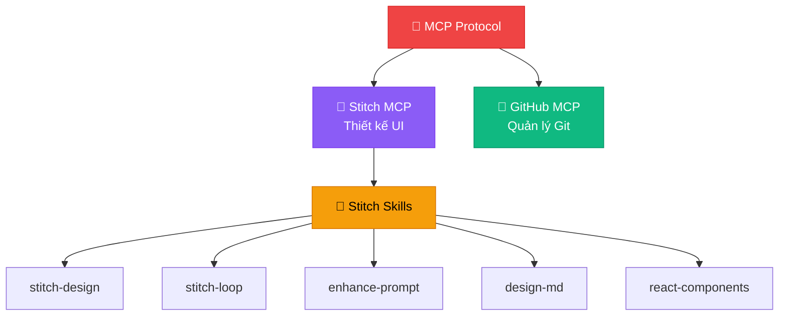

# 🔌 Section 6 · Model Context Protocol (MCP)

  
  
  
  

> **Kết nối AI Agents với External Systems — API, Database, Tools**

---

## 🎯 Mục tiêu Section

Sau section này, bạn sẽ:

- ✅ Hiểu **MCP** là gì và vai trò trong việc xây dựng AI Agents
- ✅ Kết nối Antigravity với **Google Stitch MCP Server**
- ✅ Cài đặt và sử dụng **Stitch Agent Skills**
- ✅ Setup **GitHub MCP Server** trong Antigravity
- ✅ Áp dụng **4 use cases thực tế** với GitHub MCP

---

## 📚 Lectures

| # | Lecture | Mô tả | Thời lượng |
|---|---------|--------|------------|
| 6.1 | **MCP là gì?** | Tổng quan và kiến trúc hệ thống. | ~30 phút |
| 6.2 | **Workflow Vibe Coding với MCP + Stitch** | Review workflow thực tế. | ~25 phút |
| 6.3 | **Kết nối IDE tới Stitch MCP Server** | Setup thực hành. | ~30 phút |
| 6.4 | **Cài đặt Stitch Agent Skills** | `stitch-design`, `stitch-loop`, `enhance-prompt`, `design-md`, `react-components` | ~25 phút |
| 6.5 | **GitHub MCP Server** | Setup trong Antigravity. | ~25 phút |
| 6.6 | **GitHub MCP Demo: 4 Use Cases** | Branch, PR, Review, Merge — tất cả tự động. | ~30 phút |

---

## 🔑 Key Concepts

---

## 🛠 Stitch Skills Reference

| Skill | Mục đích | Lệnh cài đặt |
|-------|---------|---------------|
| `stitch-design` | Thiết kế UI tổng thể | `npx skills add google-labs-code/stitch-skills --skill stitch-design --global` |
| `stitch-loop` | Sinh multi-page website | `npx skills add google-labs-code/stitch-skills --skill stitch-loop --global` |
| `enhance-prompt` | Tối ưu prompt cho Stitch | `npx skills add google-labs-code/stitch-skills --skill enhance-prompt --global` |
| `design-md` | Tạo design system document | `npx skills add google-labs-code/stitch-skills --skill design-md --global` |
| `react-components` | Convert design → React | `npx skills add google-labs-code/stitch-skills --skill react:components --global` |

---

## 📋 Prerequisites

- ✅ Hoàn thành **Section 1-4** — Đặc biệt Context Engineering
- ✅ Tài khoản GitHub

---

## 🔗 Links

- [Stitch Skills Repository](https://github.com/google-labs-code/stitch-skills)
- [Stitch MCP Setup](https://stitch.withgoogle.com/docs/mcp/setup)

---

[← Section 5](../section-05-multi-agent/README.md) · [🏠 Home](../../README.md) · [📑 Mục lục](../SUMMARY.md) · [Section 7 →](../section-07-vibe-coding/README.md)

