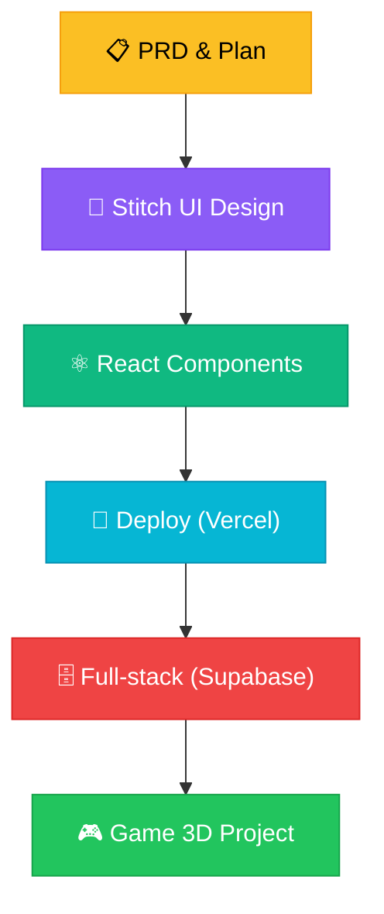

# 🎨 Section 7 · Vibe Coding Dự Án Thực Tế — Từ Ý Tưởng Đến Sản Phẩm

  
  
  
  

> **Áp dụng toàn bộ kiến thức để build dự án web hoàn chỉnh và game 3D bằng phương pháp Vibe Coding**

---

## 🎯 Mục tiêu Section

Sau section này, bạn sẽ:

- ✅ Nắm vững **quy trình 4 bước khi Vibe coding** từ ý tưởng đến sản phẩm
- ✅ Biết cách cài đặt và sử dụng **Stitch Agent Skills** để tự động hoá thiết kế UI và convert thành Code
- ✅ Thành thạo việc tạo **PRD (Project Requirement Document)** để điều hướng AI Agent
- ✅ Vibe coding hoàn thiện dự án **VibeSpace** (Pomodoro, Sound Mixer, Todo List, YouTube Player, Scene Selector)
- ✅ Triển khai dự án lên Production với **Vercel**
- ✅ Mở rộng hệ thống full-stack với **Backend và Database** kết nối qua Supabase/Render
- ✅ Tự tay xây dựng dự án thứ 2: **Game 3D Endless Runner** bằng Vibe Coding

---

## 📚 Lectures

| # | Lecture | Mô tả |
|---|---------|--------|
| 7.1 | [**Tổng quan Vibe Coding & Giới thiệu dự án**](lesson-01-vibe-coding-overview.md) | Vibe Coding là gì, vai trò PM của dev, giới thiệu dự án VibeSpace. |
| 7.2 | [**Quy trình 4 bước khi Vibe coding**](lesson-01-vibe-coding-overview.md) | Quy trình chi tiết từ Planning, Design, Coding đến Polish. |
| 7.3 | **Cài đặt plugin Agent Skills** | Đóng gói quy trình phát triển phần mềm và các Stitch Skills. |
| 7.4 | [**Tìm hiểu về PRD (Project requirement document)**](lesson-02-prd-and-project-planning.md) | Cách viết PRD hiệu quả và prompt template để AI tự viết PRD. |
| 7.5 | [**Lập kế hoạch dự án VibeSpace**](lesson-02-prd-and-project-planning.md) | Khởi tạo PRD, PLAN, ARCHITECTURE cho VibeSpace. |
| 7.6 | **Thiết kế UI cho VibeSpace trên Google Stitch** | Mockup và thiết kế các screens cho Dashboard. |
| 7.7 | **Chuyển đổi Thiết kế UI → Code** | Convert layout từ Stitch thành React component chạy localhost. |
| 7.8 | **Triển khai website lên Production với Vercel** | Build và deploy ứng dụng lên Vercel. |
| 7.9 | **Mở rộng dự án VibeSpace gồm Backend và Database** | Thêm backend Node.js và cơ sở dữ liệu Supabase. |
| 7.10 | **Kết nối MCP tới Render và Supabase** | Gọi các công cụ MCP để quản lý database và hosting. |
| 7.11 | **Vibe Coding Làm Game 3D Endless Runner - Dự án 2** | Áp dụng quy trình làm game 3D trực quan. |

---

## 🔑 Key Concepts

---

## 📋 Prerequisites

- ✅ Hoàn thành **Section 1-6**
- ✅ Setup môi trường Google Stitch và GitHub MCP thành công

---

[← Section 6](../section-06-mcp/README.md) · [🏠 Home](../../README.md) · [📑 Mục lục](../SUMMARY.md)

