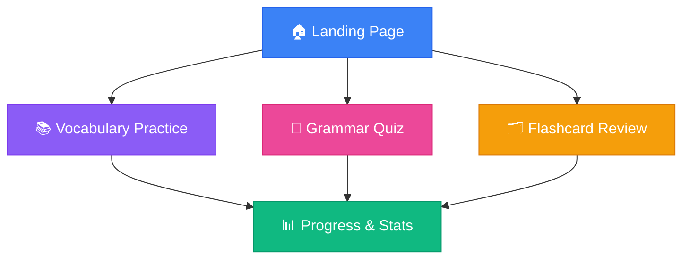

# 🎨 Section 7 · Vibe Coding Dự Án Thực Tế — Từ Ý Tưởng Đến Sản Phẩm

<p align="center">
  
  
  
  
  
</p>

> **Áp dụng toàn bộ kiến thức từ Section 1-6 để xây dựng một dự án web hoàn chỉnh bằng Vibe Coding**

---

## 🎯 Mục tiêu Section

Sau section này, bạn sẽ:

- ✅ Thành thạo **workflow Vibe Coding** từ ý tưởng → thiết kế → code → deploy
- ✅ Sử dụng thành thạo **Stitch Skills** để thiết kế UI chuyên nghiệp
- ✅ Tự động hoá quy trình **Git** với GitHub MCP
- ✅ Có **1 dự án hoàn chỉnh** trong portfolio

---

## 🏗️ Dự án: English Practice Hub

> 🎓 Trang web luyện tập tiếng Anh với vocabulary, grammar quiz, và flashcards



---

## 📚 Lectures

| # | Lecture | Mô tả | Thời lượng |
|---|---------|--------|------------|
| 7.1 | [**Tổng quan Vibe Coding & Lập kế hoạch**](lesson-01-vibe-coding-overview.md) | Mindset, workflow, project plan | ~35 phút |
| 7.2 | **Cài đặt Stitch Skills & Chuẩn bị** | Setup môi trường dev đầy đủ | ~25 phút |
| 7.3 | **Thiết kế Design System với Stitch** | Color, typography, shape, DESIGN.md | ~45 phút |
| 7.4 | **Tạo UI Screens – Phần 1** | Landing page, navigation, header | ~50 phút |
| 7.5 | **Tạo UI Screens – Phần 2** | Vocabulary, grammar quiz, flashcard | ~50 phút |
| 7.6 | **Convert Design → React Code** | `react-components` skill, Next.js | ~55 phút |
| 7.7 | **GitHub Workflow tự động** | Branch, commit, PR, merge | ~45 phút |
| 7.8 | **Thêm tính năng & Fix bug** | Dark mode, progress tracking, iterative | ~45 phút |
| 7.9 | **Polish UI, Responsive & Animation** | Mobile-first, micro-animations | ~45 phút |
| 7.10 | **Review & Tổng kết** | Best practices, lessons learned | ~35 phút |

---

## 📖 Tài liệu bổ sung

| File | Mô tả | Đối tượng |
|------|--------|-----------|
| [curriculum.md](curriculum.md) | Curriculum chi tiết 10 bài học | Giảng viên & Học viên |
| [teaching-guide.md](teaching-guide.md) | Hướng dẫn giảng dạy chi tiết | Giảng viên |
| [step-by-step-guide.md](step-by-step-guide.md) | Hướng dẫn từng bước với prompt mẫu | Học viên |

---

## 🛠 Công cụ sử dụng

| Công cụ | Vai trò | Bài học |
|---------|---------|---------|
| **Antigravity IDE** | AI Coding Agent chính | Tất cả |
| **Stitch MCP Server** | Thiết kế UI, tạo screens | 3, 4, 5, 9 |
| **GitHub MCP Server** | Quản lý repo, branches, PRs | 2, 7, 8 |
| `stitch-design` | Thiết kế tổng thể | 3, 4, 5 |
| `stitch-loop` | Sinh multi-page website | 5 |
| `enhance-prompt` | Tối ưu prompt cho Stitch | 4, 5 |
| `design-md` | Tạo DESIGN.md | 3 |
| `react-components` | Convert design → React | 6 |

---

## 📁 Cấu trúc dự án cuối cùng

```
english-practice-hub/
├── .stitch/
│   └── DESIGN.md              # Design system document
├── src/
│   ├── app/
│   │   ├── page.tsx            # Landing page
│   │   ├── layout.tsx          # Root layout
│   │   ├── vocabulary/
│   │   │   └── page.tsx        # Vocabulary practice
│   │   ├── grammar/
│   │   │   └── page.tsx        # Grammar quiz
│   │   └── flashcards/
│   │       └── page.tsx        # Flashcard review
│   ├── components/
│   │   ├── Header.tsx
│   │   ├── Footer.tsx
│   │   ├── QuizCard.tsx
│   │   ├── FlashCard.tsx
│   │   ├── ProgressBar.tsx
│   │   └── ThemeToggle.tsx
│   └── styles/
│       └── globals.css
├── public/
├── package.json
└── README.md
```

---

## 📋 Prerequisites

- ✅ Hoàn thành **Section 1-6**

---

<div align="center">

[← Section 6](../section-06-mcp/README.md) · [🏠 Home](../../README.md) · [📑 Mục lục](../SUMMARY.md)

</div>
