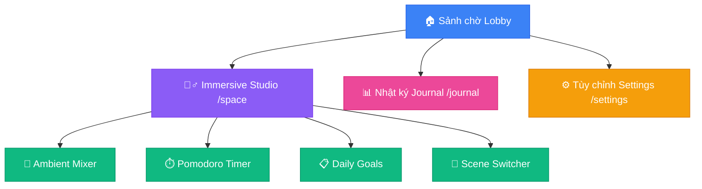

# 🎨 Section 7 · Vibe Coding Dự Án Thực Tế — Từ Ý Tưởng Đến Sản Phẩm

<p align="center">
  
  
  
  
  
</p>

> **Áp dụng toàn bộ kiến thức từ Section 1-6 để xây dựng một dự án web hoàn chỉnh bằng Vibe Coding**

---

## 🎯 Mục tiêu Section

Sau section này, bạn sẽ:

- ✅ Thành thạo **workflow Vibe Coding** từ ý tưởng → thiết kế → code → deploy
- ✅ Sử dụng thành thạo **Stitch Skills** để thiết kế UI chuyên nghiệp và cá nhân hóa sâu sắc
- ✅ Tự động hoá quy trình **Git** với GitHub MCP
- ✅ Có **1 dự án dashboard cực kỳ lộng lẫy và thực tế** trong portfolio

---

## 🏗️ Dự án: VibeSpace Studio

> 🧘‍♂️ Trạm tập trung và âm thanh chữa lành tích hợp đồng hồ Pomodoro, bộ trộn âm thanh thiên nhiên đa kênh, trình phát nhạc Lo-fi và phong cảnh động cá nhân hóa.



---

## 📚 Lectures

| # | Lecture | Mô tả | Thời lượng |
|---|---------|--------|------------|
| 7.1 | [**Tổng quan Vibe Coding & Giới thiệu VibeSpace**](lesson-01-vibe-coding-overview.md) | Mindset, workflow, giới thiệu dự án VibeSpace | ~30 phút |
| 7.2 | [**Specs-Driven Vibe Coding – Viết PRD & Lập kế hoạch**](lesson-02-prd-and-project-planning.md) | Viết PRD, Tech Specs, và lập kế hoạch PLAN.md | ~35 phút |
| 7.3 | [**Cài đặt Stitch Skills & Setup Context Engineering**](lesson-03-setup-context-engineering.md) | Setup môi trường dev, cài đặt skills, khởi tạo context docs | ~30 phút |
| 7.4 | [**Thiết kế Design System với Stitch**](lesson-04-design-system-with-stitch.md) | Màu sắc (Cyber-Zen), typography, shape, DESIGN.md | ~45 phút |
| 7.5 | [**Tạo UI Screens – Phần 1**](lesson-05-lobby-and-navigation.md) | Thiết kế Sảnh chờ (Lobby) & Cấu trúc chính | ~50 phút |
| 7.6 | **Tạo UI Screens – Phần 2** | Thiết kế Immersive Focus Studio với các Widget nổi | ~50 phút |
| 7.7 | **Convert Design → React Code** | `react-components` skill, cấu trúc ReactJS (Vite) & Routing | ~55 phút |
| 7.8 | **GitHub Workflow tự động** | Quản lý repo workspaces, branch, commit, PR, merge | ~45 phút |
| 7.9 | **Thêm tính năng & Fix bug** | Tích hợp iTunes API, Supabase DB, và Mixer đa kênh | ~45 phút |
| 7.10 | **Polish UI, Responsive & Animation** | Nhịp thở SVG, lật thẻ, chuyển cảnh mượt mà | ~45 phút |
| 7.11 | **Review & Tổng kết** | Best practices khi Vibe Coding với AI Agent | ~35 phút |

---

## 📖 Tài liệu bổ sung

| File | Mô tả | Đối tượng |
|------|--------|-----------|
| [curriculum.md](curriculum.md) | Curriculum chi tiết 11 bài học | Giảng viên & Học viên |
| [teaching-guide.md](teaching-guide.md) | Hướng dẫn giảng dạy chi tiết với prompt mẫu | Giảng viên |
| [step-by-step-guide.md](step-by-step-guide.md) | Hướng dẫn từng bước với prompt và tích hợp API | Học viên |

---

## 🛠 Công cụ sử dụng

| Công cụ | Vai trò | Bài học |
|---------|---------|---------|
| **Antigravity IDE** | AI Coding Agent chính | Tất cả |
| **Stitch MCP Server** | Thiết kế UI, tạo screens | 4, 5, 6, 10 |
| **GitHub MCP Server** | Quản lý repo, branches, PRs | 3, 8, 9 |
| **Supabase Client** | SDK kết nối trực tiếp database trên đám mây | 2, 3, 9 |
| `stitch-design` | Thiết kế tổng thể | 4, 5, 6 |
| `stitch-loop` | Sinh multi-page website | 6 |
| `enhance-prompt` | Tối ưu prompt cho Stitch | 5, 6 |
| `design-md` | Tạo DESIGN.md | 4 |
| `react-components` | Convert design → React | 7 |

---

## 📁 Cấu trúc dự án cuối cùng

```
vibespace-dashboard/
├── .stitch/
│   └── DESIGN.md              # Design system document
├── src/
│   ├── components/
│   │   ├── PomodoroTimer.tsx   # Đồng hồ đếm ngược Pomodoro
│   │   ├── AmbientMixer.tsx    # Bộ trộn âm thanh thiên nhiên đa kênh
│   │   ├── LofiPlayer.tsx      # Trình phát nhạc Lo-fi (iTunes API)
│   │   ├── TodoChecklist.tsx   # Danh sách mục tiêu trong ngày
│   │   ├── BreathingBubble.tsx # Vòng tròn bong bóng tập thở SVG
│   │   ├── SceneSelector.tsx   # Bộ chuyển đổi và tuỳ chỉnh ảnh nền
│   │   └── ThemeToggle.tsx     # Customizer chuyển đổi theme màu
│   ├── pages/
│   │   ├── Lobby.tsx           # Lobby Entrance Page (Sảnh chờ)
│   │   ├── Space.tsx           # Immersive Focus Studio (Bảng điều khiển lõi)
│   │   ├── Journal.tsx         # Productivity Stats Journal
│   │   └── Settings.tsx        # Customize Timer & sound presets
│   ├── App.tsx                 # Cấu hình Routing chính cho ứng dụng
│   ├── main.tsx                # Khởi tạo React & Mount DOM
│   └── index.css               # CSS & Glassmorphism styles
├── public/
├── .env                       # Cấu hình API keys của Supabase (URL, Anon Key)
├── index.html
├── package.json
├── vite.config.ts
└── README.md
```

---

## 📋 Prerequisites

- ✅ Hoàn thành **Section 1-6**

---

<div align="center">

[← Section 6](../section-06-mcp/README.md) · [🏠 Home](../../README.md) · [📑 Mục lục](../SUMMARY.md)

</div>
