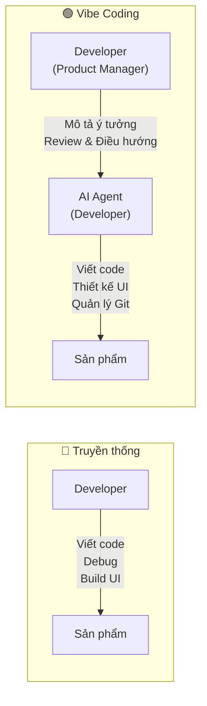
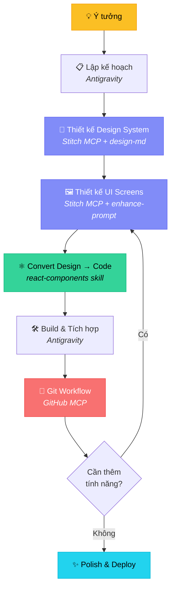
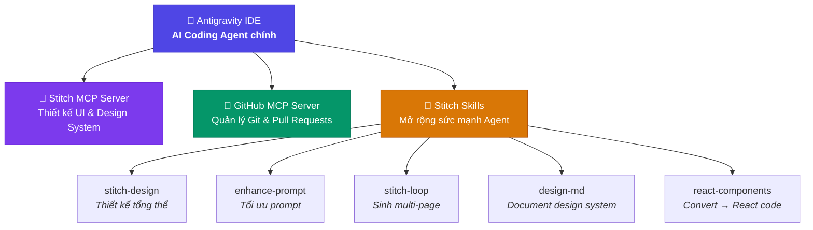
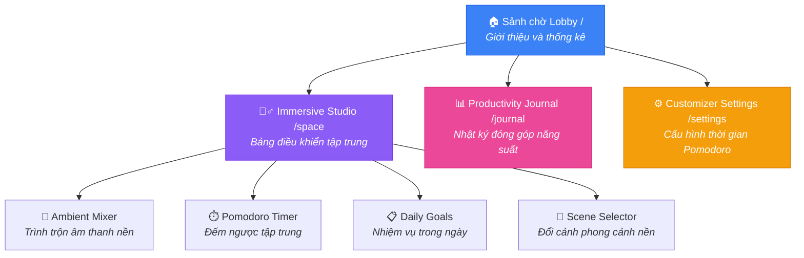
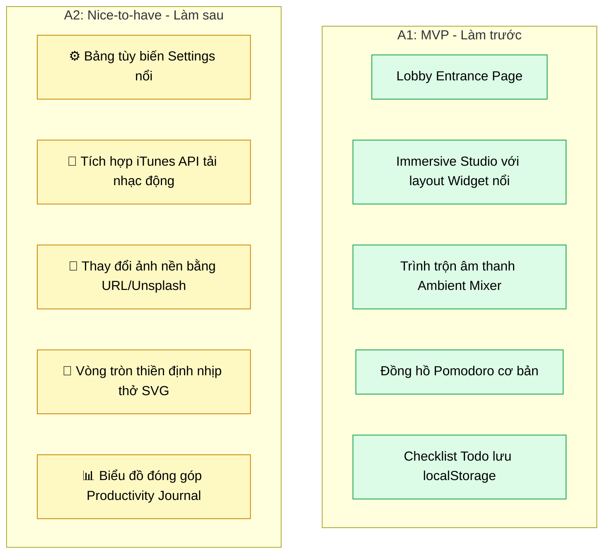
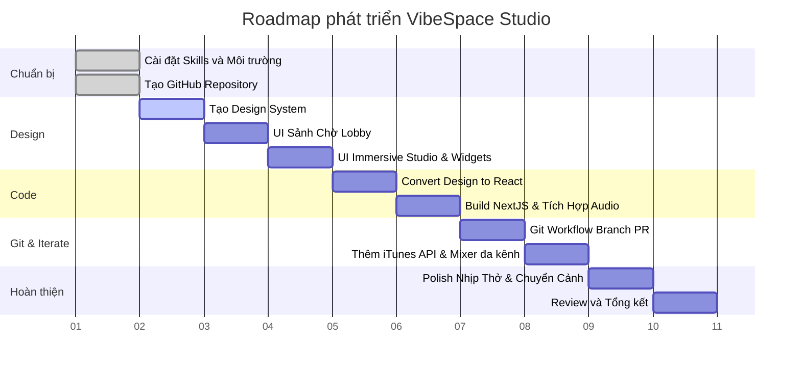

# 📘 Bài 1: Tổng quan Vibe Coding & Lập kế hoạch dự án

> **Section 7** · Vibe Coding Dự Án Thực Tế  
> **Thời lượng:** 30-40 phút  
> **Yêu cầu:** Đã hoàn thành Section 1-6

---

## 🎯 Mục tiêu bài học

Sau bài này, bạn sẽ:

- ✅ Hiểu **Vibe Coding** là gì và nó khác gì so với lập trình truyền thống
- ✅ Nắm được **workflow tổng thể** từ ý tưởng → sản phẩm hoàn chỉnh
- ✅ Biết được **vai trò mới của Developer** trong kỷ nguyên AI Agent
- ✅ Có **project plan chi tiết** cho dự án thực tế **VibeSpace** sẽ xây dựng xuyên suốt section

---

## 1. Vibe Coding là gì?

### 1.1 Định nghĩa

> **Vibe Coding** là phương pháp lập trình trong đó developer **mô tả ý tưởng bằng ngôn ngữ tự nhiên**, và **AI Agent sẽ thực thi** – viết code, thiết kế UI, quản lý dự án.

Thuật ngữ "Vibe Coding" được đặt bởi **Andrej Karpathy** (cựu Director of AI tại Tesla, co-founder OpenAI) vào đầu năm 2025:

> *"There's a new kind of coding I call 'vibe coding', where you fully give in to the vibes, embrace exponentials, and forget that the code even exists."*
>
> — Andrej Karpathy

Nói đơn giản: **Bạn mô tả "cái gì" cần làm, AI Agent lo "cách nào" để làm.**

### 1.2 Sự thay đổi vai trò

Trong Vibe Coding, vai trò của mỗi người thay đổi hoàn toàn:



| | **Lập trình truyền thống** | **Vibe Coding** |
|---|---|---|
| **Developer làm gì?** | Viết code từng dòng, debug, build UI | Mô tả ý tưởng, review, điều hướng AI |
| **Tốc độ** | Chậm – phụ thuộc vào kinh nghiệm | Nhanh – AI sinh code trong vài giây |
| **Kiến thức cần** | Thành thạo ngôn ngữ lập trình | Tư duy sản phẩm + Kỹ năng viết prompt |
| **Thiết kế UI** | Cần designer hoặc tự design | AI Agent + Stitch MCP thiết kế |
| **Quản lý code** | Git thủ công | GitHub MCP tự động |

### 1.3 Ví dụ thực tế

**❌ Cách truyền thống – Tạo Landing Page:**
```
1. Mở IDE, tạo file index.html          (5 phút)
2. Viết HTML structure                    (15 phút)
3. Tạo file styles.css, viết CSS         (30 phút)
4. Thêm JavaScript cho interactions      (20 phút)
5. Test responsive trên các thiết bị     (15 phút)
6. Fix bugs, điều chỉnh                  (20 phút)
─────────────────────────────────────────
⏱ Tổng: ~1.5 - 2 giờ
```

**✅ Cách Vibe Coding – Cùng một Landing Page:**
```
1. Mô tả cho AI Agent:                   (2 phút)
   "Tạo landing page với hero section, 
   3 feature cards, CTA button..."
   
2. AI Agent sinh code tự động             (30 giây)
3. Review và yêu cầu chỉnh sửa           (5 phút)
   "Đổi màu primary sang xanh dương,
   thêm animation cho cards..."
─────────────────────────────────────────
⏱ Tổng: ~8 - 10 phút
```

> 💡 **Nhanh hơn 10-15x** – Đó là sức mạnh của Vibe Coding!

---

## 2. Workflow tổng thể của Vibe Coding

Toàn bộ quy trình Vibe Coding mà chúng ta sẽ thực hành trong Section 7:



### Mỗi bước sử dụng công cụ gì?

| Bước | Công cụ chính | Bài học tương ứng |
|------|--------------|-------------------|
| 💡 Ý tưởng + Kế hoạch | Antigravity | **Bài 1** (bài này) |
| 🔧 Cài đặt môi trường | Stitch Skills CLI | Bài 2 |
| 🎨 Design System | Stitch MCP + `design-md` | Bài 3 |
| 🖼️ UI Screens | Stitch MCP + `enhance-prompt` + `stitch-loop` | Bài 4, 5 |
| ⚛️ Design → Code | `react-components` skill | Bài 6 |
| 🐙 Git Workflow | GitHub MCP | Bài 7 |
| 🔄 Thêm tính năng | Stitch MCP + GitHub MCP | Bài 8 |
| ✨ Polish | Antigravity | Bài 9, 10 |

---

## 3. Các công cụ sẽ sử dụng

Trong Section 7, chúng ta sẽ sử dụng **hệ sinh thái công cụ** sau:



### Tóm tắt vai trò từng công cụ

| Công cụ | Vai trò | Ví dụ tương đương |
|---------|---------|-------------------|
| **Antigravity** | "Bộ não" – điều phối mọi thứ | Như 1 senior developer |
| **Stitch MCP** | "Đôi mắt" – thiết kế UI đẹp | Như 1 UI/UX designer |
| **GitHub MCP** | "Đôi tay" – quản lý source code | Như 1 DevOps engineer |
| **Stitch Skills** | "Siêu năng lực" – khả năng đặc biệt | Như các plugin chuyên dụng |

---

## 4. Giới thiệu dự án: VibeSpace Studio

### 4.1 Tổng quan dự án

> 🧘‍♂️ **VibeSpace Studio** — Trạm tập trung và âm thanh chữa lành tích hợp đồng hồ Pomodoro, bộ trộn âm thanh thiên nhiên đa kênh, trình phát nhạc Lo-fi và phong cảnh động cá nhân hóa.

**Tại sao chọn dự án này?**
- 📱 **UI cực kỳ lộng lẫy** – Thiết kế dạng thẻ kính mờ (Glassmorphism) nổi trên nền phong cảnh động.
- 🎮 **Tương tác rất mạnh** – Trình phát nhạc iTunes API thực tế, bộ trộn âm thanh (mixer) đa kênh chạy song song, đồng hồ đếm ngược Pomodoro và bảng việc cần làm.
- 🎨 **Cá nhân hóa sâu sắc** – Cho phép người dùng tùy chọn chủ đề nhạc lo-fi theo từ khóa, đổi ảnh phong cảnh nền bằng URL bất kỳ hoặc qua từ khóa Unsplash, và lưu thiết lập vào `localStorage`.
- 🌍 **Đời sống gần gũi** – Hỗ trợ đắc lực cho các lập trình viên rèn luyện lối sống tập trung, giảm stress mỗi ngày.

### 4.2 Các trang của ứng dụng



### 4.3 Chi tiết từng cấu phần tại Focus Studio (`/space`)

#### 🎵 Ambient Mixer & Lo-fi Player (Study With Me)
- **iTunes Search API integration**: Nhập từ khóa (lofi, piano, jazz...) để tải về playlist dynamic. Hỗ trợ Play, Pause, Next, Prev.
- **Multi-channel Sound Mixer**: Các thanh trượt chỉnh âm lượng độc lập cho tiếng mưa rơi, sóng biển, gió thổi, lửa trại để người dùng tự thiết kế bản nhạc thư giãn của mình.

#### ⏱️ Pomodoro Timer & Zen Quotes
- **Pomodoro Timer**: Đồng hồ đếm ngược với 3 chế độ (Work, Short Break, Long Break). Có vòng tròn tiến trình SVG sinh động, tự chuyển đổi trạng thái và âm báo nhẹ nhàng khi kết thúc phiên.
- **Zen Quotes**: Trích dẫn châm ngôn sống ngẫu nhiên từ ZenQuotes API hiển thị tinh tế ở dưới cùng màn hình giúp chữa lành và tiếp thêm năng lực tích cực.

#### 📋 Daily Focus Goals
- Bảng Checklist ghi chú nhanh các công việc cần hoàn thành trong ngày.
- Hỗ trợ lưu trữ tự động vào `localStorage` kèm thanh tiến độ hoàn thành (Progress Bar).

#### 🌅 Scene Selector & dynamic backgrounds
- Cung cấp danh sách các cảnh đẹp tuyển chọn (ảnh chất lượng cao / ảnh động).
- Hỗ trợ đổi hình nền động bằng cách nhập từ khóa tìm ảnh Unsplash hoặc dán một đường dẫn ảnh URL bất kỳ.

---

## 5. Phân tích yêu cầu & MVP

### 5.1 MVP (Minimum Viable Product) vs Nice-to-have

Khi Vibe Coding, chúng ta cần tư duy sản phẩm để phân chia giai đoạn phát triển hợp lý:



---

### 5.2 Tech Stack

| Layer | Công nghệ | Lý do chọn |
|-------|-----------|------------|
| **Framework** | Next.js 14 (App Router) | Tối ưu hóa SEO, routing mạnh mẽ, phổ biến nhất |
| **Language** | TypeScript | Kiểm soát chặt chẽ lỗi cú pháp, dễ bảo trì |
| **Styling** | Tailwind CSS + Glassmorphism | Thiết kế giao diện trong suốt, viền neon mờ ảo, đáp ứng nhanh |
| **UI Design** | Google Stitch | AI-powered design system, MCP integration tốt |
| **Audio Processing** | Web Audio API / HTML5 Audio | Phát nhạc nền và trộn âm thanh đa kênh đồng thời |
| **APIs** | **iTunes Search API** + **ZenQuotes API** | Gọi dữ liệu nhạc Lo-fi động và câu trích dẫn 100% miễn phí |
| **State & Storage** | React State & LocalStorage | Quản lý trạng thái và lưu trữ lâu dài cấu hình người dùng |

---

### 5.3 Cấu trúc dự án dự kiến

```
vibespace-dashboard/
├── .stitch/
│   └── DESIGN.md                 ← Design system của Stitch
├── src/
│   ├── app/
│   │   ├── page.tsx              ← Lobby Entrance
│   │   ├── layout.tsx            ← Root layout + Global styling
│   │   ├── space/
│   │   │   └── page.tsx          ← Immersive Studio (Hợp nhất các Widget nổi)
│   │   ├── journal/
│   │   │   └── page.tsx          ← Productivity Journal
│   │   └── settings/
│   │       └── page.tsx          ← Settings cấu hình
│   ├── components/
│   │   ├── PomodoroTimer.tsx     ← Widget đồng hồ
│   │   ├── AmbientMixer.tsx      ← Widget trộn âm thanh thiên nhiên
│   │   ├── LofiPlayer.tsx        ← Trình phát nhạc Lo-fi (iTunes API)
│   │   ├── TodoChecklist.tsx     ← Bảng công việc cần làm
│   │   ├── BreathingBubble.tsx   ← Vòng tròn nhịp thở SVG
│   │   ├── SceneSelector.tsx     ← Bảng đổi hình nền
│   │   └── ThemeToggle.tsx       ← Nút chỉnh theme màu hệ thống
│   └── styles/
│       └── globals.css           ← Tailwind & Glassmorphism classes
├── public/                       ← Chứa âm thanh lặp (.mp3) và ảnh tĩnh
├── package.json
└── README.md
```

---

## 6. Tạo Project Plan bằng Antigravity

### Thứ tự phát triển

Roadmap phát triển mà chúng ta sẽ thực hành xuyên suốt Section 7:



### Từng giai đoạn chi tiết

| Giai đoạn | Bài học | Việc cần làm | Công cụ |
|-----------|---------|-------------|---------|
| **1. Chuẩn bị** | Bài 1-2 | Lên kế hoạch, cài tools, tạo repo `vibespace-dashboard` | Antigravity, GitHub MCP |
| **2. Design** | Bài 3-5 | Tạo design system, thiết kế UI Lobby, Studio và các Widget | Stitch MCP, Stitch Skills |
| **3. Code** | Bài 6 | Convert design → React, build project Next.js | `react-components` skill |
| **4. Git & Iterate** | Bài 7-8 | Branch workflow, code gọi API iTunes & trộn nhạc nền | GitHub MCP, Audio Context |
| **5. Polish** | Bài 9-10 | Nhịp thở thiền định SVG, responsive di động, SEO | Antigravity |

---

## 7. Tư duy quan trọng khi Vibe Coding

### 🧠 5 Nguyên tắc vàng

#### 1. "Bạn là Product Manager, không phải Developer"
Đừng nghĩ về code – hãy nghĩ về **sản phẩm**. AI Agent sẽ lo phần viết mã nguồn chi tiết.

#### 2. "Mô tả càng chi tiết, kết quả càng tốt"
```
❌ Prompt mơ hồ:    "Tạo trang web nghe nhạc thiền"
✅ Prompt chi tiết:  "Tạo trang Studio tập trung toàn màn hình có hình nền phong cảnh, 
                      có đồng hồ Pomodoro mờ kính bên phải, và bộ trộn âm lượng 
                      tiếng mưa, tiếng lửa trại bên trái..."
```

#### 3. "Design First, Code Later"
Luôn bắt đầu từ việc thiết kế các layer hình ảnh trên Stitch, sau đó mới convert sang code React. Đừng nhảy vào code ngay!

#### 4. "Iterate, Don't Perfect"
Vibe Coding là quy trình **lặp đi lặp lại**. Phiên bản đầu tiên không cần hoàn hảo – bạn có thể thêm các tính năng nâng cao (như tùy biến URL ảnh nền) dần dần.

#### 5. "Trust but Verify"
AI rất mạnh nhưng có thể gặp lỗi khi xử lý luồng Audio đồng thời. Luôn **chạy thử** và review code mà AI generate trước khi merge branch.

---

## 📝 Tóm tắt bài học

| Khái niệm | Nội dung chính |
|-----------|---------------|
| **Vibe Coding** | Lập trình bằng ngôn ngữ tự nhiên, AI Agent thực thi |
| **Vai trò mới** | Developer = Product Manager + Architect |
| **Workflow** | Ý tưởng → Design (Stitch) → Code → Git (GitHub MCP) → Lặp |
| **Dự án** | VibeSpace Studio – Trạm tập trung chữa lành cho lập trình viên |
| **MVP** | Lobby Entrance (`/`) & Focus Studio (`/space` với Widget hợp nhất) |
| **Nguyên tắc** | Design First, Mô tả chi tiết, Lặp liên tục |

---

## ⏭️ Bài tiếp theo

**Bài 2: Cài đặt Stitch Skills & Chuẩn bị môi trường** – Chúng ta sẽ cài đặt tất cả các skills cần thiết và tạo GitHub repository cho dự án VibeSpace.

---

*📚 Section 7 · Google Antigravity: Xây dựng AI Agent, AI App & Vibe Coding*
