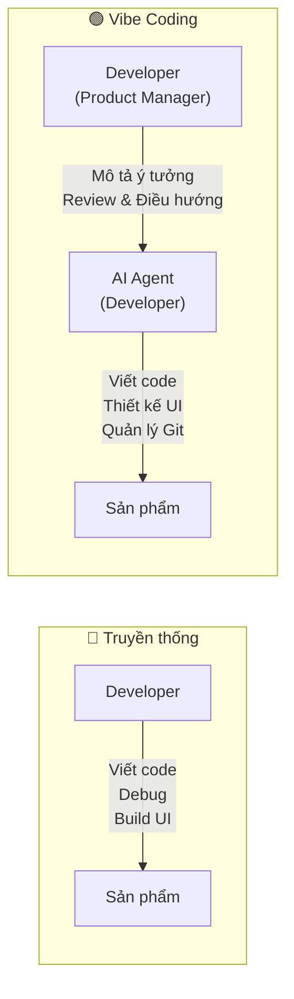
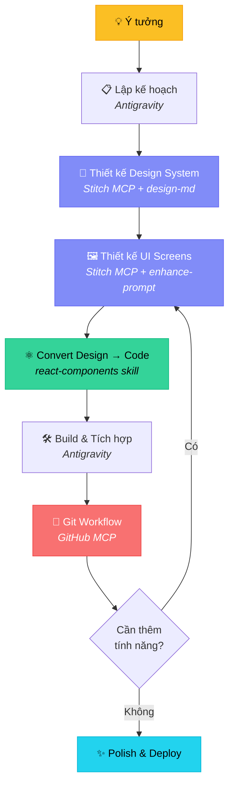
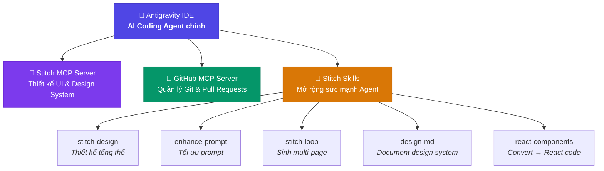

# 📘 Bài 1: Tổng quan Vibe Coding & Lập kế hoạch dự án

> **Section 7** · Vibe Coding Dự Án Thực Tế  
> **Thời lượng:** 30-40 phút  
> **Yêu cầu:** Đã hoàn thành Section 1-6

---

## 🎯 Mục tiêu bài học

Sau bài này, bạn sẽ:

- ✅ Hiểu **Vibe Coding** là gì và nó khác gì so với lập trình truyền thống
- ✅ Nắm được **workflow tổng thể** từ ý tưởng → sản phẩm hoàn chỉnh
- ✅ Biết được **vai trò mới của Developer** trong kỷ nguyên AI Agent
- ✅ Có **project plan chi tiết** cho dự án thực tế **VibeSpace** sẽ xây dựng xuyên suốt section

---

## 1. Vibe Coding là gì?

### 1.1 Định nghĩa

> **Vibe Coding** là phương pháp lập trình trong đó developer **mô tả ý tưởng bằng ngôn ngữ tự nhiên**, và **AI Agent sẽ thực thi** – viết code, thiết kế UI, quản lý dự án.

Thuật ngữ "Vibe Coding" được đặt bởi **Andrej Karpathy** (cựu Director of AI tại Tesla, co-founder OpenAI) vào đầu năm 2025:

> _"There's a new kind of coding I call 'vibe coding', where you fully give in to the vibes, embrace exponentials, and forget that the code even exists."_
>
> — Andrej Karpathy

Nói đơn giản: **Bạn mô tả "cái gì" cần làm, AI Agent lo "cách nào" để làm.**

### 1.2 Sự thay đổi vai trò

Trong Vibe Coding, vai trò của mỗi người thay đổi hoàn toàn:



|                       | **Lập trình truyền thống**           | **Vibe Coding**                       |
| --------------------- | ------------------------------------ | ------------------------------------- |
| **Developer làm gì?** | Viết code từng dòng, debug, build UI | Mô tả ý tưởng, review, điều hướng AI  |
| **Tốc độ**            | Chậm – phụ thuộc vào kinh nghiệm     | Nhanh – AI sinh code trong vài giây   |
| **Kiến thức cần**     | Thành thạo ngôn ngữ lập trình        | Tư duy sản phẩm + Kỹ năng viết prompt |
| **Thiết kế UI**       | Cần designer hoặc tự design          | AI Agent + Stitch MCP thiết kế        |
| **Quản lý code**      | Git thủ công                         | GitHub MCP tự động                    |

### 1.3 Ví dụ thực tế

**❌ Cách truyền thống – Tạo Landing Page:**

```
1. Mở IDE, tạo file index.html          (5 phút)
2. Viết HTML structure                    (15 phút)
3. Tạo file styles.css, viết CSS         (30 phút)
4. Thêm JavaScript cho interactions      (20 phút)
5. Test responsive trên các thiết bị     (15 phút)
6. Fix bugs, điều chỉnh                  (20 phút)
─────────────────────────────────────────
⏱ Tổng: ~1.5 - 2 giờ
```

**✅ Cách Vibe Coding – Cùng một Landing Page:**

```
1. Mô tả cho AI Agent:                   (2 phút)
   "Tạo landing page với hero section,
   3 feature cards, CTA button..."

2. AI Agent sinh code tự động             (30 giây)
3. Review và yêu cầu chỉnh sửa           (5 phút)
   "Đổi màu primary sang xanh dương,
   thêm animation cho cards..."
─────────────────────────────────────────
⏱ Tổng: ~8 - 10 phút
```

> 💡 **Nhanh hơn 10-15x** – Đó là sức mạnh của Vibe Coding!

---

## 2. Workflow tổng thể của Vibe Coding

Toàn bộ quy trình Vibe Coding mà chúng ta sẽ thực hành trong Section 7:



### Mỗi bước sử dụng công cụ gì?

| Bước                          | Công cụ chính                                 | Bài học tương ứng           |
| ----------------------------- | --------------------------------------------- | --------------------------- |
| 💡 Ý tưởng                    | Antigravity                                   | **Bài 1** (bài này)         |
| 📋 Lập kế hoạch & PRD          | Antigravity                                   | Bài 2                       |
| 🖼️ Phác thảo Giao diện UI      | Stitch MCP + `enhance-prompt`                 | Bài 3                       |
| ⚛️ Chuyển đổi Thiết kế → Code  | `react-components` skill                      | Bài 4                       |
| 🔄 Tích hợp Logic & Tính năng  | Antigravity                                   | Bài 5                       |
| 🐙 Polish & Git Workflow      | GitHub MCP                                    | Bài 6                       |
| 🏁 Review & Tổng kết          | Antigravity                                   | Bài 7                       |

---

## 3. Các công cụ sẽ sử dụng

Trong Section 7, chúng ta sẽ sử dụng **hệ sinh thái công cụ** sau:



### Tóm tắt vai trò từng công cụ

| Công cụ           | Vai trò                             | Ví dụ tương đương          |
| ----------------- | ----------------------------------- | -------------------------- |
| **Antigravity**   | "Bộ não" – điều phối mọi thứ        | Như 1 senior developer     |
| **Stitch MCP**    | "Đôi mắt" – thiết kế UI đẹp         | Như 1 UI/UX designer       |
| **GitHub MCP**    | "Đôi tay" – quản lý source code     | Như 1 DevOps engineer      |
| **Stitch Skills** | "Siêu năng lực" – khả năng đặc biệt | Như các plugin chuyên dụng |

## 4. Giới thiệu dự án: VibeSpace Studio

### 4.1 Tổng quan dự án

**VibeSpace Studio** là một ứng dụng "Ambient Space & Productivity Dashboard" (Trạm tập trung & Âm thanh chữa lành). Ứng dụng tích hợp các tính năng bổ trợ năng suất cùng hệ thống âm thanh, hình ảnh giúp người dùng giải tỏa căng thẳng và tăng cường sự tập trung khi học tập hay làm việc.

Dự án thực tế này sẽ bao gồm 5 tính năng cốt lõi:
1. **⏱️ Pomodoro Focus Timer**: Đồng hồ đếm ngược với 3 chế độ (Tập trung, Nghỉ ngắn, Nghỉ dài), vòng tiến trình SVG động mượt mà, và tự động thay đổi tiêu đề trình duyệt.
2. **🎵 Ambient Sound Mixer**: Bộ trộn âm thanh thiên nhiên đa kênh (Rain, Campfire, Wind, Forest) cho phép người dùng tùy chỉnh mức âm lượng riêng biệt của từng kênh âm thanh để tạo ra một không gian làm việc cá nhân hóa.
3. **📺 YouTube Music Player Widget**: Trình phát nhạc tích hợp YouTube IFrame API cho phép người dùng copy và dán bất kỳ link bài nhạc Lo-fi hay nhạc nền nào để phát trực tiếp ngay trên Dashboard với thanh kiểm soát âm lượng riêng biệt.
4. **📋 Daily Todo List**: Widget quản lý danh sách công việc cần làm trong ngày tích hợp thanh tiến trình tự động tính toán, lưu trữ dữ liệu thông qua LocalStorage.
5. **🌅 Scene & Theme Selector**: Bộ chuyển đổi phong cảnh hình nền động chất lượng cao (Rừng thông sương mù, Bãi biển hoàng hôn, Quán café mưa, Vũ trụ) để thay đổi tức thì cảm xúc toàn bộ không gian làm việc.

### 4.2 Tại sao chọn dự án này?

- **Hội tụ đầy đủ yếu tố kỹ thuật**: Kết hợp giữa quản lý trạng thái phức tạp (State management), tương tác API bên thứ ba (YouTube API), xử lý Audio (Web Audio API/HTML Audio), hoạt họa (SVG & CSS Transitions), và tối ưu giao diện Glassmorphism cao cấp.
- **Phù hợp hoàn hảo cho Vibe Coding**: Bạn sẽ đi từ bước phác thảo ý tưởng (PRD), thiết kế Layout bằng Stitch, rồi tự động sinh mã React từ UI mockup và ghép nối logic, giúp hiểu sâu sắc workflow thực tế.

---

## ⏭️ Bài tiếp theo

Sau khi đã hiểu rõ khái niệm Vibe Coding và bức tranh tổng thể của dự án VibeSpace, chúng ta sẽ bước vào **Bài 2: Specs-Driven Vibe Coding – PRD & Định hướng Thiết kế** để đặt nền móng giao diện và trải nghiệm người dùng cho dự án.

👉 **[Bài tiếp theo: Bài 2 – Specs-Driven Vibe Coding – PRD & Định hướng Thiết kế](lesson-02-prd-and-project-planning.md)**

---

_📚 Section 7 · Google Antigravity: Xây dựng AI Agent, AI App & Vibe Coding_
