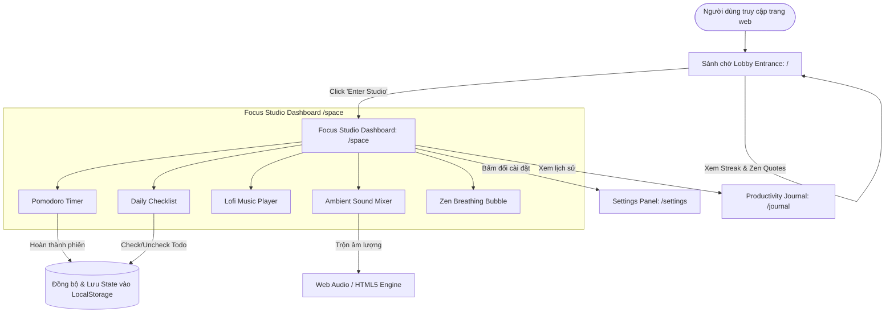

# Bài 2: Specs-Driven Vibe Coding – Viết PRD & Lập kế hoạch dự án

> **Mục tiêu bài học:** 
> - Hiểu rõ triết lý **Specs-Driven Development** (Phát triển hướng Đặc tả) và tầm quan trọng sống còn của nó trong Vibe Coding.
> - Sở hữu và hiểu sâu bộ tài liệu **PRD (Product Requirement Document)** và **Tech Specs (Đặc tả kỹ thuật)** chi tiết của dự án **VibeSpace Studio**.
> - Học cách áp dụng **Prompt Engineering** để tự động tạo Specs chuyên nghiệp cho bất kỳ ý tưởng dự án nào.
> - Nắm vững cách lập kế hoạch phát triển MVP và phân rã các Task nhỏ bằng file `PLAN.md`.

---

## 1. Triết lý "Specs-Driven Development" trong Vibe Coding

Trong lập trình truyền thống, bạn thường mở trình soạn thảo mã nguồn và bắt đầu gõ code ngay khi có ý tưởng. Nếu thiếu sót, bạn sẽ sửa dần. Nhưng trong **Vibe Coding** – nơi AI Agent là người viết mã chính còn bạn đóng vai trò là **Product Manager** kiêm **Architect** – việc bắt tay vào code ngay mà không có đặc tả rõ ràng là một **"thảm họa token"**.

```
❌ Vibe Coding KHÔNG KẾ HOẠCH:
Ý tưởng thô ➔ Prompt mơ hồ ➔ AI sinh code phỏng đoán ➔ Lỗi / Tràn tiếng ➔ Hỏi AI fix ➔ AI phá cấu trúc cũ ➔ Lỗi nặng hơn ➔ Bế tắc (Hallucination Loop)

✅ SPECS-DRIVEN VIBE CODING:
Ý tưởng thô ➔ Viết PRD & Tech Specs rõ ràng ➔ Thiết lập Context Document ➔ AI đọc hiểu ➔ AI sinh code chính xác ➔ Tích hợp mượt mà (Success Flow)
```

### Tại sao AI Agent cần Specs (Đặc tả)?

1. **Khắc chế hiện tượng ảo giác (Hallucination)**: AI rất mạnh trong việc tạo code, nhưng nếu bạn không giới hạn phạm vi, AI sẽ tự "phỏng đoán" cấu trúc dữ liệu, tên API, hoặc cách đặt tên component. Specs chính là đường ray giữ cho AI đi đúng hướng.
2. **Tiết kiệm Token & Chi phí**: Việc sửa một lỗi logic do AI hiểu sai cấu trúc dữ liệu ở giai đoạn cuối sẽ tiêu tốn lượng token gấp 10-20 lần so với việc đưa cho AI một file cấu trúc dữ liệu chuẩn ngay từ đầu.
3. **Đảm bảo tính nhất quán (Consistency)**: Khi dự án lớn lên với hàng chục component và nhiều trang, Specs giúp các component (ví dụ: bộ trộn âm Mixer và trình phát nhạc Lofi) chia sẻ chung một cấu trúc dữ liệu (`localStorage` state) mà không bị lệch kiểu (type mismatch).

---

## 2. Tài liệu PRD (Product Requirement Document) – VibeSpace Studio

Dưới đây là tài liệu đặc tả sản phẩm hoàn chỉnh của **VibeSpace Studio**. Bạn sẽ dùng tài liệu này làm kim chỉ nam để AI Agent thiết kế và sinh code cho toàn bộ dự án.

> [!NOTE]
> Bạn có thể copy-paste toàn bộ phần PRD này và cung cấp cho AI Agent khi bắt đầu xây dựng dự án để AI hiểu chính xác nghiệp vụ sản phẩm.

---

### 📝 PRODUCT REQUIREMENT DOCUMENT (PRD)
**Tên dự án:** VibeSpace Studio
**Trạng thái:** MVP Specification
**Tác giả:** Product Manager & Antigravity AI Architect

#### 2.1 Tổng quan sản phẩm & Mục tiêu
**VibeSpace Studio** là một ứng dụng web (Focus Station) dạng không gian làm việc và âm thanh chữa lành cá nhân hóa. Sản phẩm hướng tới đối tượng người dùng là các lập trình viên, nhà thiết kế, nhà văn, và học sinh – những người cần một không gian trực tuyến yên tĩnh, đẹp đẽ và kích thích sự tập trung tối đa, giảm bớt căng thẳng (stress) khi làm việc trong thời gian dài.

#### 2.2 Đối tượng người dùng (Target Persona)
- **Minh (24 tuổi, Lập trình viên Front-End)**: Thường xuyên bị phân tâm bởi mạng xã hội và thông báo điện thoại, thích nghe nhạc Lo-fi và tiếng mưa rơi để tập trung viết code, nhưng ghét việc phải mở 5 tab khác nhau (Spotify, YouTube tiếng mưa, Pomodoro app, Todoist).
- **Trang (21 tuổi, Sinh viên Đại học)**: Hay bị căng thẳng trước mùa thi, cần một công cụ đếm ngược Pomodoro trực quan kèm nhạc thiền nhịp thở để kiểm soát cơn lo âu và theo dõi tiến độ học tập hàng ngày.

#### 2.3 Phạm vi tính năng MVP (Minimum Viable Product)
Để tối ưu hóa quá trình xây dựng, chúng ta chia các tính năng thành hai nhóm ưu tiên rõ rệt:

##### Nhóm P0: Tính năng cốt lõi bắt buộc phải có (MVP Core)
1. **Sảnh chờ Lobby (`/`)**: 
   - Giao diện chào đón tối giản, sang trọng.
   - Nút "Enter Studio" nổi bật để chuyển sang không gian làm việc.
   - Hiển thị thống kê chuỗi ngày tập trung liên tục (Streaks) được lưu trữ.
   - Hiển thị một câu châm ngôn ngẫu nhiên (Zen Quotes) để tạo động lực.
2. **Không gian làm việc lõi Immersive Studio (`/space`)**:
   - Giao diện toàn màn hình (Full viewport) với ảnh nền phong cảnh mượt mà.
   - Layout chứa các **Widget nổi dạng kính mờ (Floating Glassmorphic Cards)** có thể bật/tắt hoặc sắp xếp linh hoạt.
3. **Đồng hồ đếm ngược Pomodoro Widget**:
   - 3 chế độ: 25 phút tập trung (Work), 5 phút nghỉ ngắn (Short Break), 15 phút nghỉ dài (Long Break).
   - Vòng tròn tiến trình SVG sinh động co dãn theo thời gian trôi qua.
   - Âm báo nhẹ nhàng khi kết thúc phiên đếm ngược.
4. **Bộ trộn âm thanh thiên nhiên Ambient Sound Mixer**:
   - Cho phép phát song song nhiều kênh âm thanh ambient: Tiếng Mưa rơi (Rain), Tiếng Lửa trại bập bùng (Campfire), Tiếng Sóng biển rì rào (Waves), Tiếng Gió rít nhẹ (Wind).
   - Thanh trượt (Slider) điều chỉnh âm lượng riêng biệt cho từng kênh.
5. **Danh sách việc cần làm Daily Focus Checklist**:
   - Bảng Todo tối giản giúp người dùng note nhanh các mục tiêu tập trung trong ngày.
   - Hỗ trợ thêm mới, xóa và đánh dấu hoàn thành công việc.
   - Tích hợp thanh tiến độ (Progress Bar) trực quan.

##### Nhóm P1 & P2: Tính năng nâng cao (Nice-to-have - Làm sau)
1. **Trình phát nhạc Lo-fi Player (iTunes Search API)**:
   - Cho phép phát nhạc Lo-fi động được lấy từ iTunes API.
   - Hỗ trợ đổi thể loại nhạc (Chill, Coding, Piano, Study) thông qua ô chọn.
2. **Vòng tròn nhịp thở Thiền định Breathing Bubble SVG**:
   - Widget bong bóng co dãn mượt mà theo nhịp thở Zen (4 giây Hít vào ➔ 4 giây Giữ hơi ➔ 4 giây Thở ra) để giúp người dùng giảm căng thẳng tức thì.
3. **Trang nhật ký năng suất Productivity Journal (`/journal`)**:
   - Biểu đồ dạng ô lưới đóng góp (GitHub Contribution Grid) hiển thị lịch sử số phút tập trung trong năm.
4. **Bảng cài đặt hệ thống Settings Panel (`/settings`)**:
   - Cho phép thay đổi thời gian Pomodoro tùy chỉnh, chọn nguồn ảnh phong cảnh nền (URL tự định nghĩa hoặc API).

#### 2.4 Sơ đồ User Flow (Luồng người dùng)



---

## 3. Tài liệu Tech Specs (Technical Specifications) – VibeSpace Studio

Tài liệu Đặc tả kỹ thuật dưới đây định nghĩa rõ kiến trúc phần mềm, cấu trúc dữ liệu lưu trữ, và cách vận hành các tính năng phức tạp như Audio Engine để AI Agent code chuẩn xác ngay từ lần đầu tiên.

---

### 💻 TECHNICAL SPECIFICATIONS (TECH SPECS)
**Mã dự án:** VIBESPACE-01
**Kiến trúc:** Next.js 14 App Router, React, Tailwind CSS, TypeScript
**Lưu trữ:** Clientside LocalStorage Stateful Engine

#### 3.1 Cấu trúc Định tuyến (Routing Architecture)
Ứng dụng sẽ tuân thủ cấu trúc định tuyến App Router của Next.js 14 với các trang sau:
- `/` (src/app/page.tsx): Lobby Entrance (Trang giới thiệu, thống kê streak và nút khởi động).
- `/space` (src/app/space/page.tsx): Immersive Focus Studio (Bảng điều khiển tập trung chứa các widget nổi mờ kính).
- `/journal` (src/app/journal/page.tsx): Trang hiển thị biểu đồ đóng góp thời gian tập trung (Productivity Grid).
- `/settings` (src/app/settings/page.tsx): Trang hoặc bảng cấu hình tùy chọn thời gian Pomodoro và preset âm thanh.

#### 3.2 Lược đồ dữ liệu State lưu trong LocalStorage (State Schema)
Toàn bộ trạng thái làm việc của người dùng phải được lưu và đồng bộ tự động xuống `localStorage` dưới một key duy nhất là `vibespace_state_v1` để tránh xung đột dữ liệu.

Dưới đây là khai báo TypeScript Interface chuẩn cho State Schema của ứng dụng:

```typescript
export interface TodoItem {
  id: string;
  text: string;
  completed: boolean;
  createdAt: string;
}

export interface PomodoroConfig {
  workTime: number;       // Thời gian tập trung (phút) - Mặc định: 25
  shortBreak: number;     // Thời gian nghỉ ngắn (phút) - Mặc định: 5
  longBreak: number;      // Thời gian nghỉ dài (phút) - Mặc định: 15
  sessionsBeforeLongBreak: number; // Số phiên trước khi nghỉ dài - Mặc định: 4
}

export interface AudioMixerState {
  rainVolume: number;     // Tiếng mưa: 0.0 đến 1.0
  campfireVolume: number; // Tiếng lửa trại: 0.0 đến 1.0
  wavesVolume: number;    // Tiếng sóng biển: 0.0 đến 1.0
  windVolume: number;     // Tiếng gió rít: 0.0 đến 1.0
  lofiVolume: number;     // Âm lượng nhạc Lofi phát từ API: 0.0 đến 1.0
  isPlaying: boolean;     // Trạng thái phát chung của mixer
  currentLofiGenre: string; // Thể loại nhạc lofi ('chill', 'coding', 'piano')
}

export interface UserStreaks {
  currentStreak: number;  // Chuỗi ngày tập trung liên tục hiện tại
  longestStreak: number;  // Chuỗi ngày dài nhất từng đạt được
  lastActiveDate: string; // Định dạng YYYY-MM-DD để kiểm tra chuỗi liên tục hàng ngày
  totalFocusMinutes: number; // Tổng số phút đã tập trung
}

export interface FocusSession {
  date: string;           // Định dạng YYYY-MM-DD
  minutesFocused: number; // Số phút tập trung được ghi nhận trong ngày
}

// Interface lõi lưu trữ toàn bộ trạng thái hệ thống
export interface VibeSpaceState {
  theme: 'cyber-zen' | 'forest-mist' | 'sunset-glow';
  currentScene: string;   // Tên hoặc URL ảnh/video nền đang chọn
  pomodoroConfig: PomodoroConfig;
  todos: TodoItem[];
  audioMixer: AudioMixerState;
  streaks: UserStreaks;
  history: FocusSession[]; // Dữ liệu phục vụ vẽ biểu đồ đóng góp ở trang Journal
}
```

#### 3.3 Đặc tả Audio Engine (Chống re-render trùng tiếng)

##### Vấn đề kỹ thuật
Trong React, các component thường xuyên bị re-render do sự thay đổi state (ví dụ: giây đồng hồ đếm ngược Pomodoro nhảy liên tục). Nếu khởi tạo đối tượng `new Audio()` bên trong component một cách ngây thơ, React sẽ liên tục tạo ra hàng chục luồng âm thanh mới mỗi giây, gây ra hiện tượng **tràn tiếng (audio overlap)**, lặp tiếng vang dữ dội và không thể nhấn nút pause để tắt nhạc được.

##### Giải pháp Đặc tả (Audio Singleton / Ref Pattern)
Mọi luồng âm thanh Ambient và Lofi phải được quản lý thông qua một tham chiếu duy nhất không đổi qua các lần re-render. Chúng ta sẽ áp dụng mô hình **Audio Manager** bằng cách lưu trữ các thực thể HTML5 Audio trong một `useRef` hoặc triển khai một React Context Audio Provider hoạt động như một **Singleton**.

**Quy tắc triển khai cho AI Agent:**
1. Khởi tạo đối tượng Audio lặp (loop = true) dạng **lazy-load** (chỉ khởi tạo khi người dùng nhấn Play lần đầu tiên để tránh vi phạm chính sách Autoplay của trình duyệt).
2. Lưu các thực thể Audio vào một đối tượng map trong `useRef`:
   ```typescript
   const audioRefs = useRef<{ [key: string]: HTMLAudioElement | null }>({
     rain: null,
     campfire: null,
     waves: null,
     wind: null,
     lofi: null,
   });
   ```
3. Khi thay đổi thanh trượt âm lượng (volume slider), chỉ cập nhật thuộc tính `.volume` của đối tượng audio tương ứng mà không tạo mới thực thể.
4. Khi nhấn Stop, gọi hàm `.pause()` trên tất cả các key đang phát và reset `.currentTime = 0`.

---

## 4. Sử dụng Prompt Engineering để sinh PRD & Tech Specs tự động

Bạn không cần phải tự gõ từng dòng tài liệu đặc tả dài dòng này cho các dự án tương lai. Hãy tận dụng sức mạnh của **Prompt Engineering** để yêu cầu các AI lớn (như Gemini, Claude, GPT) soạn thảo giúp bạn dựa trên một ý tưởng sơ khai ban đầu.

Dưới đây là **Template Prompt Vàng** để sinh tài liệu Specs mà bạn có thể lưu lại sử dụng:

### 📝 TEMPLATE PROMPT SINH PRD & TECH SPECS

```text
[BỐI CẢNH / CONTEXT]
Tôi đang chuẩn bị xây dựng một dự án ứng dụng web có tên là "[TÊN DỰ ÁN CỦA BẠN]" bằng phương pháp Vibe Coding (Sử dụng stack: [NÊU STACK CÔNG NGHỆ, ví dụ: Next.js 14, Tailwind, TypeScript, SQLite]). Ý tưởng sơ khai của ứng dụng này là: "[MÔ TẢ NGẮN GỌN Ý TƯỞNG CỦA BẠN TRONG 2-3 CÂU]".

[VAI TRÒ / ROLE]
Bạn là một Giám đốc Sản phẩm (Product Manager) kiêm Kiến trúc sư Giải pháp Phần mềm (Solutions Architect) cấp cao. Nhiệm vụ của bạn là biến ý tưởng thô của tôi thành một bộ tài liệu đặc tả kỹ thuật cực kỳ chặt chẽ và chuyên nghiệp để bất kỳ AI Agent nào đọc vào cũng có thể thực thi chính xác 100% không sai lệch.

[NHIỆM VỤ CHI TIẾT / INSTRUCTIONS]
Hãy tạo hai tài liệu đặc tả bằng định dạng Markdown:

1. PRD (Product Requirement Document):
   - Tổng quan & Mục tiêu sản phẩm.
   - Đối tượng người dùng mục tiêu (Persona).
   - Phân rã tính năng MVP (Các tính năng lõi ưu tiên làm trước) vs Nice-to-have (Tính năng nâng cao làm sau).
   - Sơ đồ luồng đi của người dùng (User Flow) vẽ bằng cú pháp Mermaid.

2. Tech Specs (Technical Specifications):
   - Cấu trúc định tuyến các trang (Routing Architecture).
   - Lược đồ cơ sở dữ liệu hoặc State Schema lưu trữ chi tiết dưới dạng TypeScript Interfaces (mô tả rõ kiểu dữ liệu của từng trường để tránh sai lệch dữ liệu).
   - Chỉ ra 1-2 thách thức kỹ thuật lớn nhất của dự án này (ví dụ: xử lý bất đồng bộ, đồng bộ state, vấn đề re-render, v.v.) và đưa ra giải pháp đặc tả kỹ thuật chi tiết để AI coding agent không mắc lỗi khi thực thi.

[RÀNG BUỘC / CONSTRAINTS]
- Trình bày mạch lạc, sử dụng các ký hiệu biểu tượng (Emoji), bảng biểu, và các hộp thông tin cảnh báo của GitHub (GitHub Alerts) để tăng tính thẩm mỹ và dễ đọc.
- Không viết mã nguồn chi tiết của toàn bộ app, chỉ tập trung viết đặc tả kiến trúc dữ liệu và giải pháp thuật toán.
```

---

## 5. Lập kế hoạch dự án bằng Antigravity (Tạo file `PLAN.md`)

Sau khi có bộ tài liệu PRD & Tech Specs, bước tiếp theo trong quy trình Specs-Driven Vibe Coding là **Lập kế hoạch phát triển dự án**. Trong thế giới thực, các lập trình viên sử dụng Jira hoặc Trello, còn trong Vibe Coding, chúng ta sử dụng một công cụ tinh gọn và hiệu quả hơn rất nhiều: **`PLAN.md` ở root của dự án**.

`PLAN.md` đóng vai trò là **bộ nhớ ngoài hoạt động** của AI Agent. Khi AI Agent hoàn thành một task, nó sẽ cập nhật trạng thái của task đó từ chưa làm `[ ]` sang đang làm `[/]` hoặc đã xong `[x]`. Điều này giúp AI không bị lạc lối khi chuyển giao giữa các phiên làm việc dài ngày.

Cấu trúc file `PLAN.md` tiêu chuẩn cho dự án VibeSpace Studio được thiết lập như sau:

```markdown
# 🗺️ VibeSpace Studio - Development Plan

## 🎯 MVP Milestones (Mục tiêu cốt lõi)

- [ ] **Milestone 1: Setup & Context Engineering** (Độ ưu tiên: Cao)
  - [ ] Khởi tạo Git repository `vibespace-studio`
  - [ ] Thiết lập bộ 3 Context documents: `AGENTS.md`, `ARCHITECTURE.md`, `PLAN.md`
  - [ ] Cài đặt các thư viện Stitch Skills cần thiết

- [ ] **Milestone 2: Thiết kế UI & Trải nghiệm (Stitch)** (Độ ưu tiên: Cao)
  - [ ] Xây dựng Design System (Cyber-Zen dark mode)
  - [ ] Tạo màn hình Sảnh chào Lobby (`/`)
  - [ ] Tạo màn hình Studio toàn cảnh (`/space`) với layout Widget nổi
  - [ ] Xuất bản tài liệu `DESIGN.md` từ Stitch

- [ ] **Milestone 3: Convert React & Cài đặt Routing (Next.js)** (Độ ưu tiên: Trung bình)
  - [ ] Khởi tạo dự án Next.js 14 App Router
  - [ ] Sử dụng skill `react-components` convert thiết kế Stitch thành React
  - [ ] Thiết lập hệ thống định tuyến giữa `/` và `/space`

- [ ] **Milestone 4: Lập trình Logic lõi & Audio Engine** (Độ ưu tiên: Cao)
  - [ ] Triển khai State Engine đồng bộ tự động `localStorage` theo đúng State Schema đặc tả
  - [ ] Lập trình Logic đếm ngược Pomodoro (Work/Break) kèm âm báo
  - [ ] Xây dựng Audio Singleton Manager để trộn âm lượng đa kênh Ambient mượt mà không lặp tiếng
  - [ ] Tích hợp iTunes Search API để đổi thể loại nhạc Lo-fi động

- [ ] **Milestone 5: Polish, Animation & Responsive** (Độ ưu tiên: Thấp)
  - [ ] Thiết kế responsive trên mobile cho các widget nổi
  - [ ] Thêm hiệu ứng thiền thở Breathing Bubble bằng nhịp SVG co dãn
  - [ ] Thêm transition đổi cảnh nền động mượt mà
```

---

## 🧠 Tổng kết & Tư duy PM khi lập kế hoạch

- **Hãy là một PM kỷ luật**: Khi Vibe Coding, AI Agent sẽ có xu hướng muốn code hết mọi thứ cùng một lúc nếu bạn gửi cho nó một prompt quá lớn. Hãy kiên quyết kiểm soát AI. Bắt AI làm việc **từng Milestone một**, cập nhật trạng thái trong `PLAN.md` trước khi sang Milestone tiếp theo.
- **Tập trung vào MVP**: Đừng cố gắng thêm các tính năng phức tạp (như lưu trữ đám mây, đăng nhập người dùng) ngay từ đầu. Hãy hoàn thành phiên bản MVP tối giản chạy mượt mà trước khi nâng cấp.

---

## ⏭️ Bài tiếp theo

**[Bài 3: Cài đặt & Setup Context Engineering cho VibeSpace](lesson-03-setup-context-engineering.md)** – Có PRD và Tech Specs trong tay, chúng ta sẽ bắt đầu cài đặt các công cụ thiết kế Stitch Skills, khởi tạo Git Repo chuyên nghiệp bằng GitHub MCP, và tự tay thiết lập bộ ba file Context Documents (`AGENTS.md`, `ARCHITECTURE.md`, `PLAN.md`) tại root dự án để tạo "bộ não ngoài" hoàn hảo cho AI Agent!

---

*📚 Section 7 · Google Antigravity: Xây dựng AI Agent, AI App & Vibe Coding*
