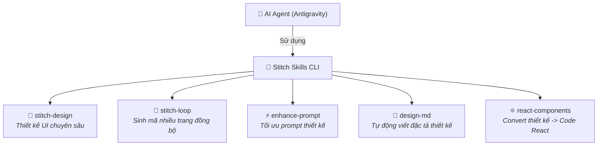

# Bài 3: Cài đặt & Setup Context Engineering cho VibeSpace

> **Section 7** · Vibe Coding Dự Án Thực Tế  
> **Thời lượng:** 25-35 phút  
> **Yêu cầu:** Đã hoàn thành Bài 1 và Bài 2

---

## 🎯 Mục tiêu bài học

Sau bài học này, bạn sẽ:

- ✅ Hiểu sâu sắc **Context Engineering** là gì và tại sao nó giúp giảm 80%+ lãng phí token và tránh lỗi vòng lặp của AI.
- ✅ Biết cách cài đặt bộ công cụ **Stitch Skills** để hỗ trợ thiết kế và convert code tự động.
- ✅ Thực hành khởi tạo Git repository từ xa thông qua **GitHub MCP Server**.
- ✅ Thiết lập bộ ba tài liệu ngữ cảnh (**Context Documents**): `AGENTS.md`, `ARCHITECTURE.md`, và `PLAN.md` làm "bộ nhớ ngoài" cho AI Agent.

---

## 1. Tổng quan & Cài đặt bộ công cụ Stitch Skills

### 1.1 Stitch Skills là gì?

Trong các section trước, bạn đã biết **Stitch** là nền tảng thiết kế UI dựa trên AI. Tuy nhiên, để AI Agent trong Antigravity có thể giao tiếp mượt mà với Stitch, tối ưu hóa các prompt thiết kế, sinh nhiều trang đồng bộ, hoặc tự động dịch layout thiết kế thành React component, chúng ta cần cài đặt thêm các **Stitch Skills**.

**Stitch Skills** là các gói mở rộng kỹ năng được tích hợp trực tiếp vào AI Agent, giúp Agent có thêm các "siêu năng lực" chuyên biệt:



### 1.2 Cài đặt Stitch Skills & Supabase SDK bằng Terminal

Để cài đặt các skills này vào hệ thống của bạn, hãy mở Terminal (hoặc chạy trực tiếp thông qua lệnh terminal của Antigravity) và thực thi các câu lệnh sau:

```bash
# 1. Cài đặt bộ công cụ thiết kế Stitch Design
npx skills add google-labs-code/stitch-skills --skill stitch-design --global

# 2. Cài đặt bộ công cụ thiết kế lặp sinh trang (Multi-page)
npx skills add google-labs-code/stitch-skills --skill stitch-loop --global

# 3. Cài đặt công cụ nâng cấp prompt thiết kế
npx skills add google-labs-code/stitch-skills --skill enhance-prompt --global

# 4. Cài đặt công cụ phân tích và viết DESIGN.md
npx skills add google-labs-code/stitch-skills --skill design-md --global

# 5. Cài đặt công cụ convert layout thiết kế sang React component
npx skills add google-labs-code/stitch-skills --skill react:components --global
```

Ở các bước sau, chúng ta cũng sẽ cần cài đặt thư viện client của Supabase để ReactJS kết nối trực tiếp với DB:

```bash
# Cài đặt thư viện client Supabase trong project của bạn
npm install @supabase/supabase-js
```

---

## 2. Tạo GitHub Repository bằng GitHub MCP

Trong Vibe Coding, AI Agent sẽ làm việc trực tiếp trên mã nguồn của bạn. Vì vậy, việc thiết lập Git từ đầu là bắt buộc để:
1. **Kiểm soát phiên bản**: Bạn có thể dễ dàng rollback (quay lại) nếu AI sinh code bị lỗi.
2. **Tự động hóa quy trình**: Sử dụng **GitHub MCP** để yêu cầu AI Agent tự tạo branch, commit code và tạo Pull Request (PR) mà bạn không cần gõ lệnh git thủ công.

### 2.1 Prompt mẫu tạo Repo bằng GitHub MCP

Hãy gửi prompt có cấu trúc sau tới Antigravity để yêu cầu Agent tạo repo trực tiếp trên tài khoản GitHub của bạn:

```text
[BỐI CẢNH / CONTEXT]
Tôi đang bắt đầu xây dựng dự án VibeSpace Studio theo PRD và Tech Specs đã thống nhất. 

[VAI TRÒ / ROLE]
Bạn là một DevOps Engineer và Git Administrator.

[NHIỆM VỤ / INSTRUCTIONS]
Hãy sử dụng công cụ GitHub MCP Server để tạo một repository mới trên tài khoản GitHub của tôi với các thông số sau:
- Tên repo: vibespace-studio
- Mô tả dự án: "🧘‍♂️ A premium dark-cyberpunk Focus Station with dynamic audio mixing, iTunes Lo-fi integration, and glassmorphic aesthetics. Built using Antigravity, Stitch, and ReactJS (Vite) with Supabase Database."
- Trạng thái: Public
- Khởi tạo cùng file README.md mặc định.

[ĐẦU RA MONG ĐỢI / EXPECTED OUTPUT]
Đường dẫn liên kết trực tiếp tới Repository vừa tạo trên GitHub kèm thông báo trạng thái thành công.
```

---

## 3. Nghệ thuật "Context Engineering" trong Vibe Coding

### 3.1 Vấn đề của AI: Trôi ngữ cảnh (Context Drift) và Ảo giác

Khi bạn phát triển một ứng dụng lớn, mã nguồn sẽ tăng lên hàng ngàn dòng code. Nếu AI Agent phải tự đọc toàn bộ thư mục dự án mỗi lần bạn ra lệnh, hai vấn đề lớn sẽ xảy ra:
1. **Chi phí token cực lớn**: AI phải scan toàn bộ files, dẫn đến lãng phí token.
2. **Quên quy chuẩn (Context Drift)**: AI bắt đầu quên các thiết lập ban đầu, tự phỏng đoán kiểu dữ liệu, hoặc tệ hơn là vi phạm các quy tắc kỹ thuật nghiêm ngặt (như việc tự động tạo mới đối tượng `new Audio()` bên trong vòng render của React gây tràn tiếng, hoặc quên cách kết nối API với Supabase).

### 3.2 Bộ nhớ ngoài (External Memory) là gì?

**Context Engineering** trong Vibe Coding là việc chủ động xây dựng các tài liệu đặc tả ngắn gọn đặt ở root của thư mục dự án để làm **"bộ nhớ ngoài"** cho AI Agent. 

Trước khi thực hiện bất kỳ task nào, AI Agent sẽ đọc bộ ba tài liệu ngữ cảnh này để biết:
- Công nghệ đang dùng là gì? (React + Vite + Supabase + Tailwind).
- Cần tuân thủ quy tắc code đặc biệt nào (ví dụ: cấm dùng type `any`, cách xử lý audio singleton, cách viết API kết nối Supabase).
- Cấu trúc các trang và luồng đi của dữ liệu ra sao?
- Task nào đã hoàn thành, task nào đang làm, task nào tiếp theo?

---

## 4. Bộ ba tài liệu ngữ cảnh (Triple Context Documents)

Hãy tạo bộ ba file markdown dưới đây ngay tại thư mục gốc (`/`) của dự án `vibespace-studio` của bạn. Đây chính là "hướng dẫn vận hành" dành riêng cho AI Agent.

### 4.1 AGENTS.md (Luật chơi dành cho AI Agent)

Tạo file [AGENTS.md](file:///Users/thanhdo/Documents/Project/antigravity-vibe-coding-course/AGENTS.md) để định nghĩa các tiêu chuẩn kỹ thuật cứng và quy định cách code. AI Agent sẽ đọc file này để tự kiềm chế không sinh ra code rác hoặc sai cấu trúc.

```markdown
# AGENTS.md - Rules and Guidelines for AI Agent

## 🧘‍♂️ Project Overview
- **Project Name:** VibeSpace Studio
- **Description:** A premium, dark-cyberpunk, glassmorphic Focus Station designed to help developers and creatives focus. Features a Pomodoro timer, multi-channel ambient sound mixer, iTunes Lo-fi player, and personalized background scene manager.
- **Status:** Development

## 🛠️ Tech Stack
- **Framework:** ReactJS (Vite)
- **Language:** TypeScript (Strict Mode)
- **Styling:** Tailwind CSS (Cyber-Zen Dark Mode & Neon accents) + Glassmorphism
- **Audio Engine:** Web Audio API & HTML5 Audio
- **State Management:** React Context + React Hooks (`useState`, `useReducer`, `useRef`)
- **Database:** Supabase BaaS (PostgreSQL) - Accessed directly via `@supabase/supabase-js`
- **Routing:** React Router (`react-router-dom`)

## 📜 Coding Conventions & Rules
- **TypeScript:** Strict Mode. **NO `any` type.** Every function parameter and return type must be explicitly typed.
- **Components:** Functional components only. Use PascalCase. Prefer modular composition.
- **Files:** Component files must be PascalCase.tsx, hooks and utility files must be camelCase.ts.
- **Path Aliases:** Always use absolute path alias `@/*` for imports (e.g., `@/components/PomodoroTimer` instead of `../../components/PomodoroTimer`).
- **Styling:** Utilize standard Tailwind utility classes. Avoid inline styles.

## ⚡ Audio Management Rules (CRITICAL)
- All Audio instances must be managed using React `useRef` as a singleton (e.g., `const audioRef = useRef<HTMLAudioElement | null>(null)`).
- **CRITICAL:** You must never instantiate new Audio objects during React render cycles as this triggers massive memory leaks and overlapping sound streams.
- Implement a clean-up function inside `useEffect` return block to pause and destroy audio streams on component unmount.

## 🔑 Supabase & Environment variables
- Always use `@/supabaseClient.ts` to query database tables.
- Read Supabase credentials using Vite env syntax: `import.meta.env.VITE_SUPABASE_URL` and `import.meta.env.VITE_SUPABASE_ANON_KEY`.
- Never hardcode API keys. Save them in a local `.env` file at the root.

## 💾 State Persistence (Supabase Sync)
- Sync all user preferences (theme, current scene, timers, volumes) to table `user_preferences`.
- Sync tasks to table `todos` (insert, update, delete).
- Record completed focus sessions into table `focus_sessions` immediately on timer complete.
```

---

### 4.2 ARCHITECTURE.md (Bản đồ cấu trúc và luồng dữ liệu)

Tạo file [ARCHITECTURE.md](file:///Users/thanhdo/Documents/Project/antigravity-vibe-coding-course/ARCHITECTURE.md) để giúp AI hiểu cách các component tương tác với nhau và cấu trúc định tuyến.

```markdown
# ARCHITECTURE.md - VibeSpace Architecture

## 🏗️ Routing & Page Architecture
VibeSpace is constructed as a React Single Page Application (SPA) using React Router with 4 views:

```mermaid
graph TD
    A[Lobby /] -->|Enter Studio| B[/space - Focus Studio]
    A -->|View Stats| C[/journal - Productivity Stats]
    A -->|Configure| D[/settings - Configurations]
    
    subgraph Space View [/space]
        B --> W1[PomodoroTimer]
        B --> W2[AmbientMixer]
        B --> W3[LofiPlayer]
        B --> W4[TodoChecklist]
        B --> W5[BreathingBubble]
    end
```

- **Navigation Visibility:**
  - Trang `/space` (Immersive Studio) là môi trường tập trung tuyệt đối. **Ẩn hoàn toàn Header/Footer** bằng cách kiểm tra hook `useLocation()` từ `react-router-dom`.
  - Các trang `/`, `/journal`, `/settings` hiển thị `Header` chung để điều hướng linh hoạt.

## 🔄 State Synchronization Flow (Supabase BaaS)
1. **Supabase Client:** Initialized once in `src/supabaseClient.ts`.
2. **Audio State & Preferences:** Local changes to volumes or active scene are immediately pushed to `user_preferences` table in Supabase via an upsert query.
3. **Productivity History Grid:** Triggered on Pomodoro Timer complete. A new session row is inserted into `focus_sessions` table in Supabase. The `/journal` page fetches this table to draw the GitHub-style contribution grid.
4. **Daily Goals:** Fetched from `todos` table in Supabase on app load, synced instantly on create/check/delete.
```

---

### 4.3 PLAN.md (Bảng checklist động theo dõi tiến độ)

Tạo file [PLAN.md](file:///Users/thanhdo/Documents/Project/antigravity-vibe-coding-course/PLAN.md) để lưu trữ lộ trình phát triển. AI Agent sẽ đọc file này khi khởi chạy và tự động cập nhật trạng thái `[ ]` (chưa làm) sang `[/]` (đang làm) và `[x]` (đã hoàn thành).

```markdown
# PLAN.md - VibeSpace Development Checklist

## 🎯 Phase 1: Preparation & Environment [Completed]
- [x] Write PRD & Tech Specs
- [x] Configure Stitch Skills globally
- [x] Initialize Git Repository `vibespace-studio`
- [x] Setup Context Documents (AGENTS.md, ARCHITECTURE.md, PLAN.md)

## 🎨 Phase 2: Design System & Screens [Planned]
- [ ] Design VibeSpace Color Tokens & Glassmorphic styles in Stitch
- [ ] Write DESIGN.md
- [ ] Create UI screen for Lobby Entrance (Sảnh chờ)
- [ ] Create UI screen for Focus Studio (/space) with 4 floating cards
- [ ] Create UI screen for Journal & Settings page

## ⚛️ Phase 3: Code Conversion & App Scaffold [Planned]
- [ ] Run `react-components` skill to generate TSX
- [ ] Initialize ReactJS project using Vite and React Router
- [ ] Map routing `/`, `/space`, `/journal`, `/settings` in App.tsx
- [ ] Add Custom Glassmorphic classes to `index.css`

## 🎵 Phase 4: Core Engine & Supabase Integration [Planned]
- [ ] Setup Supabase Client and create DB tables (`user_preferences`, `todos`, `focus_sessions`)
- [ ] Implement multi-channel sound mixing inside `AmbientMixer` (Rain, Waves, Fire, Cafe)
- [ ] Program `LofiPlayer` with iTunes Search API integration (dynamic search, CD spin)
- [ ] Program `PomodoroTimer` and insert focus sessions to Supabase on complete
- [ ] Sync Todos and Preferences dynamically with Supabase tables
- [ ] Build GitHub-style Contribution Grid visualizer on `/journal` from Supabase data

## ✨ Phase 5: Polish & Animations [Planned]
- [ ] Code Breathing Bubble (SVG stretching animation)
- [ ] Add Background Scene Selector (image/video URL customizer)
- [ ] Optimize layouts for Mobile & responsive screens
- [ ] Deploy to Vercel/Netlify
```

---

### 4.4 🧰 Template Prompt: Tự tạo Context Documents cho bất kỳ dự án nào

> **💡 Tại sao cần template?** Các ví dụ ở trên được viết riêng cho dự án VibeSpace. Nhưng khi bạn bắt đầu dự án riêng, bạn cần biết cách **yêu cầu AI Agent tạo bộ Context Documents phù hợp** với stack và yêu cầu cụ thể của mình. Dưới đây là **3 template prompt** mà bạn chỉ cần điền thông tin vào các chỗ `{{...}}` rồi gửi cho AI Agent.

#### 📋 Template 1: Tạo file AGENTS.md

```text
[BỐI CẢNH / CONTEXT]
Tôi đang xây dựng dự án "{{TÊN DỰ ÁN}}" - {{MÔ TẢ NGẮN GỌN VỀ DỰ ÁN}}.
Dự án sử dụng các công nghệ: {{DANH SÁCH TECH STACK, ví dụ: ReactJS (Vite), TypeScript, Tailwind CSS, Supabase}}.

[VAI TRÒ / ROLE]
Bạn là một Senior Software Architect chuyên về Context Engineering cho AI-assisted development.

[NHIỆM VỤ / INSTRUCTIONS]
Hãy tạo file `AGENTS.md` đặt tại thư mục gốc của dự án với nội dung bao gồm các mục sau:

1. **Project Overview**: Tên dự án, mô tả ngắn, trạng thái hiện tại (Development/Production).
2. **Tech Stack**: Liệt kê đầy đủ framework, ngôn ngữ, thư viện, database, styling, state management đang sử dụng.
3. **Coding Conventions & Rules**: Các quy tắc code BẮT BUỘC (ví dụ: strict TypeScript, naming convention, cách import, styling rules).
4. **Critical Rules**: Các quy tắc NGHIÊM NGẶT mà AI Agent tuyệt đối không được vi phạm (ví dụ: {{CÁC QUY TẮC QUAN TRỌNG NHẤT CỦA DỰ ÁN, như cách quản lý audio, cách kết nối API, cách xử lý authentication}}).
5. **Environment Variables**: Cách đọc biến môi trường và danh sách các biến cần thiết.
6. **State Management & Data Flow**: Cách quản lý state và đồng bộ dữ liệu giữa client và server/database.

[ĐẦU RA MONG ĐỢI / EXPECTED OUTPUT]
File AGENTS.md hoàn chỉnh, viết bằng Markdown, sẵn sàng đặt ở root dự án. 
Nội dung phải đủ chi tiết để một AI Agent đọc vào là hiểu ngay "luật chơi" mà không cần hỏi lại.
```

#### 📋 Template 2: Tạo file ARCHITECTURE.md

```text
[BỐI CẢNH / CONTEXT]
Tôi đang xây dựng dự án "{{TÊN DỰ ÁN}}" với kiến trúc {{KIỂU KIẾN TRÚC, ví dụ: SPA, SSR, Micro-frontend, Monolith}}.
Dự án có {{SỐ LƯỢNG}} trang/view chính: {{LIỆT KÊ CÁC TRANG, ví dụ: Landing Page (/), Dashboard (/dashboard), Settings (/settings)}}.
Database/Backend: {{MÔ TẢ NGẮN, ví dụ: Supabase BaaS với PostgreSQL, hoặc Express API + MongoDB}}.

[VAI TRÒ / ROLE]
Bạn là một Senior Software Architect chuyên về hệ thống kiến trúc phần mềm.

[NHIỆM VỤ / INSTRUCTIONS]
Hãy tạo file `ARCHITECTURE.md` đặt tại thư mục gốc của dự án với nội dung bao gồm:

1. **Routing & Page Architecture**: Sơ đồ Mermaid mô tả cấu trúc routing và mối quan hệ giữa các trang/view.
2. **Component Hierarchy**: Mỗi trang chính chứa những component nào, sắp xếp theo cây phân cấp.
3. **Navigation Rules**: Quy tắc hiển thị/ẩn Header, Footer, Sidebar theo từng trang (nếu có).
4. **State & Data Synchronization Flow**: Mô tả luồng dữ liệu từ UI → State → Database và ngược lại. Liệt kê cụ thể bảng/collection nào lưu loại dữ liệu gì.
5. **Folder Structure**: Cấu trúc thư mục dự kiến (src/components, src/hooks, src/pages, src/utils, v.v.).

[ĐẦU RA MONG ĐỢI / EXPECTED OUTPUT]
File ARCHITECTURE.md hoàn chỉnh với sơ đồ Mermaid trực quan và mô tả chi tiết bằng Markdown.
AI Agent đọc file này phải hiểu rõ "bản đồ" toàn bộ dự án mà không cần scan thư mục.
```

#### 📋 Template 3: Tạo file PLAN.md

```text
[BỐI CẢNH / CONTEXT]
Tôi đang xây dựng dự án "{{TÊN DỰ ÁN}}". 
PRD và Tech Specs đã hoàn thành. Bộ Context Documents (AGENTS.md, ARCHITECTURE.md) đã có.
Dự án cần được chia thành các phase phát triển rõ ràng từ setup → design → code → tích hợp → polish → deploy.

[VAI TRÒ / ROLE]
Bạn là một Technical Project Manager chuyên về lập kế hoạch phát triển phần mềm Agile.

[NHIỆM VỤ / INSTRUCTIONS]
Hãy tạo file `PLAN.md` đặt tại thư mục gốc của dự án, hoạt động như một **checklist tiến độ động** mà AI Agent sẽ tự đọc và cập nhật trạng thái mỗi khi hoàn thành task.

Yêu cầu:
1. Chia dự án thành {{SỐ PHASE, ví dụ: 4-6}} phase phát triển logic.
2. Mỗi phase có danh sách task dạng checkbox: `- [ ]` (chưa làm), `- [/]` (đang làm), `- [x]` (hoàn thành).
3. Phase 1 nên bao gồm các task đã hoàn thành (viết PRD, setup context docs, tạo repo).
4. Các phase tiếp theo tương ứng với {{MÔ TẢ CÁC GIAI ĐOẠN CHÍNH, ví dụ: Design System → Code scaffold → Core features → Database integration → Polish & Deploy}}.
5. Mỗi task phải đủ cụ thể để AI Agent hiểu được scope công việc.

[ĐẦU RA MONG ĐỢI / EXPECTED OUTPUT]
File PLAN.md hoàn chỉnh với checkbox Markdown, sẵn sàng để AI Agent tự đánh dấu tiến độ trong quá trình phát triển.
```

> **🎯 Mẹo sử dụng:** Bạn có thể gửi cả 3 template prompt liên tiếp trong cùng một phiên chat, hoặc gộp thành một prompt duy nhất yêu cầu AI tạo cả 3 file cùng lúc. Sau khi AI tạo xong, hãy **review kỹ nội dung** và chỉnh sửa cho phù hợp với dự án thực tế của bạn trước khi commit.

---

## 5. Thực hành: Từng bước cài đặt môi trường của bạn

Bây giờ hãy tự mình thực hiện setup môi trường và context cho dự án thực tế theo các bước sau:

1. **Bước 1:** Mở Terminal tại thư mục workspace chính của bạn.
2. **Bước 2:** Cài đặt các công cụ Stitch Skills bằng cách chạy lệnh `npx skills add` ở mục 1.2.
3. **Bước 3:** Nhập prompt tạo repository ở mục 2.1 vào Antigravity và kiểm tra xem repo đã được tạo trên GitHub cá nhân của bạn chưa.
4. **Bước 4:** Clone repo mới về máy, hoặc khởi tạo Git ngay tại thư mục hiện tại và liên kết với remote URL của GitHub.
5. **Bước 5:** Tạo 3 file `AGENTS.md`, `ARCHITECTURE.md`, và `PLAN.md` ở thư mục gốc của dự án và dán nội dung mẫu ở trên vào.
6. **Bước 6:** Tạo thêm file `.env` ở root dự án chứa các biến môi trường cấu hình Supabase:
   ```env
   VITE_SUPABASE_URL=your_supabase_project_url
   VITE_SUPABASE_ANON_KEY=your_supabase_anon_public_key
   ```
7. **Bước 7:** Thực hiện commit đầu tiên lên Git:
   ```bash
   git add .
   git commit -m "chore: setup context engineering documents and env boilerplate"
   git push origin main
   ```

---

## 📝 Tóm tắt bài học

| Khái niệm | Ý nghĩa cốt lõi |
|-----------|-----------------|
| **Stitch Skills** | Bộ kỹ năng mở rộng được cài global giúp AI Agent tương tác thiết kế và sinh code React tự động. |
| **GitHub MCP** | Cầu nối giúp AI tự động hóa việc quản lý branch, commits, và Pull Requests. |
| **Context Engineering** | Thiết lập tài liệu đặc tả rõ ràng làm "bộ nhớ ngoài" giúp AI không bị đi lệch hướng. |
| **Bộ ba Context Docs** | `AGENTS.md` (Luật chơi), `ARCHITECTURE.md` (Bản đồ cấu trúc), `PLAN.md` (Checklist tiến độ). |

---

## ⏭️ Bài tiếp theo

**[Bài 4: Thiết kế Design System với Stitch](lesson-04-design-system-with-stitch.md)** – Sau khi môi trường và ngữ cảnh dự án đã sẵn sàng, chúng ta sẽ bắt đầu bước vào quá trình thiết kế! Bạn sẽ sử dụng Stitch để xây dựng một Design System Cyber-Zen lộng lẫy và xuất bản file `DESIGN.md` hoàn chỉnh.

---

*📚 Section 7 · Google Antigravity: Xây dựng AI Agent, AI App & Vibe Coding*
