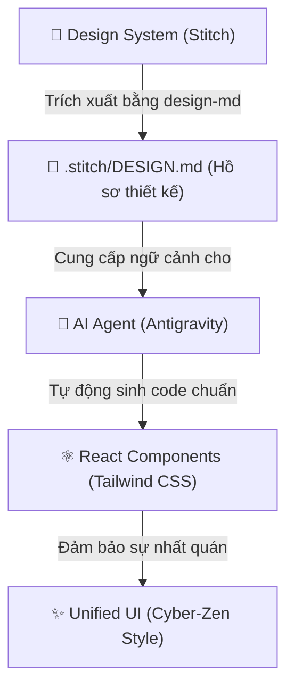

# Bài 4: Thiết kế Design System với Stitch

> **Section 7** · Vibe Coding Dự Án Thực Tế  
> **Thời lượng:** 40-50 phút  
> **Yêu cầu:** Đã hoàn thành Bài 3

---

## 🎯 Mục tiêu bài học

Sau bài học này, bạn sẽ:

- ✅ Hiểu rõ vai trò cốt lõi của **Design System** trong Vibe Coding và tại sao nó quyết định sự nhất quán thẩm mỹ của ứng dụng do AI xây dựng.
- ✅ Biết cách sử dụng **Stitch MCP Server** để khởi tạo một Stitch Project mới trực tiếp từ Antigravity.
- ✅ Thiết kế và áp dụng các thông số của hệ thống thiết kế phong cách **Cyber-Zen** (Neon Indigo, Cyber Emerald, Hot Pink, Deep Slate background, mờ kính Glassmorphism).
- ✅ Sử dụng thành thạo skill `design-md` để tự động trích xuất các thông số thiết kế thành file đặc tả `DESIGN.md` làm bộ nhớ ngữ cảnh (context) cho AI Agent ở các bước sau.

---

## 1. Tại sao Vibe Coding cần một Design System?

Trong lập trình truyền thống, bạn nhìn thấy giao diện và tự tay căn chỉnh từng pixel. Nhưng trong **Vibe Coding**, AI Agent là bên trực tiếp viết mã CSS/Tailwind. AI không có "mắt" để cảm nhận thẩm mỹ như con người. Nếu bạn ra lệnh cho AI thiết kế giao diện bằng những câu lệnh chung chung như *"Hãy làm trang web có màu tối và các nút bấm nổi bật"*, AI sẽ tự phỏng đoán:
- Nó có thể dùng màu tối Slate (`#0f172a`) ở component này, nhưng lại dùng màu tối Zinc (`#18181b`) ở component khác.
- Các nút bấm lúc thì bo góc 8px, lúc thì bo góc 24px.
- Các khoảng cách padding, margin và cỡ chữ sẽ bị lộn xộn.

Kết quả là bạn sẽ nhận được một giao diện chắp vá, thiếu đồng bộ và mất đi cảm giác cao cấp.



**Design System** chính là "nguồn sự thật duy nhất" (Single Source of Truth). Nó quy chuẩn hóa toàn bộ:
1. **Màu sắc (Colors)**: Xác định chính xác mã HEX cho từng vai trò màu (Primary, Secondary, Accent, Background).
2. **Typography**: Quy định font chữ, độ dày chữ (font-weight), và tỷ lệ kích thước chữ.
3. **Độ cong góc (Shape/Border Radius)**: Định nghĩa độ bo góc thống nhất cho các thẻ card, ô input, nút bấm.
4. **Hiệu ứng đặc biệt (Appearance/Glassmorphism)**: Mô tả độ mờ kính, bóng đổ phát sáng (neon shadow) để tạo chiều sâu trực quan.

Khi đã có Design System trên Stitch và file đặc tả `DESIGN.md`, AI Agent sẽ luôn tuân thủ 100% các token này khi sinh code React, giúp giao diện đồng bộ hoàn hảo mà không cần bạn phải chỉnh tay từng dòng CSS.

---

## 2. Khởi tạo Project trên Stitch từ Antigravity

Stitch hoạt động như một MCP Server kết nối trực tiếp với Antigravity. Để bắt đầu thiết kế, việc đầu tiên là chúng ta cần yêu cầu AI Agent khởi tạo một dự án thiết kế mới trên Stitch.

### 2.1 Sử dụng công cụ MCP `create_project`

Bạn có thể gửi prompt trực tiếp đến Antigravity để tạo project. AI Agent sẽ gọi tool `create_project` của server `stitch` dưới nền.

**Prompt mẫu khởi tạo Project:**
```text
[BỐI CẢNH / CONTEXT]
Tôi đang chuẩn bị thiết kế giao diện cho dự án VibeSpace Studio theo đặc tả PRD.

[NHIỆM VỤ / INSTRUCTIONS]
Hãy sử dụng Stitch MCP Server để tạo một project thiết kế mới có tên là "VibeSpace Studio".

[ĐẦU RA MONG ĐỢI / EXPECTED OUTPUT]
Xác nhận trạng thái tạo project thành công kèm theo Project ID được trả về từ Stitch MCP.
```

---

## 3. Thiết lập Design Tokens chuẩn Cyber-Zen

Dự án VibeSpace Studio hướng tới trải nghiệm làm việc tập trung cao độ, yên bình nhưng vẫn mang hơi thở tương lai. Do đó, chúng ta sẽ chọn phong cách **Cyber-Zen** – sự kết hợp giữa triết lý tối giản, thư thái của Zen và các điểm nhấn ánh sáng neon huyền ảo của Cyberpunk trên nền tối sâu thẳm.

### 3.1 Bảng mã màu & Thông số thiết kế (Cyber-Zen Specs)

Hãy yêu cầu AI Agent cấu hình hệ thống Design System trên Stitch với các thông số chi tiết dưới đây:

| Phân loại Token | Tên Token | Mã màu/Thông số | Vai trò thiết kế |
| :--- | :--- | :--- | :--- |
| **Colors** | Primary | `#6366F1` (Neon Indigo) | Màu chính cho các nút bấm hành động (CTA), viền phát sáng chính. |
| | Secondary | `#10B981` (Cyber Emerald) | Màu xanh mint dịu mắt biểu thị trạng thái Pomodoro, checklist hoàn thành. |
| | Accent | `#EC4899` (Hot Pink) | Màu nhấn mạnh cho trạng thái nghỉ ngơi (Break) hoặc các chỉ số streak đặc biệt. |
| | Background | `#0B0F19` (Dark Space) | Màu nền tối sâu thẳm mô phỏng không gian vũ trụ, giảm mỏi mắt khi làm việc ban đêm. |
| | Text | `#F8FAFC` (Silver White) | Chữ chính hiển thị rõ ràng, độ tương phản cao. |
| | Muted Text | `#94A3B8` (Slate-400) | Chữ phụ, mô tả, nhãn phụ hoặc các trích dẫn tĩnh. |
| **Glassmorphism** | Card Glass | `#151D30` (Opacity 70%) | Lớp kính mờ phủ trên nền phong cảnh động. |
| | Card Border | `#FFFFFF1A` (Opacity 10%) | Viền kính siêu mỏng để tách biệt card với nền. |
| | Backdrop Blur | `16px` | Độ mờ của phong cảnh phía sau lớp kính. |
| **Shapes** | Corner Radius | `16px` (`rounded-2xl`) | Độ bo góc mềm mại cho các Widget nổi và nút bấm. |
| **Typography** | Font Family | `Outfit` hoặc `Inter` | Font chữ không chân (sans-serif) hình học thanh lịch, hiện đại. |
| **Theme Mode**| Dark Mode | Bắt buộc | Môi trường làm việc tập trung cao, không hỗ trợ Light Mode. |

### 3.2 Prompt mẫu cấu hình Design System trên Stitch

Gửi prompt cấu trúc sau cho Antigravity để thiết lập hệ thống Design System hoàn chỉnh trên dự án Stitch vừa tạo:

```text
[BỐI CẢNH / CONTEXT]
Tôi đã tạo project Stitch "VibeSpace Studio". Bây giờ, tôi muốn thiết lập một Design System nhất quán cho toàn bộ dự án theo phong cách Cyber-Zen mờ kính.

[VAI TRÒ / ROLE]
Bạn là một Lead UI/UX Designer và Design System Specialist.

[NHIỆM VỤ / INSTRUCTIONS]
Hãy sử dụng các công cụ của Stitch MCP Server để thiết lập Design System cho project "VibeSpace Studio" với các đặc tả token sau:
1. Palette màu sắc:
   - Primary Color (Neon Indigo): #6366F1
   - Secondary Color (Cyber Emerald): #10B981
   - Accent Color (Hot Pink): #EC4899
   - Background Color (Dark Space): #0B0F19
   - Text Color (Slate-50): #F8FAFC
   - Sub-text Color (Slate-400): #94A3B8
2. Hiệu ứng Kính mờ (Glassmorphism Settings):
   - Thẻ Card Glass: Màu nền #151D30 với opacity 70%, blur filter 16px.
   - Border Card: Màu trắng tinh khiết với opacity 10% (#FFFFFF1A), độ dày 1px.
3. Typography:
   - Font Family chính: "Outfit" (Google Fonts). Font dự phòng: "Inter", sans-serif.
4. Corners & Shapes:
   - Bo góc chuẩn (Border Radius): 16px cho tất cả các card, buttons, và inputs.
5. Mode:
   - Thiết lập cấu hình Dark Mode làm chế độ mặc định duy nhất.

[ĐẦU RA MONG ĐỢI / EXPECTED OUTPUT]
Xác nhận Design System đã được cấu hình thành công trên Stitch và liệt kê tóm tắt các token đã lưu.
```

---

## 4. Sử dụng Skill `design-md` để tự động hóa `DESIGN.md`

Sau khi Design System đã được thiết lập trên dự án Stitch, chúng ta cần chuyển đổi các thông số thiết kế trực quan này thành một tài liệu ngữ cảnh dạng văn bản. Đó là lúc chúng ta sử dụng **Stitch Skill `design-md`**.

Công cụ này sẽ đọc trực tiếp cấu hình Design System trên Stitch của bạn và tự động biên soạn một file đặc tả thiết kế có tên là `DESIGN.md` đặt tại thư mục `.stitch/` của dự án. 

### 4.1 Cách thực thi lệnh qua Terminal

Hãy chạy lệnh sau ở thư mục gốc của dự án:

```bash
# Chạy công cụ phân tích thiết kế Stitch và xuất ra DESIGN.md
npx skills run google-labs-code/stitch-skills --skill design-md
```

### 4.2 Cấu trúc nội dung chuẩn của `.stitch/DESIGN.md`

Dưới đây là nội dung chi tiết của file [.stitch/DESIGN.md](file:///Users/tanthanh/Documents/Project/antigravity-vibe-coding-course/docs/section-07-vibe-coding/lesson-04-design-system-with-stitch.md) mà công cụ sinh ra. File này sẽ là "kim chỉ nam" cho AI Agent khi nó convert layout sang code CSS/Tailwind ở bài học sau:

```markdown
# VibeSpace Studio - Design System Specifications

This document defines the core styling rules, design tokens, and components specifications for the VibeSpace Studio application. All generated components must strictly adhere to these specifications to guarantee visual consistency.

## 🎨 Design Tokens

### 1. Color Palette (Cyber-Zen Dark Mode)
We utilize dark space values combined with high-contrast neon accents to minimize eye strain and foster deep focus.

| Token | Class Name | Hex Code | Usage |
| :--- | :--- | :--- | :--- |
| **Primary (Neon Indigo)** | `text-indigo-500` / `bg-indigo-600` | `#6366F1` | Primary CTA, focus states, primary glow highlights |
| **Secondary (Cyber Emerald)** | `text-emerald-400` / `bg-emerald-500` | `#10B981` | Pomodoro active, checklist completions, success |
| **Accent (Hot Pink)** | `text-pink-500` / `bg-pink-500` | `#EC4899` | Break states, streak milestones, delete alarms |
| **Background (Dark Space)** | `bg-[#0B0F19]` | `#0B0F19` | Main layout backing, page-level deep canvas |
| **Card Glass Back** | `bg-[#151D30]/70` | `#151D30` | Core background for floating cards, 70% opacity |
| **Text Main** | `text-slate-50` | `#F8FAFC` | Main headings, readables, buttons text |
| **Text Muted** | `text-slate-400` | `#94A3B8` | Subtitles, label captions, citation lines |

### 2. Typography
- **Primary Font:** `Outfit` (sans-serif) - geometric, clean, futuristic.
- **Secondary Font:** `Inter` (sans-serif) - highly readable for tables and checklist items.

### 3. Borders & Shapes
- **Card Radius:** `16px` (`rounded-2xl`)
- **Button / Input Radius:** `12px` (`rounded-xl`)
- **Card Border Color:** `rgba(255, 255, 255, 0.10)` (`border-white/10`)
- **Border Width:** `1px`

---

## 🔮 Glassmorphism & Special Styles

To create an immersive, layering effect over the live landscapes, all primary widgets must implement the glassmorphic card design:

```css
.glass-card {
  background: rgba(21, 29, 48, 0.70);
  backdrop-filter: blur(16px);
  -webkit-backdrop-filter: blur(16px);
  border: 1px solid rgba(255, 255, 255, 0.10);
  border-radius: 1rem; /* rounded-2xl */
  box-shadow: 0 25px 50px -12px rgba(0, 0, 0, 0.5);
}

.neon-shadow-indigo {
  box-shadow: 0 0 15px rgba(99, 102, 241, 0.35);
}

.neon-shadow-emerald {
  box-shadow: 0 0 15px rgba(16, 185, 129, 0.35);
}
```

---

## ⚡ Animation Specifications

### 1. Slow Album Spin (Lofi CD Player)
A smooth, infinite rotational animation applied to the CD icon when playing music.
- **Duration:** 20 seconds.
- **Timing:** Linear.
- **Iteration:** Infinite.
- **Tailwind class:** `animate-spin-slow`

```css
@keyframes spin-slow {
  from { transform: rotate(0deg); }
  to { transform: rotate(360deg); }
}
```

### 2. Zen Breathing Circle (SVG Bubble)
A gentle scale pulsing animation representing focus inhale, hold, and exhale.
- **Duration:** 12 seconds total (4s inhale, 4s hold, 4s exhale).
- **Scale Range:** From `0.85` (contracted) to `1.25` (expanded).
- **Timing:** Cubic-bezier (`cubic-bezier(0.4, 0, 0.2, 1)`).

```css
@keyframes breathing-pulse {
  0%, 100% {
    transform: scale(0.85);
    opacity: 0.6;
    filter: drop-shadow(0 0 8px rgba(99, 102, 241, 0.3));
  }
  33% {
    transform: scale(1.25);
    opacity: 1;
    filter: drop-shadow(0 0 20px rgba(99, 102, 241, 0.6));
  }
  66% {
    transform: scale(1.25);
    opacity: 1;
    filter: drop-shadow(0 0 20px rgba(99, 102, 241, 0.6));
  }
}
```
```

---

## 5. Review và Tinh chỉnh Thiết kế

Khi file `DESIGN.md` đã được ghi nhận ở thư mục `.stitch/` của bạn, AI Agent sẽ sử dụng nó làm **Rules** để áp dụng vào các bước code. Trước khi chuyển sang bước thiết kế giao diện chi tiết, bạn nên kiểm tra kỹ các thông số này:
1. Đảm bảo các mã màu đúng chuẩn tương phản và không bị quá chói (neon accents chỉ dùng làm điểm nhấn, không dùng làm màu nền chính).
2. Kiểm tra độ bo góc và viền border có tạo cảm giác nhẹ nhàng, tinh tế hay không.
3. Đảm bảo file `.stitch/DESIGN.md` đã được commit lên Git cùng với bộ mã nguồn cơ sở để làm ngữ cảnh đồng bộ.

---

## 📝 Tóm tắt bài học

| Khái niệm | Ý nghĩa cốt lõi |
| :--- | :--- |
| **Design System** | "Nguồn sự thật duy nhất" về giao diện, giúp AI Agent sinh code CSS nhất quán và không phỏng đoán bừa bãi. |
| **Cyber-Zen Style** | Phong cách tối giản mờ kính kết hợp nền tối vũ trụ và đèn neon dịu mắt, tối ưu cho sự tập trung lâu dài. |
| **Stitch MCP** | Công cụ giúp tạo project, thiết lập bảng màu, typography trực tiếp thông qua chat Antigravity. |
| **`design-md` Skill** | Kỹ năng mở rộng giúp tự động dịch Design Tokens từ Stitch thành file `.stitch/DESIGN.md` markdown. |

---

## ⏭️ Bài tiếp theo

**[Bài 5: Tạo UI Screens với Stitch – Phần 1 (Sảnh chờ Lobby & Navigation)](lesson-05-lobby-and-navigation.md)** – Sau khi Design System đã định hình cấu trúc màu sắc và phong cách Cyber-Zen, chúng ta sẽ bắt đầu thiết kế màn hình thực tế đầu tiên: Sảnh chờ Lobby Entrance huyền ảo và thanh điều hướng thông minh.

---

*📚 Section 7 · Google Antigravity: Xây dựng AI Agent, AI App & Vibe Coding*
