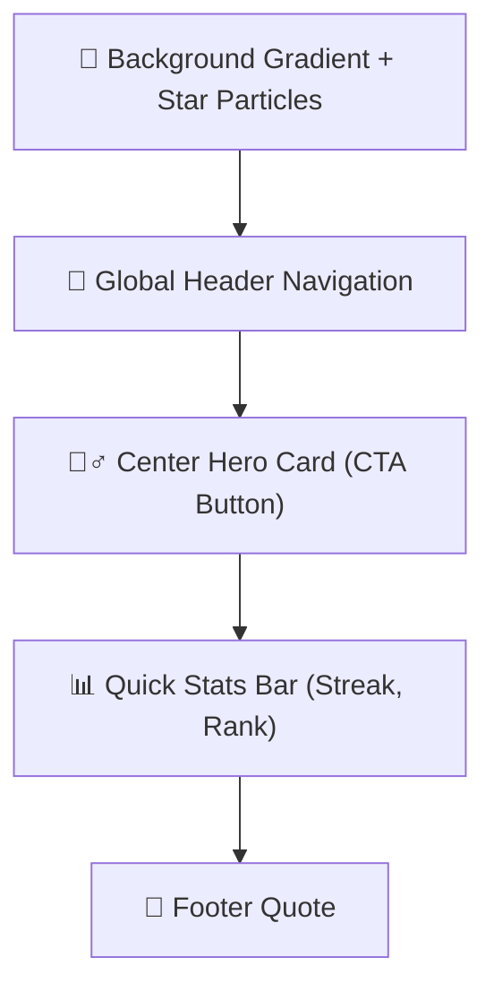

# Bài 5: Tạo UI Screens với Stitch – Phần 1 (Sảnh chờ Lobby & Navigation)

> **Section 7** · Vibe Coding Dự Án Thực Tế  
> **Thời lượng:** 45-60 phút  
> **Yêu cầu:** Đã hoàn thành Bài 4

---

## 🎯 Mục tiêu bài học

Sau bài học này, bạn sẽ:

- ✅ Hiểu rõ tầm quan trọng và cách sử dụng kỹ thuật **Enhance Prompt** để biến các mô tả ý tưởng thô thành các prompt thiết kế UI tinh xảo.
- ✅ Thực hành thiết kế màn hình **Sảnh chờ (Lobby Entrance Page)** cho VibeSpace Studio trên Stitch với hiệu ứng mờ kính (glassmorphism) và màu nhấn neon.
- ✅ Thiết kế cấu trúc định hướng và thanh điều hướng toàn cầu (**Global Navigation Header**) nhất quán.
- ✅ Biết cách áp dụng quy trình **stitch-design** và tạo ra các biến thể thiết kế (**variants**) để so sánh và lựa chọn phương án tối ưu nhất.

---

## 1. Tối ưu prompt thiết kế với Kỹ thuật Enhance Prompt

### 1.1 Vấn đề của Prompt thô
Khi thiết kế giao diện với AI, lỗi phổ biến nhất của các nhà phát triển là đưa ra những prompt quá đơn giản như: *"Hãy tạo một màn hình sảnh chờ đẹp mắt cho app làm việc"*. 

Với prompt thô này, AI sẽ tự điền vào các khoảng trống thông tin theo phán đoán ngẫu nhiên. Kết quả là bố cục có thể bị lệch, khoảng cách không hợp lý, các thành phần không ăn nhập với nhau và quan trọng nhất là vi phạm các token của **Design System** đã thiết lập ở Bài 4.

Để khắc phục điều này, chúng ta sử dụng Stitch Skill `enhance-prompt`. Kỹ năng này đóng vai trò như một chuyên gia tư vấn thiết kế trung gian, nhận prompt thô của bạn và tự động tái cấu trúc, bổ sung các chi tiết kỹ thuật về:
- Cấu trúc phân cấp thông tin (Information Hierarchy).
- Bố cục lưới và căn lề (Layout grid, Flexbox alignment).
- Chỉ định rõ các màu sắc, font chữ và bo góc từ Design System.
- Thêm các mô tả về hiệu ứng tương tác (hover, click) và chiều sâu (shadow, backdrop-blur).

### 1.2 Thực hành tối ưu hóa Prompt thiết kế

Bạn có thể chạy công cụ `enhance-prompt` trực tiếp bằng cách gửi yêu cầu tới Antigravity.

**So sánh sự khác biệt lớn giữa trước và sau khi tối ưu:**

* **Prompt thô (Ban đầu):**
  > *"Tạo sảnh chờ Lobby của VibeSpace Studio. Nền tối có hạt bụi sao bay. Ở giữa có một card kính lớn hiển thị tiêu đề phát sáng, lời giới thiệu và nút bấm rực rỡ bắt đầu tập trung. Ở dưới có thêm các con số thống kê streak của người dùng."*

* **Prompt sau khi tối ưu (Bởi skill `enhance-prompt`):**
  > **[Viewport]** Desktop 1920x1080.  
  > **[Background]** Dark slate base (`#0B0F19`) overlaid with a soft radial gradient from deep purple (`#1E152A`) in the center to dark navy on the edges. Add faint, slow-pulsing circular star-particles in the background (opacity 15%).  
  > **[Layout]** Vertical flex container, centered both horizontally and vertically.  
  > **[Main Component]** A central floating glassmorphic card:
  >   - Background: `#151D30` with 70% opacity, backdrop-blur filter 16px.
  >   - Border: 1px solid white with 10% opacity (`#FFFFFF1A`).
  >   - Radius: 24px (`rounded-3xl`).
  >   - Inner Padding: 48px (3rem).
  >   - Header Tag inside: A small capsule pill at the top-center containing the text "🎧 VIBESPACE v1.0" with Neon Indigo (`#6366F1`) text and border.
  >   - Title: "Your Sanctuary for Deep Work" in font "Outfit", size 48px, bold, color `#F8FAFC`, with a subtle drop-shadow highlight.
  >   - Description: "Layer natural ambient sounds, fetch customizable Lo-fi playlists, and synchronize your Pomodoro workflow in a dark, distraction-free environment." in font "Inter", size 16px, color `#94A3B8`, line-height 1.6.
  >   - CTA Button: Centered, size 16px, bold, font "Outfit", color `#F8FAFC`. Dimensions: padding 16px 32px. Radius: 16px. Background gradient: Diagonal from Neon Indigo (`#6366F1`) to Hot Pink (`#EC4899`). Add an outer neon glow shadow matching the primary color.
  > **[Secondary Component - Stats]** Floating 120px below the Main Card:
  >   - A horizontal grid of 3 slim glassmorphic cards (background opacity 40%, radius 12px) displaying:
  >     + Item 1: "Today Focus: 120 mins"
  >     + Item 2: "Current Streak: 5 Days 🔥"
  >     + Item 3: "Rank: Zen Master 🧘‍♂️"
  > **[Footer]** A bottom-anchored text bar containing a quote: "Act as if what you do makes a difference. It does. — William James" in slate-400 (opacity 50%).

---

## 2. Thiết kế Sảnh chờ (Lobby Entrance Page) trên Stitch

Sau khi đã có prompt được tối ưu hóa từ bước trên, chúng ta sẽ gửi prompt này đến Stitch MCP Server để vẽ màn hình giao diện đầu tiên của VibeSpace Studio: Sảnh chờ Lobby.



### 2.1 Hướng dẫn thiết kế từng phần

1. **Background (Nền màn hình)**: Sử dụng gradient chéo mượt mà từ mã tối vũ trụ `#0B0F19` sang sắc tím huyền ảo `#1E152A`. Việc kết hợp này giúp tạo chiều sâu thị giác ngay khi người dùng vừa truy cập.
2. **Center Hero Card (Thẻ trung tâm)**:
   - Đây là điểm nhấn chính của trang. Nó phải nổi bật nhưng không được quá thô cứng. Chúng ta cấu hình hiệu ứng kính mờ (glassmorphism) bằng cách sử dụng nền tối mờ, độ nhám lọc mờ (backdrop-blur) cao kết hợp với viền trắng siêu mảnh có độ trong suốt 90% để giả lập ánh sáng phản chiếu trên lớp kính.
   - Nút bấm bắt đầu (CTA) sử dụng dải màu gradient từ xanh tím `Indigo` sang hồng `Hot Pink` tạo cảm giác chuyển động năng lượng và sự hào hứng bắt đầu phiên làm việc.
3. **Quick Stats Bar (Thanh thống kê nhanh)**:
   - Được thiết kế là 3 thẻ kính nằm độc lập lơ lửng phía dưới để tạo nhịp điệu bố cục. Các chỉ số này đánh vào tâm lý chinh phục (gamification) của người học/lập trình viên khi thấy chuỗi streak tập trung liên tục của mình.

### 2.2 Gửi Prompt vẽ màn hình lên Stitch

Hãy gửi câu lệnh sau cho Antigravity để Agent thực thi vẽ màn hình:

```text
[BỐI CẢNH / CONTEXT]
Tôi đang ở trong project Stitch "VibeSpace Studio". Tôi cần tạo màn hình đầu tiên: Sảnh chờ Lobby.

[NHIỆM VỤ / INSTRUCTIONS]
Hãy gọi công cụ Stitch MCP Server để tạo một Screen mới có tên là "Lobby Entrance" dựa trên prompt thiết kế chi tiết đã được tối ưu hóa sau:
"Tạo giao diện sảnh chờ Lobby Entrance của VibeSpace trên viewport Desktop 1920x1080. Nền gradient chéo sâu thẳm từ #0B0F19 sang #1E152A có các vòng bụi sao mờ. Trung tâm chứa 1 card kính mờ glassmorphic bo góc 24px, viền sáng mảnh 1px #FFFFFF1A, bên trong có tag capsule '🎧 VIBESPACE v1.0', tiêu đề lớn 'Your Sanctuary for Deep Work', mô tả ngắn gọn và nút bấm bắt đầu 'Enter Immersive Space' rực rỡ gradient chéo Indigo-Pink phát sáng neon. Phía dưới card chứa thanh 3 widget chỉ số streak, rank mờ lơ lửng. Đáy trang chứa quote châm ngôn William James mờ."

[ĐẦU RA MONG ĐỢI / EXPECTED OUTPUT]
Xác nhận Screen "Lobby Entrance" đã được tạo thành công kèm ảnh preview hoặc link dẫn tới canvas thiết kế.
```

---

## 3. Thiết kế thanh điều hướng (Global Navigation Header)

Thanh điều hướng là xương sống điều hướng của ứng dụng VibeSpace. Nó giúp người dùng chuyển đổi qua lại giữa các trang chính: Sảnh chờ, Nhật ký năng suất (Journal), và Cài đặt (Settings).

### 3.1 Bố cục Header
- **Góc bên trái**: Logo chữ **VibeSpace** (Font Outfit, chữ trắng đậm kết hợp biểu tượng thiền định tối giản).
- **Góc bên phải**: Các liên kết điều hướng dạng text: `Lobby` | `Productivity Journal` | `Timer Settings`. Khi hover qua các link này, chúng sẽ phát sáng nhẹ màu Indigo.
- **Background**: Header cũng sử dụng thiết kế kính mờ mỏng (`backdrop-blur-md` với chiều cao cố định 72px) đặt cố định ở cạnh trên của màn hình (sticky top).

### 3.2 Quy tắc ẩn Navigation tại Focus Space (RẤT QUAN TRỌNG)
Theo tài liệu **ARCHITECTURE.md** đã thống nhất ở bài học trước:
- Trang `/space` (Immersive Focus Studio) là không gian tập trung tuyệt đối. Để chống xao nhãng cho người dùng, **thanh Header điều hướng này phải được ẩn hoàn toàn**.
- Thay vào đó, trong trang `/space` sẽ chỉ hiển thị các widget nổi và một nút quay lại (Back) siêu nhỏ ở góc để người dùng thoát ra khi cần.
- Điều này sẽ được cài đặt cụ thể ở bài học lập trình ReactJS bằng cách sử dụng hook `useLocation` để kiểm tra path hiện tại.

---

## 4. Thực hành: `stitch-design` Workflow & Variants

Trong quy trình làm việc chuyên nghiệp với Stitch, bạn không chỉ tạo ra một phiên bản thiết kế duy nhất rồi dùng luôn. Phương pháp **stitch-design workflow** khuyến khích việc tạo ra các biến thể khác nhau (**variants**) để kiểm tra tính hiệu quả về mặt UX.

### 4.1 Tạo các biến thể thiết kế (Variants Generator)
Sau khi màn hình Lobby Entrance cơ bản được vẽ xong, hãy yêu cầu Agent sinh ra các variants thông qua Stitch MCP:

* **Variant A (Cyberpunk Neon)**: Sử dụng nhiều màu nhấn Hot Pink hơn, bóng đổ neon sắc nét và bụi sao chuyển động mạnh hơn. Phù hợp cho những ai thích cảm giác năng lượng, công nghệ cao.
* **Variant B (Zen Forest - Khuyên dùng)**: Sử dụng màu nhấn Cyber Emerald làm chủ đạo, giảm độ chói của các nút bấm và làm mờ mịn các lớp viền kính hơn. Tạo cảm giác thư thái, dễ chịu tối đa cho mắt.

### 4.2 So sánh và chọn lựa
Bạn có thể ra lệnh cho Antigravity sinh variants bằng prompt sau:

```text
[BỐI CẢNH / CONTEXT]
Tôi đang có màn hình thiết kế "Lobby Entrance" trên Stitch.

[NHIỆM VỤ / INSTRUCTIONS]
Hãy sử dụng Stitch MCP Server để sinh ra 2 variants (biến thể thiết kế) cho màn hình này:
- Variant 1 (Cyberpunk-Zen Focus): Đẩy mạnh độ tương phản, các viền neon phát sáng sắc nét, gradient nút CTA rực rỡ hơn.
- Variant 2 (Minimal Forest Zen): Thay màu nhấn Indigo thành màu Cyber Emerald (#10B981) dịu mát, làm mềm mịn hiệu ứng đổ bóng và tăng nhẹ độ trong suốt của card lên 80%.

[ĐẦU RA MONG ĐỢI / EXPECTED OUTPUT]
Xác nhận đã sinh thành công 2 variants và gợi ý lựa chọn phiên bản phù hợp nhất cho mục đích chống mỏi mắt.
```

Sau khi xem xét các variants do AI sinh ra, bạn sẽ chốt phương án thiết kế tốt nhất để chuẩn bị cho các bước tiếp theo.

---

## 📝 Tóm tắt bài học

| Khái niệm / Công cụ | Ý nghĩa cốt lõi |
| :--- | :--- |
| **Enhance Prompt** | Kỹ năng mở rộng giúp tự động nâng cấp prompt thô thành đặc tả thiết kế UI chi tiết, chặt chẽ. |
| **Lobby Entrance** | Màn hình sảnh chờ đón người dùng, thiết lập động lực tập trung qua các chỉ số streak và câu châm ngôn. |
| **Global Navigation** | Thanh Header điều hướng toàn cầu, tuân thủ nguyên tắc ẩn đi tại trang tập trung để chống xao nhãng. |
| **Variants** | Các biến thể thiết kế do AI tạo ra giúp nhà phát triển dễ dàng so sánh và chọn ra UI tối ưu nhất cho mắt. |

---

## ⏭️ Bài tiếp theo

**[Bài 6: Tạo UI Screens với Stitch – Phần 2 (Immersive Focus Studio)](lesson-06-immersive-focus-studio.md)** – Chúng ta sẽ thiết kế giao diện cốt lõi nhất của dự án: Trang làm việc `/space` tràn màn hình với phong cảnh rừng thông sương mù và 4 tiện ích card kính lơ lửng độc đáo!

---

*📚 Section 7 · Google Antigravity: Xây dựng AI Agent, AI App & Vibe Coding*
