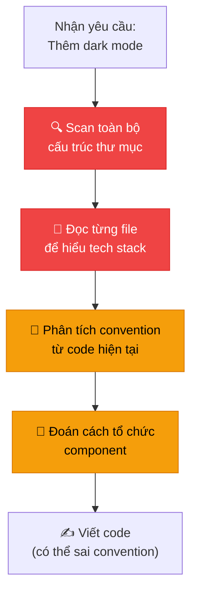
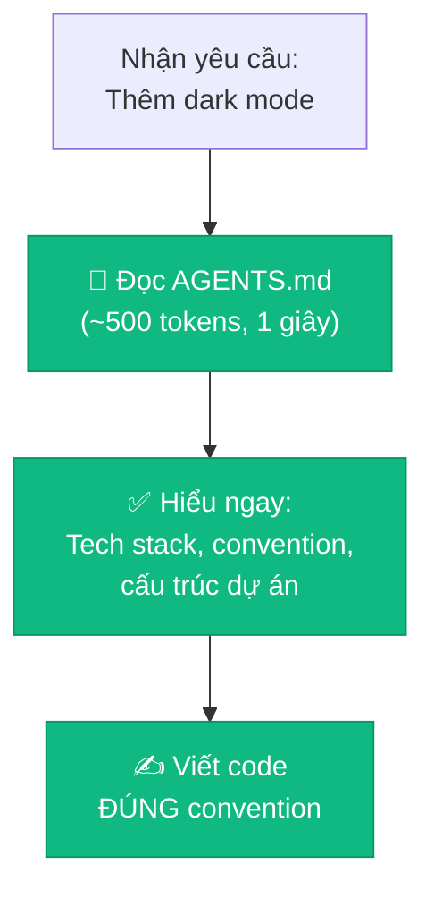
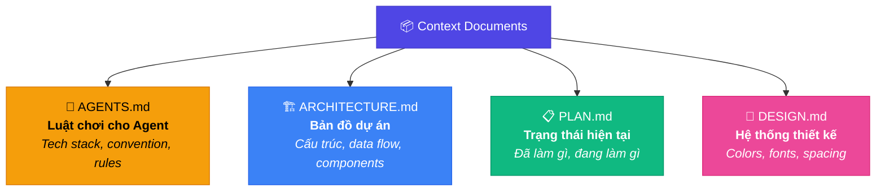
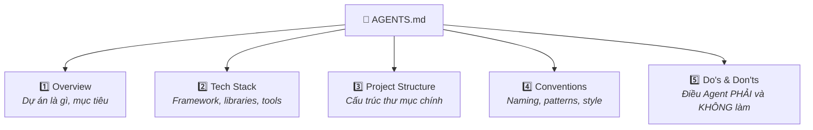
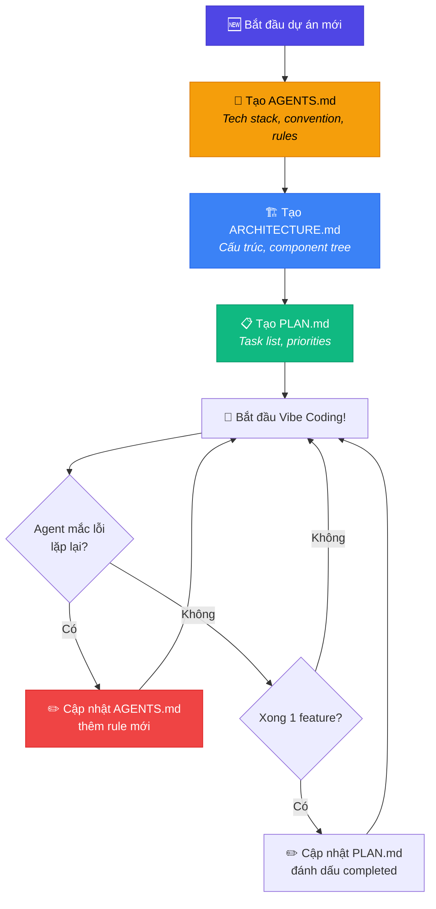
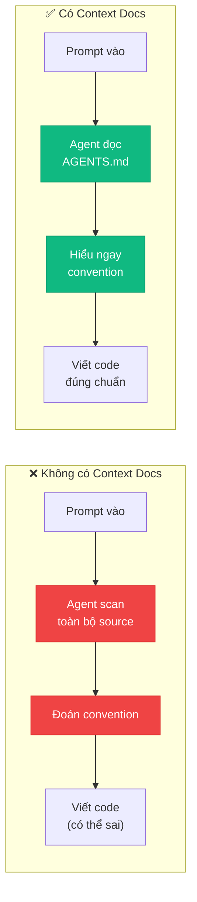

# 📘 Bài 2: Project Context Documents – "Bộ nhớ ngoài" cho Agent

> **Section:** Context Engineering – Giúp AI Agent "Nhớ" & Tối Ưu Token  
> **Thời lượng:** 40-50 phút  
> **Yêu cầu:** Đã học Bài 1 – Context Engineering là gì?

---

## 🎯 Mục tiêu bài học

Sau bài này, bạn sẽ:

- ✅ Biết cách tạo **"bộ nhớ ngoài"** cho Agent bằng các file context documents
- ✅ Viết được **AGENTS.md** — file quan trọng nhất giúp Agent hiểu dự án
- ✅ Tạo **ARCHITECTURE.md** — thay thế việc Agent phải scan toàn bộ code
- ✅ Sử dụng **PLAN.md** — giữ Agent đi đúng hướng, không làm lan man

---

## 1. Vấn đề: Agent không biết gì về dự án của bạn

### 1.1 Kịch bản thực tế

Bạn mở Antigravity, bắt đầu conversation mới và gõ:

```
"Thêm chức năng dark mode cho ứng dụng"
```

**Agent sẽ phải:**



**Kết quả:**
- ⏱️ Tốn 30-60 giây chỉ để Agent "hiểu" dự án
- 💰 ~30,000 tokens để scan + đọc files
- ❌ Có thể đoán sai convention, sai kiến trúc

### 1.2 Giải pháp: Context Documents

Thay vì để Agent tự mò, ta **chuẩn bị sẵn** tài liệu cho Agent đọc:



**Kết quả:**
- ⏱️ Agent hiểu dự án trong **1 giây**
- 💰 Chỉ ~500 tokens thay vì 30,000
- ✅ Code đúng convention ngay từ đầu

> 💡 **Context Documents = "Bộ nhớ ngoài"** — Giống như cho nhân viên mới đọc tài liệu onboarding thay vì để họ tự tìm hiểu.

---

## 2. Hệ thống Context Documents

Một dự án cần **4 loại file** context documents chính:



| File | Vai trò | Khi nào Agent cần? | Tokens ước tính |
|------|---------|-------------------|----------------|
| **AGENTS.md** | Convention, tech stack, rules | **Mọi lúc** | 300-500 |
| **ARCHITECTURE.md** | Cấu trúc, file map, data flow | Khi thêm feature mới | 400-800 |
| **PLAN.md** | Task list, trạng thái | Khi bắt đầu phiên mới | 200-400 |
| **DESIGN.md** | Design tokens, UI rules | Khi làm việc với UI | 300-600 |

**Tổng: ~1,200-2,300 tokens** — thay vì **30,000+ tokens** khi scan toàn bộ source!

---

## 3. AGENTS.md – File quan trọng nhất

### 3.1 AGENTS.md là gì?

**AGENTS.md** là file đặt ở root dự án, chứa **tất cả thông tin Agent cần biết** để làm việc đúng. Giống như một bản "onboarding guide" cho nhân viên mới.

### 3.2 Cấu trúc AGENTS.md

Một AGENTS.md tốt gồm **5 phần**:



### 3.3 Template AGENTS.md mẫu

Dưới đây là template bạn có thể **copy và tuỳ chỉnh** cho dự án của mình:

```markdown
# AGENTS.md

## Overview
- **Project:** English Practice Hub
- **Description:** Trang web luyện tập tiếng Anh (vocabulary, grammar quiz, flashcards)
- **Status:** MVP - Đang phát triển

## Tech Stack
- **Framework:** Next.js 14 (App Router)
- **Language:** TypeScript (strict mode)
- **Styling:** Tailwind CSS
- **State:** React hooks (useState, useReducer)
- **Data:** Mock data trong /src/data/

## Project Structure

src/
├── app/           → Pages (Next.js App Router)
├── components/    → Reusable UI components
├── data/          → Mock data (vocabulary, questions)
├── hooks/         → Custom React hooks
├── types/         → TypeScript type definitions
└── utils/         → Helper functions

## Conventions
- **Components:** PascalCase, functional components + hooks
- **Files:** Component files: PascalCase.tsx, utils: camelCase.ts
- **Imports:** Use @/ path alias for src/
- **CSS:** Tailwind utility classes, NO inline styles
- **Types:** Define in /src/types/, NO `any` type

## Do's & Don'ts

### ✅ DO
- Use TypeScript strict mode
- Write reusable components in /src/components/
- Use Tailwind for styling
- Follow existing patterns in codebase

### ❌ DON'T
- Don't use `any` type
- Don't create inline styles
- Don't add new dependencies without mentioning
- Don't modify /src/data/ structure without asking
```

### 3.4 Nguyên tắc viết AGENTS.md hiệu quả

| Nguyên tắc | ✅ Tốt | ❌ Xấu |
|-----------|--------|--------|
| **Ngắn gọn** | "Framework: Next.js 14 App Router" | "Chúng ta sử dụng framework Next.js phiên bản 14 với App Router pattern vì nó hỗ trợ SSR tốt..." |
| **Chỉ thị rõ ràng** | "Components: PascalCase, functional only" | "Cố gắng đặt tên component theo PascalCase nếu có thể" |
| **Cập nhật thường xuyên** | Thêm rule mới khi Agent mắc lỗi lặp | Viết 1 lần rồi không bao giờ cập nhật |
| **Actionable** | "KHÔNG dùng any type" | "TypeScript rất quan trọng cho dự án" |

> 💡 **Mẹo hay:** Mỗi khi Agent mắc lỗi lặp đi lặp lại, **thêm 1 rule vào AGENTS.md** để ngăn lỗi đó ở tương lai. AGENTS.md là file "sống" — luôn được cập nhật.

---

## 4. ARCHITECTURE.md – Bản đồ dự án

### 4.1 Vấn đề: Agent phải "đoán" kiến trúc

Khi không có ARCHITECTURE.md, Agent phải:
1. Scan toàn bộ thư mục
2. Đọc nhiều file để hiểu cấu trúc
3. **Đoán** data flow giữa các component

→ Tốn **10,000-30,000 tokens** và có thể đoán sai.

### 4.2 Template ARCHITECTURE.md

```markdown
# ARCHITECTURE.md

## System Overview

English Practice Hub là SPA (Single Page Application) với 4 routes chính.

## Pages & Routes

| Route          | Page          | Main Components              | Data Source             |
|----------------|--------------|------------------------------|-------------------------|
| `/`            | Landing      | HeroSection, FeatureCard     | Static                  |
| `/vocabulary`  | Vocabulary   | VocabularyCard, ProgressBar  | `vocabulary.ts`         |
| `/grammar`     | Grammar Quiz | QuizCard, Timer, ScoreBoard  | `grammar-questions.ts`  |
| `/flashcards`  | Flashcard    | FlashCard, DeckList          | `flashcards.ts`         |

## Component Hierarchy

Layout (Header + Footer)
├── LandingPage
│   ├── HeroSection
│   ├── FeatureCard x3
│   └── StatsCounter
├── VocabularyPage
│   ├── CategoryFilter
│   ├── VocabularyCard
│   └── ProgressBar
├── GrammarPage
│   ├── QuizCard
│   ├── Timer
│   └── ScoreBoard
└── FlashcardPage
    ├── DeckList (sidebar)
    └── FlashCard (flip animation)


## Data Flow

User interaction → Component state (useState) → UI update
No backend API, all data from local .ts files in /src/data/

## Key Patterns
- State management: React hooks only (no Redux)
- Data: Imported from /src/data/*.ts
- Navigation: Next.js App Router (file-based)
- Theming: CSS variables in globals.css + Tailwind
```

### 4.3 Hiệu quả của ARCHITECTURE.md

| Không có ARCHITECTURE.md | Có ARCHITECTURE.md |
|-------------------------|-------------------|
| Agent scan 15+ files | Agent đọc 1 file |
| ~25,000 tokens | ~600 tokens |
| 30-60 giây phân tích | 1-2 giây |
| Có thể hiểu sai cấu trúc | Hiểu chính xác |

---

## 5. PLAN.md – Trạng thái dự án

### 5.1 Tại sao cần PLAN.md?

Khi bắt đầu phiên mới, Agent cần biết:
- Đã làm xong những gì? (để không lặp lại)
- Đang dở task nào? (để tiếp tục)
- Sắp tới làm gì? (để đi đúng hướng)

### 5.2 Template PLAN.md

```markdown
# PLAN.md – English Practice Hub

## Completed ✅
- [x] Landing page với Hero, Features, Stats
- [x] Header component với navigation
- [x] Footer component
- [x] Vocabulary page - hiển thị từ vựng cơ bản

## In Progress 🔄
- [ ] Grammar Quiz page
  - [x] QuizCard component
  - [ ] Timer countdown
  - [ ] Score tracking

## Next Up 📋
- [ ] Flashcard page
- [ ] Dark mode toggle
- [ ] Responsive design (mobile)

## Known Issues 🐛
- VocabularyCard: Chưa handle edge case khi hết từ
- Header: Active link chưa highlight đúng

## Technical Decisions 📝
- Dùng useState cho quiz state (không cần Redux vì scope nhỏ)
- Mock data dạng TypeScript arrays (không dùng JSON)
```

### 5.3 PLAN.md giúp Agent thế nào?

**Không có PLAN.md:**
```
🗣️ "Tiếp tục phát triển ứng dụng"
🤖 Agent: "Để tôi scan toàn bộ code để xem bạn đã làm gì..."
   → Tốn 30,000+ tokens, 1 phút
```

**Có PLAN.md:**
```
🗣️ "Đọc PLAN.md và tiếp tục task đang dở"
🤖 Agent: "OK, tôi thấy Grammar Quiz đang dở.
   Đã xong QuizCard, cần làm Timer countdown và Score tracking.
   Bắt đầu với Timer nhé!"
   → Chỉ 400 tokens, 2 giây
```

---

## 6. Thực hành: Tạo Context Documents cho dự án

### 6.1 Workflow tạo Context Documents



### 6.2 Cấu trúc file trong dự án

Sau khi tạo xong, dự án sẽ có cấu trúc:

```
english-practice-hub/
├── AGENTS.md              ← 🔴 Agent đọc đầu tiên
├── ARCHITECTURE.md        ← 🟡 Agent đọc khi cần hiểu cấu trúc
├── PLAN.md                ← 🟢 Agent đọc khi bắt đầu phiên mới
├── .stitch/
│   └── DESIGN.md          ← 🔵 Agent đọc khi làm UI
├── src/
│   └── ...
└── package.json
```

### 6.3 Cách prompt Agent sử dụng Context Documents

**Khi bắt đầu phiên mới:**
```
Đọc file AGENTS.md và PLAN.md trước, sau đó tiếp tục phát triển task tiếp theo.
```

**Khi thêm feature mới:**
```
Đọc AGENTS.md và ARCHITECTURE.md.
Thêm chức năng [tên feature] theo đúng convention và kiến trúc hiện tại.
```

**Khi fix bug:**
```
Đọc AGENTS.md.
Fix bug [mô tả bug] trong file [tên file cụ thể].
```

---

## 7. Before vs After: Demo tiết kiệm token

### So sánh tổng thể



### Bảng so sánh token

| Tình huống | Không có docs | Có docs | Tiết kiệm |
|-----------|--------------|---------|-----------|
| Agent hiểu dự án | 30,000 tokens | 500 tokens | **98%** |
| Agent hiểu kiến trúc | 25,000 tokens | 600 tokens | **97%** |
| Agent biết trạng thái | 15,000 tokens | 400 tokens | **97%** |
| **Tổng mỗi phiên** | **70,000 tokens** | **1,500 tokens** | **~97%** |

> 🎯 **Kết luận:** Chỉ cần dành 15-20 phút tạo Context Documents, bạn tiết kiệm **hàng trăm nghìn tokens** mỗi ngày.

---

## 📝 Tóm tắt bài học

| Khái niệm | Nội dung chính |
|-----------|---------------|
| **Context Documents** | File tài liệu giúp Agent hiểu dự án ngay lập tức |
| **AGENTS.md** | Luật chơi: tech stack, convention, do's & don'ts |
| **ARCHITECTURE.md** | Bản đồ: cấu trúc, components, data flow |
| **PLAN.md** | Trạng thái: đã làm, đang làm, sẽ làm |
| **Nguyên tắc** | Ngắn gọn, rõ ràng, cập nhật thường xuyên |
| **Tiết kiệm** | ~97% tokens so với để Agent tự scan |

---

## ⏭️ Bài tiếp theo

**Bài 3: Kỹ thuật Summarize Context** — Bạn sẽ học 4 kỹ thuật để giữ Agent "tỉnh táo" trong phiên làm việc dài, bao gồm Context Compaction, Handoff Document, Sliding Window, và Context Quarantine.

---

*📚 Context Engineering · Google Antigravity: Xây dựng AI Agent, AI App & Vibe Coding*
