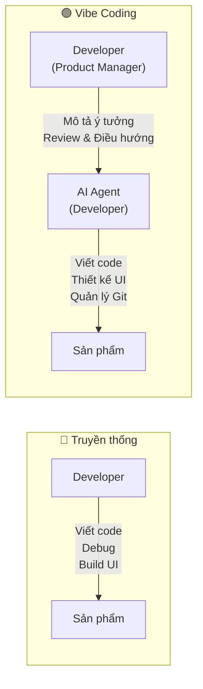
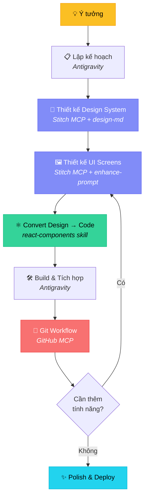
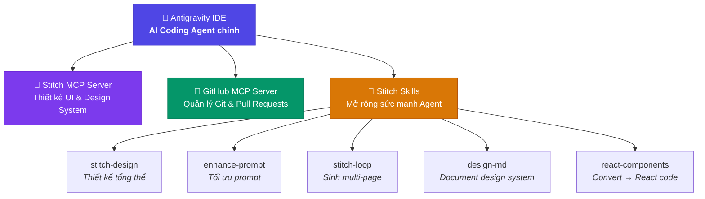
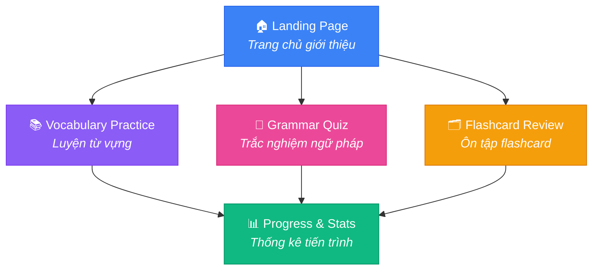
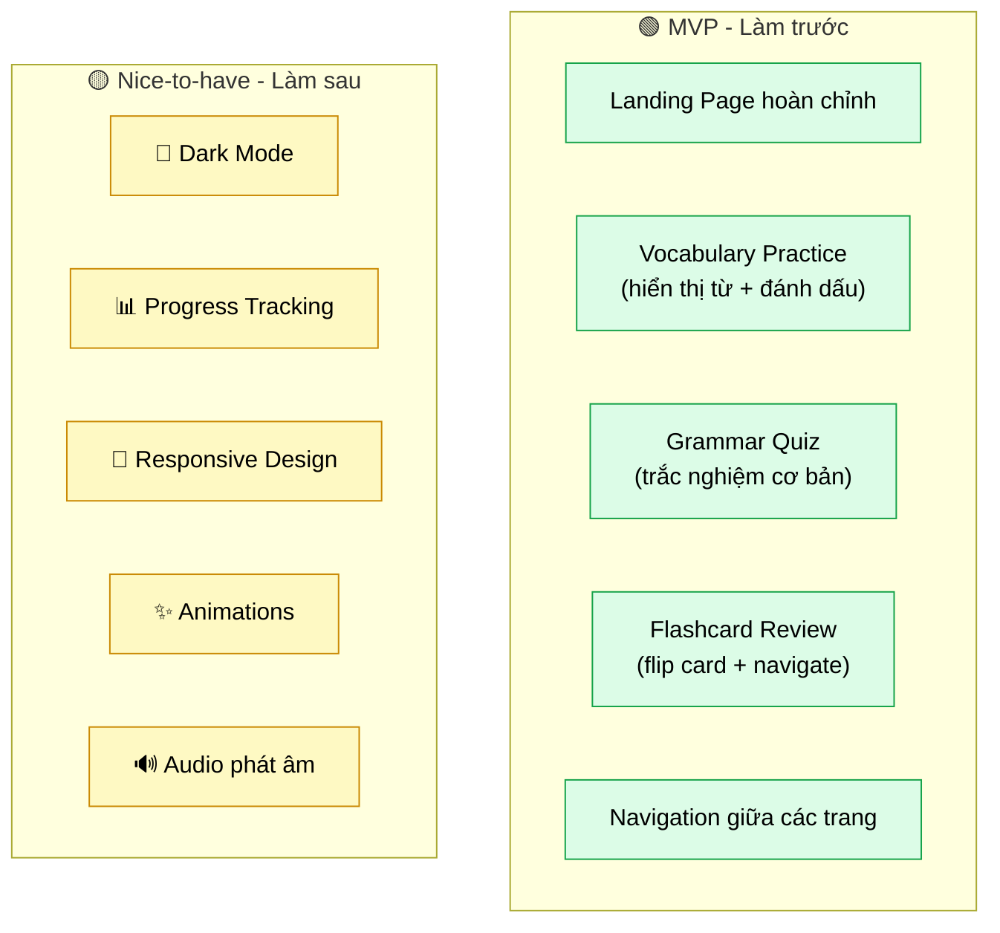

# 📘 Bài 1: Tổng quan Vibe Coding & Lập kế hoạch dự án

> **Section 6** · Vibe Coding Dự Án Thực Tế  
> **Thời lượng:** 30-40 phút  
> **Yêu cầu:** Đã hoàn thành Section 1-5

---

## 🎯 Mục tiêu bài học

Sau bài này, bạn sẽ:

- ✅ Hiểu **Vibe Coding** là gì và nó khác gì so với lập trình truyền thống
- ✅ Nắm được **workflow tổng thể** từ ý tưởng → sản phẩm hoàn chỉnh
- ✅ Biết được **vai trò mới của Developer** trong kỷ nguyên AI Agent
- ✅ Có **project plan chi tiết** cho dự án thực tế sẽ xây dựng xuyên suốt section

---

## 1. Vibe Coding là gì?

### 1.1 Định nghĩa

> **Vibe Coding** là phương pháp lập trình trong đó developer **mô tả ý tưởng bằng ngôn ngữ tự nhiên**, và **AI Agent sẽ thực thi** – viết code, thiết kế UI, quản lý dự án.

Thuật ngữ "Vibe Coding" được đặt bởi **Andrej Karpathy** (cựu Director of AI tại Tesla, co-founder OpenAI) vào đầu năm 2025:

> *"There's a new kind of coding I call 'vibe coding', where you fully give in to the vibes, embrace exponentials, and forget that the code even exists."*
>
> — Andrej Karpathy

Nói đơn giản: **Bạn mô tả "cái gì" cần làm, AI Agent lo "cách nào" để làm.**

### 1.2 Sự thay đổi vai trò

Trong Vibe Coding, vai trò của mỗi người thay đổi hoàn toàn:



| | **Lập trình truyền thống** | **Vibe Coding** |
|---|---|---|
| **Developer làm gì?** | Viết code từng dòng, debug, build UI | Mô tả ý tưởng, review, điều hướng AI |
| **Tốc độ** | Chậm – phụ thuộc vào kinh nghiệm | Nhanh – AI sinh code trong vài giây |
| **Kiến thức cần** | Thành thạo ngôn ngữ lập trình | Tư duy sản phẩm + Kỹ năng viết prompt |
| **Thiết kế UI** | Cần designer hoặc tự design | AI Agent + Stitch MCP thiết kế |
| **Quản lý code** | Git thủ công | GitHub MCP tự động |

### 1.3 Ví dụ thực tế

**❌ Cách truyền thống – Tạo Landing Page:**
```
1. Mở IDE, tạo file index.html          (5 phút)
2. Viết HTML structure                    (15 phút)
3. Tạo file styles.css, viết CSS         (30 phút)
4. Thêm JavaScript cho interactions      (20 phút)
5. Test responsive trên các thiết bị     (15 phút)
6. Fix bugs, điều chỉnh                  (20 phút)
─────────────────────────────────────────
⏱ Tổng: ~1.5 - 2 giờ
```

**✅ Cách Vibe Coding – Cùng một Landing Page:**
```
1. Mô tả cho AI Agent:                   (2 phút)
   "Tạo landing page với hero section, 
   3 feature cards, CTA button..."
   
2. AI Agent sinh code tự động             (30 giây)
3. Review và yêu cầu chỉnh sửa           (5 phút)
   "Đổi màu primary sang xanh dương,
   thêm animation cho cards..."
─────────────────────────────────────────
⏱ Tổng: ~8 - 10 phút
```

> 💡 **Nhanh hơn 10-15x** – Đó là sức mạnh của Vibe Coding!

---

## 2. Workflow tổng thể của Vibe Coding

Toàn bộ quy trình Vibe Coding mà chúng ta sẽ thực hành trong Section 6:



### Mỗi bước sử dụng công cụ gì?

| Bước | Công cụ chính | Bài học tương ứng |
|------|--------------|-------------------|
| 💡 Ý tưởng + Kế hoạch | Antigravity | **Bài 1** (bài này) |
| 🔧 Cài đặt môi trường | Stitch Skills CLI | Bài 2 |
| 🎨 Design System | Stitch MCP + `design-md` | Bài 3 |
| 🖼️ UI Screens | Stitch MCP + `enhance-prompt` + `stitch-loop` | Bài 4, 5 |
| ⚛️ Design → Code | `react-components` skill | Bài 6 |
| 🐙 Git Workflow | GitHub MCP | Bài 7 |
| 🔄 Thêm tính năng | Stitch MCP + GitHub MCP | Bài 8 |
| ✨ Polish | Antigravity | Bài 9, 10 |

---

## 3. Các công cụ sẽ sử dụng

Trong Section 6, chúng ta sẽ sử dụng **hệ sinh thái công cụ** sau:



### Tóm tắt vai trò từng công cụ

| Công cụ | Vai trò | Ví dụ tương đương |
|---------|---------|-------------------|
| **Antigravity** | "Bộ não" – điều phối mọi thứ | Như 1 senior developer |
| **Stitch MCP** | "Đôi mắt" – thiết kế UI đẹp | Như 1 UI/UX designer |
| **GitHub MCP** | "Đôi tay" – quản lý source code | Như 1 DevOps engineer |
| **Stitch Skills** | "Siêu năng lực" – khả năng đặc biệt | Như các plugin chuyên dụng |

---

## 4. Giới thiệu dự án: English Practice Hub

### 4.1 Tổng quan dự án

> 🎓 **English Practice Hub** — Trang web giúp người dùng luyện tập tiếng Anh một cách hiệu quả và thú vị.

**Tại sao chọn dự án này?**
- 📱 UI phong phú – nhiều loại component khác nhau
- 🎮 Tương tác nhiều – quiz, flashcard, progress tracking
- 🌍 Thực tế – ai cũng cần học tiếng Anh
- 🎨 Phù hợp demo Stitch – design đẹp, nhiều screens

### 4.2 Các trang của ứng dụng



### 4.3 Chi tiết từng trang

#### 🏠 Landing Page
- Hero section với tiêu đề, mô tả, nút CTA
- 3 Feature cards: Vocabulary, Grammar, Flashcard
- Thống kê: "5000+ Words", "200+ Quizzes", "10K+ Learners"
- Footer

#### 📚 Vocabulary Practice
- Hiển thị từ vựng: từ, phiên âm IPA, loại từ, nghĩa, ví dụ
- Nút hành động: "Đã biết" / "Chưa biết" / "Tiếp theo"
- Progress bar theo dõi tiến trình
- Filter theo category: Common, Academic, Business

#### 🧠 Grammar Quiz
- Câu hỏi trắc nghiệm 4 đáp án
- Timer đếm ngược
- Score counter
- Progress indicator (câu mấy / tổng câu)

#### 🗂️ Flashcard Review
- Card có thể flip: mặt trước (English) ↔ mặt sau (Vietnamese)
- Navigation: Previous / Next
- Đánh giá: Again, Hard, Good, Easy
- Deck list sidebar

---

## 5. Phân tích yêu cầu & MVP

### 5.1 MVP (Minimum Viable Product) vs Nice-to-have

Khi Vibe Coding, chúng ta vẫn cần **tư duy sản phẩm** – không phải nhảy vào làm tất cả cùng lúc.



> 💡 **Nguyên tắc:** Hoàn thành MVP trước, sau đó iterate thêm tính năng. Vibe Coding cho phép bạn thêm tính năng cực nhanh nên đừng lo!

### 5.2 Tech Stack

| Layer | Công nghệ | Lý do chọn |
|-------|-----------|------------|
| **Framework** | Next.js (App Router) | SSR, routing tốt, phổ biến |
| **Language** | TypeScript | Type-safe, dễ maintain |
| **Styling** | Tailwind CSS | Utility-first, nhanh, tương thích Stitch |
| **UI Design** | Google Stitch | AI-powered design, MCP integration |
| **Version Control** | GitHub | Standard, MCP hỗ trợ |
| **Data** | Mock data (JSON/TS) | Đủ cho demo, dễ thay thế sau |

### 5.3 Cấu trúc dự án dự kiến

```
english-practice-hub/
├── .stitch/
│   └── DESIGN.md                 ← Design system (Stitch sinh)
├── src/
│   ├── app/
│   │   ├── page.tsx              ← Landing Page
│   │   ├── layout.tsx            ← Root layout + Navigation
│   │   ├── vocabulary/
│   │   │   └── page.tsx          ← Vocabulary Practice
│   │   ├── grammar/
│   │   │   └── page.tsx          ← Grammar Quiz
│   │   └── flashcards/
│   │       └── page.tsx          ← Flashcard Review
│   ├── components/
│   │   ├── Header.tsx            ← Navigation bar
│   │   ├── Footer.tsx            ← Footer
│   │   ├── HeroSection.tsx       ← Hero section landing
│   │   ├── FeatureCard.tsx       ← Feature highlight card
│   │   ├── VocabularyCard.tsx    ← Hiển thị từ vựng
│   │   ├── QuizCard.tsx          ← Câu hỏi quiz
│   │   ├── FlashCard.tsx         ← Flashcard flip
│   │   ├── ProgressBar.tsx       ← Thanh tiến trình
│   │   └── ThemeToggle.tsx       ← Dark/Light mode
│   ├── data/
│   │   ├── vocabulary.ts         ← Mock data từ vựng
│   │   ├── grammar-questions.ts  ← Mock data câu hỏi
│   │   └── flashcards.ts         ← Mock data flashcard
│   └── styles/
│       └── globals.css           ← Global styles
├── public/                        ← Static assets
├── package.json
└── README.md
```

---

## 6. Tạo Project Plan bằng Antigravity

### Thứ tự phát triển

Dưới đây là roadmap phát triển mà chúng ta sẽ đi theo xuyên suốt Section 6:

```mermaid
gantt
    title 📅 Roadmap phát triển English Practice Hub
    dateFormat X
    axisFormat %s

    section Chuẩn bị
    Cài đặt Skills & Môi trường   :done, a1, 0, 1
    Tạo GitHub Repository          :done, a2, 0, 1

    section Design
    Tạo Design System (Stitch)     :active, b1, 1, 2
    UI: Landing Page               :b2, 2, 3
    UI: Vocabulary, Quiz, Flashcard:b3, 3, 4

    section Code
    Convert Design → React         :c1, 4, 5
    Build Next.js Project          :c2, 5, 6

    section Git & Iterate
    Git Workflow (Branch, PR)      :d1, 6, 7
    Thêm Dark Mode, Progress      :d2, 7, 8

    section Polish
    Responsive & Animations        :e1, 8, 9
    Review & Tổng kết              :e2, 9, 10
```

### Từng giai đoạn chi tiết

| Giai đoạn | Bài học | Việc cần làm | Công cụ |
|-----------|---------|-------------|---------|
| **1. Chuẩn bị** | Bài 1-2 | Lập kế hoạch, cài tools, tạo repo | Antigravity, GitHub MCP |
| **2. Design** | Bài 3-5 | Tạo design system, thiết kế UI screens | Stitch MCP, Stitch Skills |
| **3. Code** | Bài 6 | Convert design → React, build project | `react-components` skill |
| **4. Git & Iterate** | Bài 7-8 | Branch workflow, thêm features | GitHub MCP |
| **5. Polish** | Bài 9-10 | Responsive, animations, review | Antigravity |

---

## 7. Tư duy quan trọng khi Vibe Coding

### 🧠 5 Nguyên tắc vàng

#### 1. "Bạn là Product Manager, không phải Developer"
Đừng nghĩ về code – hãy nghĩ về **sản phẩm**. AI Agent sẽ lo phần code.

#### 2. "Mô tả càng chi tiết, kết quả càng tốt"
```
❌ Prompt mơ hồ:    "Tạo trang web học tiếng Anh"
✅ Prompt chi tiết:  "Tạo landing page với hero section có tiêu đề 
                      'Master English, Your Way', subtitle mô tả app, 
                      3 feature cards, CTA button 'Start Learning'"
```

#### 3. "Design First, Code Later"
Luôn bắt đầu từ thiết kế trên Stitch, sau đó mới convert sang code. Đừng nhảy vào code ngay!

#### 4. "Iterate, Don't Perfect"
Vibe Coding là quy trình **lặp đi lặp lại**. Version 1 không cần hoàn hảo – bạn có thể cải thiện liên tục.

#### 5. "Trust but Verify"
AI rất mạnh nhưng không hoàn hảo. Luôn **review code** mà AI generate trước khi merge.

---

## 📝 Tóm tắt bài học

| Khái niệm | Nội dung chính |
|-----------|---------------|
| **Vibe Coding** | Lập trình bằng ngôn ngữ tự nhiên, AI Agent thực thi |
| **Vai trò mới** | Developer = Product Manager + Architect |
| **Workflow** | Ý tưởng → Design (Stitch) → Code → Git (GitHub MCP) → Iterate |
| **Dự án** | English Practice Hub – Luyện tập tiếng Anh |
| **MVP** | 4 trang: Landing, Vocabulary, Grammar Quiz, Flashcard |
| **Nguyên tắc** | Design First, Mô tả chi tiết, Iterate liên tục |

---

## ⏭️ Bài tiếp theo

**Bài 2: Cài đặt Stitch Skills & Chuẩn bị môi trường** – Chúng ta sẽ cài đặt tất cả tools cần thiết và tạo GitHub repository cho dự án.

---

*📚 Section 6 · Google Antigravity: Xây dựng AI Agent, AI App & Vibe Coding*
